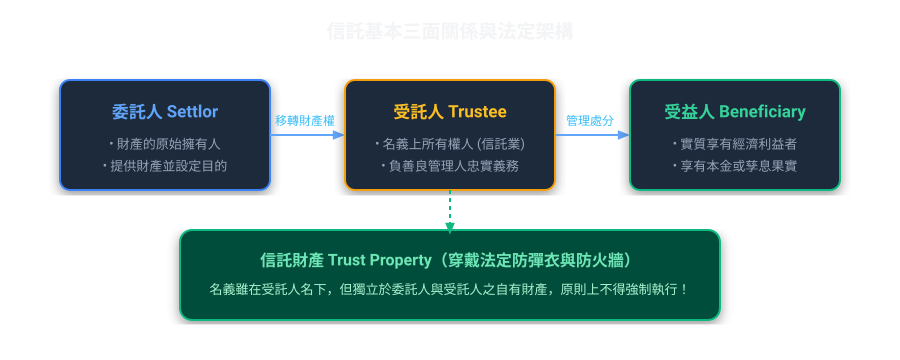
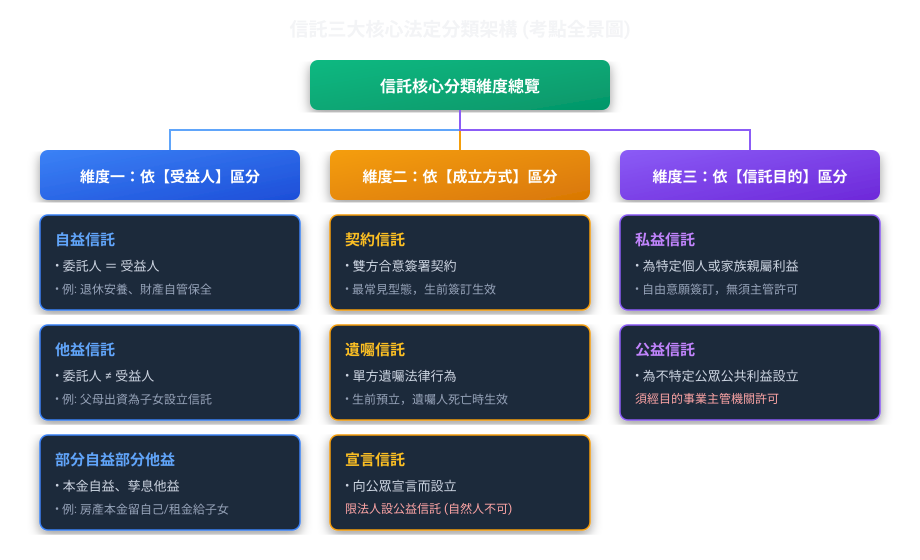
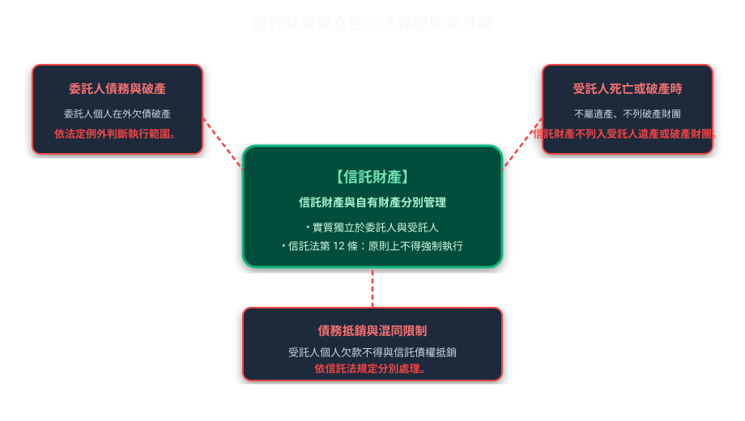
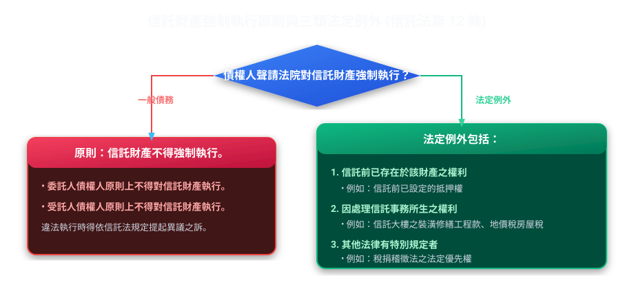
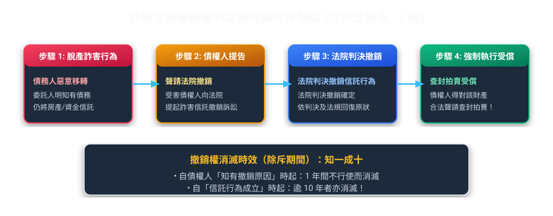
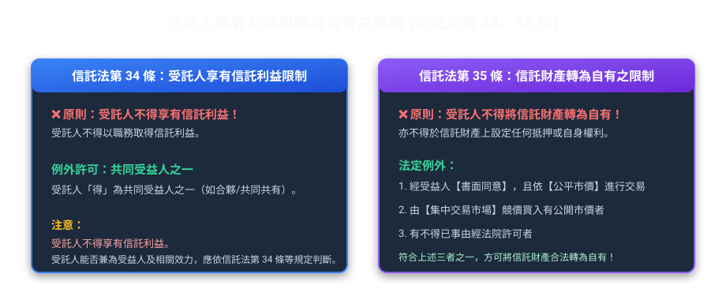
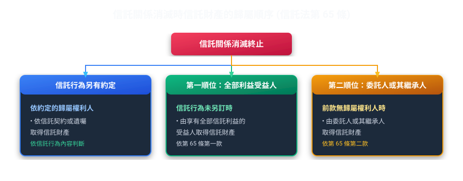

# 第 01 章：信託法基礎與信託財產獨立性（生活圖解篇）

---

##  本章學習導航與核心地圖

本章整理信託財產獨立性（第 12 條）、登記對抗要件（第 4 條）、詐害信託撤銷權（第 6 條）與受託人義務（第 22 至 35 條），並以情境說明法律原則與例外。

---

##  一、信託的本質與生活化白話比喻

### 1. 什麼是信託？（信託法第 1 條）
> **法條原意**：稱信託者，謂委託人將財產權移轉或為其他處分，使受託人依信託本旨，為受益人之利益或為特定之目的，管理或處分信託財產之關係。

*   **高傳真金融實務情境（高齡安養與二代教育金傳承信託）**：
    王老先生（**委託人**）將 1,000 萬元資金信託移轉予臺灣銀行信託部（**受託人**），簽訂信託契約，約定受託銀行每月撥付 3 萬元作為王老先生的生活安養費（**自益信託部分**），並約定在孫子小明考上大學後，每學期撥付 10 萬元學雜費與留學基金（**他益信託部分**）。
    *   ① **財產權實質移轉**：1,000 萬元所有權名義已合法移轉至臺銀信託專戶，信託財產原則上與受託人自有財產區隔；強制執行仍須檢視信託法第 12 條但書及其他法律規定；
    *   ② **分別管理義務**：臺銀必須將這筆資金與自有營運資產嚴格分帳、獨立列管；
    *   ③ **贈與稅申報**：孫子小明享有學費給付之權利；若該安排依《遺產及贈與稅法》第 5 條之 1 發生應課贈與稅情形，委託人依第 24 條之 1 及第 24 條辦理，申報期限為 30 日。
*   **四大核心構成要件**：
    1.  **委託人必須把「財產權移轉或處分」給受託人**：受託人必須取得外觀上的所有權或名義，若只是口頭委託代跑腿、財產沒有過戶或移轉，僅是民法上的「委任」，而不是信託！
    2.  **必須有「信託目的」**：目的必須合法、可能、確定，且不能違反公共秩序與善良風俗。
    3.  **受託人是「為受益人利益」或「特定目的」而管理**：不是為受託人自己賺錢。
    4.  **信託財產必須具體確定**：不能是抽象概念（例如不能以「未來可能發生的好運」為信託財產）。

---

##  二、信託的分類：圖表對照

> ** 考古題易錯觀念（何者錯誤）**：
> *   **陷阱 1**：自然人得否以「宣言信託」設立信託？
>     *    **錯誤**！台灣《信託法》第 71 條規定，只有**法人**為增進公共利益，經主管機關許可，得以宣言信託成立公益信託。**自然人不可用宣言信託**！
> *   **陷阱 2**：法定信託在台灣存在嗎？
>     *    **非基於法律行為**！台灣信託法採設立信託主義（契約、遺囑、宣言），「法定信託」非由當事人之設立行為成立，為英美法系產物，非我國信託法規定之設立型態。

---

##  三、信託財產的獨立性（防彈衣理論）

信託財產名義上雖然移轉到了受託人名下，但它既不是委託人的私產，也不是受託人的遺產，法律為它套上了一層**不可穿透的「防彈衣（防火牆）」**！

### 1. 信託財產獨立性的主要規定（信託法第 9 至 14 條）
1. **物上代位（第 9 條）**：信託財產因管理、處分、滅失或毀損取得的財產權，仍屬信託財產。財產形態改變不影響其信託財產性質；能否強制執行仍須依第 12 條判斷。
2. **不屬受託人遺產（第 10 條）**：受託人死亡時，信託財產不列入其遺產。
3. **不屬受託人破產財團（第 11 條）**：受託人破產時，信託財產不列入其破產財團。
4. **強制執行限制（第 12 條）**：原則不得對信託財產強制執行；信託前已存在於該財產的權利、處理信託事務所生權利或其他法律另有規定者除外。
5. **禁止抵銷（第 13 條）**：屬於信託財產的債權，不得與受託人個人債務抵銷。

---

### 🚨 2. 信託財產不得強制執行的三類法定例外

信託法第 12 條第 1 項但書列出信託財產得強制執行的例外，應連同條文本文一起理解。

> **審題提示**：
> *   委託人的普通債權人拿本票裁定，要去查封信託財產？ ❌ **原則不得執行；仍須檢視第 12 條但書及其他法律規定。**
> *   銀行在房子信託前，就已經設定了第一順位最高限額抵押權，委託人違約不繳房貸，銀行可否拍賣信託房屋？  **可以！此為「信託前已存在之權利」！**
> *   受託人請水電師傅修繕信託的公寓水管，修繕完畢積欠工程款 10 萬元，水電師傅可否向法院聲請對信託公寓強制執行？  **可以！此為「因處理信託事務所生之權利」！**

---

##  四、信託公示制度：對抗要件（信託法第 4 條）

信託不是兩個人在抽屜裡偷偷簽約就能對抗全世界，必須「公示」，不然第三人根本不知道財產已經信託！

| 財產類型 | 公示與生效規定 | 未登記之法律效果 |
| :--- | :--- | :--- |
| **應登記之財產權** （如：土地、房屋、船舶、航空器、商標權、專利權） | 向地政機關或主管機關辦妥**信託登記** | 信託登記是對抗第三人的要件，不是信託契約的成立要件；未登記時，可能無法以信託關係對抗第三人。 |
| **有價證券（股票、債券）** | 1. 記名股票：於證券上**載明為信託財產**（背書加註） 2. 向發行公司**通知並為信託登記**（過戶備查） | **非經背書載明並通知公司登記，不得對抗發行公司及第三人** |

> ** 實務精選案例【精華地漏辦信託專簿登記之對抗風險】**：
> 陳董將名下一筆市價 5,000 萬元的精華土地信託移轉給好友張三管理，契約完全合法，但在地政事務所僅辦妥「所有權移轉登記」，卻漏未辦理「信託登記（未載明為信託財產及信託專簿）」：
> ① **委託人與受託人間**：信託契約效力與財產權移轉登記應分別判斷。
> ② **對外關係**：未辦妥信託登記時，不得以信託關係對抗第三人；個案執行效果仍依相關法規及事實判斷。

> ** 考古題常見陷阱（第 41 期第 1 題情境）**：
> *   題目：「以股票為信託者，通知發行公司即可對抗第三人？」
> *    **錯！** 必須「載明於證券（股票背書）」**且**「通知公司登記」，兩道手續缺一不可，僅通知公司無效！

---

##  五、脫產防線：詐害信託與撤銷權（信託法第 6 條、第 7 條）

【建商欠款脫產信託與除斥期間之防禦】
包商黃董積欠下游材料商林老闆 3,000 萬元工程款，為免豪宅被查封，將名下價值 4,000 萬元的豪宅信託登記給不知情的胞弟作為子女教育基金：
① **有害及債權**：黃董信託行為導致其剩餘資產不足清償債務，構成有害及債權；
② **法院撤銷及受益人保護**：債權人得依第 6 條聲請法院撤銷有害債權的信託行為；受益人已取得的利益是否受影響，另依第 6 條第 2 項判斷，不概括以受益人是否知情作唯一結論。
③ **嚴格除斥期間**：林老闆必須在「自知有撤銷原因起 1 年內」，或「自信託行為成立日起 10 年內」，向民事法院提起撤銷訴訟；逾期則撤銷權消滅！

### 1. 撤銷的法定條件
1.  **有害於債權人**：信託行為發生時，委託人之資產已經不足以清償所有既有債務（害及資力）。
2. **受託人知情不是第 6 條所列的撤銷要件**：債權人仍須證明信託行為有害其債權，並向法院聲請撤銷。
3.  **法定推定有害（第 6 條第 2 項）**：信託成立後 **6 個月內**，委託人被宣告破產者，**法律直接推定該信託行為有害於債權**！

### 2. 撤銷權的除斥期間（時效重點數字！）
*   **短期間**：自債權人**知有撤銷原因起，1 年間**不行使而消滅。
*   **長期間**：自信託行為**成立日起，逾 10 年**不行使而消滅。

---

##  六、受託人的權利、義務與利益衝突迴避

受託人掌管他人龐大身家，法規對其設定了極高的誠信標準：

### 1. 受託人的主要義務
1.  **善良管理人之注意義務（信託法第 22 條）**：
    受託人應依信託本旨，以善良管理人之注意，處理信託事務。即使是**無償受託人**（沒收任何手續費或報酬），一樣要負**善良管理人**的高規格注意標準！（民法無償委任通常僅負與處理自己事務為同一之注意，但信託法標準更高！）。
2.  **親自處理義務（第 25 條）**：
    受託人原則上**應親自處理信託事務**。
    *   **例外**：信託行為另有訂定，或有不得已事由時，得使第三人代為處理；受託人並依信託法第 26、27 條負相關責任。
3. **分別管理義務（第 24 條）**：受託人應將信託財產與自有財產分別管理；不同信託的信託財產原則上分別管理，但信託行為另有約定時，依其約定。

---

### 2. 受託人享有利益與轉為自有之限制（信託法第 34、35 條）

> **法條辨析**：
> *   問：受託人可否同時為該信託之唯一受益人？
>     *    信託法第 34 條規定，受託人不得享有信託利益，但與他人共同為受益人時例外；不得將該例外擴張成受託人可單獨享有全部利益。
> *   問：受託人看中信託財產中的不動產或名車，想將信託財產轉為自有財產（自易交易），法律如何規範？
    *    **原則不得為之。** 第 35 條列有三種例外：① 經受益人書面同意並依市價取得；② 由集中市場競價取得；③ 有不得已事由經法院許可。
>     *    必須取得**受益人之書面同意**，並且要以**公平市價**承購！

---

##  七、信託之消滅與賸餘財產歸屬（信託法第 62~65 條）

信託關係因為信託目的已完成、不能完成、期限屆滿、或終止而消滅時，剩下的財產該給誰？

> **信託法第 65 條**：信託行為另有約定時依約定；沒有約定時，先歸屬於享有全部信託利益的受益人，再由委託人或其繼承人承受。

---

##  法規原文對照庫

  
 查閱中華民國《信託法》關鍵法定條文原文

  

    
<strong>第 1 條（信託定義）</strong>：稱信託者，謂委託人將財產權移轉或為其他處分，使受託人依信託本旨，為受益人之利益或為特定之目的，管理或處分信託財產之關係。

    
<strong>第 4 條（公示與對抗要件）</strong>：以應登記或註冊之財產權為信託者，非經信託登記，不得對抗第三人。以有價證券為信託者，非依目的事業主管機關規定於證券上或其他表彰權利之文件上載明為信託財產，不得對抗第三人。

    
<strong>第 6 條（詐害信託撤銷權）</strong>：信託行為有害於委託人之債權人權利者，債權人得聲請法院撤銷之。信託成立後 6 個月內委託人破產者，推定其有害於債權。

    
<strong>第 7 條（撤銷權除斥期間）</strong>：前條撤銷權，自債權人知有撤銷原因時起，1 年間不行使而消滅。自信託行為成立時起，逾 10 年者，亦同。

    
<strong>第 12 條（強制執行禁止與例外）</strong>：對信託財產不得強制執行。但基於信託前已存在於該財產之權利、因處理信託事務所生之權利或其他法律有特別規定者，不在此限。

    
<strong>第 34 條（受託人利益限制）</strong>：受託人不得以任何名義，享有信託利益。但與他人為共同受益人時，不在此限。

    
<strong>第 35 條（轉為自有之限制）</strong>：受託人除有下列各款情形之一外，不得將信託財產轉為自有財產，或於該信託財產上設定或取得權利：一、經受益人書面同意，並依市價為之者。二、由集中市場競價取得者。三、有不得已事由經法院許可者。

  

