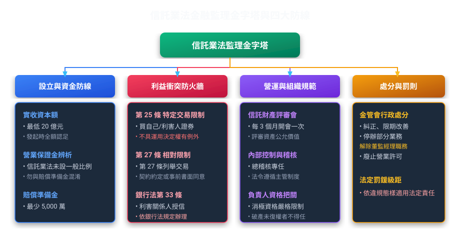
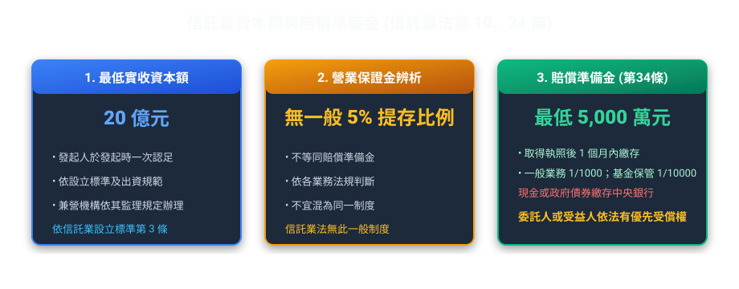
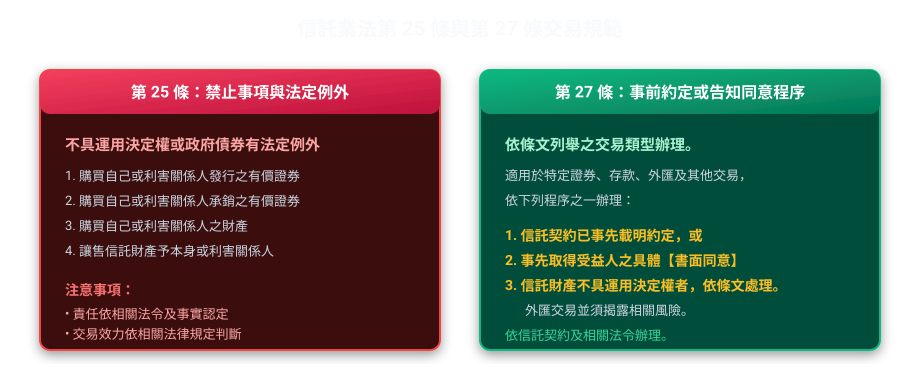
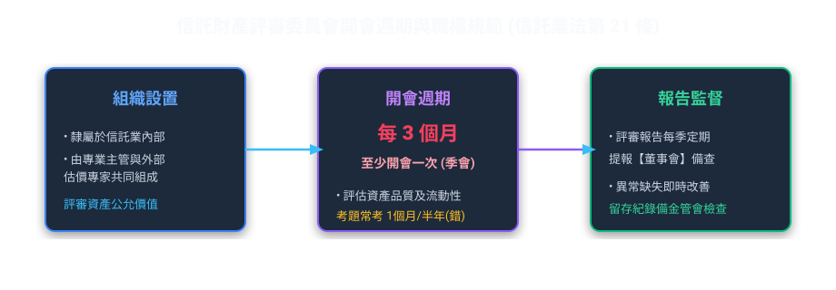
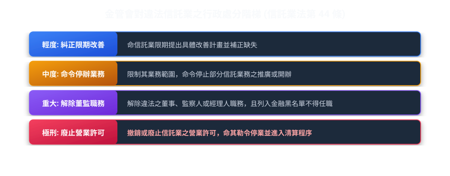

# 第 02 章：信託業法與監理

---

## 先建立本章的理解脈絡

信託公司除了遵守一般信託規則，還要符合金融業的資本、治理與監理要求。可把本章看成兩層檢查：第一層看公司是否有資格經營，第二層看交易、內控與申報是否保護委託人和受益人。

##  本章學習導航與核心地圖

《信託業法》規範信託業的業務範圍、治理與監理。本章依現行法條整理設立條件、利害關係人交易及監理責任。
本章整理信託業設立條件、利害關係人交易規範及監理責任。

---

##  一、信託業的誕生：設立門檻與三道資金防線

要開辦信託業務，法律採「特許營業許可制與業務分別核定原則」：
① 分別核定原則：信託業法第 16 條之信託業務與第 17 條之附屬業務，主管機關（金管會）必須「分別核定」，嚴禁概括核定；涉及外匯業務者另須經中央銀行許可。
② 禁止承諾本金或最低收益率（第 31 條）：信託業不得承諾擔保本金或最低收益率；商品發行機構的條件與受託銀行的責任，應依契約及相關法令判斷。

### 1. 信託業資本額與賠償準備金

| 項目 | 法定金額 / 比率 | 繳存地點 / 形式 | 主要功能與受償權利 |
| :--- | :--- | :--- | :--- |
| 最低實收資本額 | 一般信託公司 20 億元；僅辦理不動產投資信託 10 億元、僅辦理不動產資產信託 3 億元、兩類均辦理 10 億元 | 信託公司設立門檻；依業務範圍適用不同標準 | 依《信託業設立標準》第 3 條判讀 |
| 營業保證金 | 《信託業法》未設一般信託業者繳存資本額 5% 營業保證金之規定 | 原表列此項混淆其他金融業務之保證金 | 不應與信託業賠償準備金混為一談 |
| 賠償準備金 （信託業法第 34 條） | 最低 5,000 萬元 （並依受託總額千分之一或萬分之一累計） | 取得執照後 1 個月內 以現金或政府公債繳存中央銀行 | 專門擔保受託人違法疏失。  委託人或受益人依法就賠償準備金有優先受償權！ |

>  考古題易錯觀念（何者錯誤）：
> *   陷阱 1：賠償準備金繳存於財政部？  錯誤！是繳存「中央銀行」！
> *   陷阱 2：賠償準備金得以股票或不動產繳存？  錯誤！限以「現金」或「政府債券」繳存！
> *   陷阱 3：賠償準備金是一般債權人的擔保？  錯誤！法律明定由「委託人或受益人」享有優先受償之權！
> *   陷阱 4：兼營信託業務之投信或證券商，其營業保證金不得充當賠償準備金？  錯誤！兼營機構以現金或公債繳存之保證金，「得充當」信託業賠償準備金！

---

##  二、信託業法第 25 條與第 27 條利害關係交易限制

第 25 條列出信託業以信託財產進行利害關係交易的禁止事項及法定例外；第 27 條規範特定銀行業務及其他交易的事前約定或告知同意程序。

### 1. 信託業的「利害關係人」是誰？（信託業法第 7 條）
記憶關鍵數字：「持股 5%」與「持股 10%」！
*   持有信託公司股份總額 5% 以上之股東。
*   信託業負責人（董、監、總經理）。
*   信託業負責人獨資、合夥，或持股超過 10% 之企業。
*   信託公司持股超過 5% 之轉投資企業。
*   對信託財產具有運用決定權之人。

### 2. 第 25 條與第 27 條交易規範對照

| 比較維度 | 第 25 條（禁止事項與法定例外） | 第 27 條（事前約定或告知同意） |
| :--- | :--- | :--- |
| 規範內容 | 限制信託業以信託財產購買本身或利害關係人發行、承銷的證券、購買其財產或讓售財產予其本身或利害關係人。 | 限制信託業辦理特定銀行業務、外匯交易及第 25 條以外的利害關係交易。 |
| 範圍 | 購買本身或利害關係人發行／承銷的有價證券或票券；購買其財產；讓售信託財產予其本身或利害關係人；主管機關另定事項。 | 購買銀行部門經紀的證券或票券；於本身銀行部門或利害關係人處存款或辦理外匯交易；其他第 25 條以外交易。 |
| 例外或程序 | 信託財產不具運用決定權者不受第 1 項限制，但須充分告知；政府發行債券亦有法定例外。受益人書面同意本身不是例外。 | 依信託契約約定，或事先告知受益人並取得書面同意；不以董事會重度決議為第 27 條明文要件。 |

---

##  三、公司治理：信託財產評審委員會

信託業管理這麼多龐大資產，資產到底值多少錢？有沒有跌價風險？需要專門委員會審核：

*   評審週期：每三個月至少一次。
*   職責：審查受託財產之評審原則、公允價格認定及後續風險控管，並將結果提報董事會。

### 2. 信託業法定定期報告與會計師查核層級（核心觀念！）
*   每三個月至少一次：評審信託財產並報告董事會。
*   每半營業年度終了後 2 個月內：報送經會計師「核閱」之財務報告。
*   每營業年度終了後 4 個月內：報送經會計師「查核簽證」之營業報告書、資產負債表、財產目錄及損益表，並辦理公告。

---

##  四、監理處分與罰則體系

信託業違反法令或章程，或有損害受益人權益之虞時，主管機關得依法採取監理措施。

>  歷屆經典試題（解任董監職務）：
> *   題目：信託業董事或監察人違反法令時，信託業商業同業公會得否直接解除其職務？
> *    錯！ 同業公會無此行政權力，只有主管機關（金管會）有權命令解除其董監職務！

---

##  法規原文對照庫

  
 查閱中華民國《信託業法》關鍵法定條文原文

  

    
<strong>第 10 條（設立資本額）</strong>：信託業之最低實收資本額，由主管機關審酌經濟情勢定之（一般信託公司為新臺幣 20 億元；不動產專營公司依業務類型適用不同門檻）。發起人應於發起時一次全額認足。

    
<strong>第 25 條（特定利害關係交易限制）</strong>：信託業不得以信託財產進行條文列舉的交易；信託財產不具運用決定權或標的為政府發行債券時，依條文有例外，且須履行告知義務。

    
<strong>第 27 條（特定銀行業務及其他交易）</strong>：對條文列舉的證券、存款、外匯及其他交易，除依信託契約約定，或事先告知受益人並取得書面同意外，不得辦理；信託財產不具運用決定權時另有法定例外。

    
<strong>第 34 條（賠償準備金）</strong>：信託業應於取得營業執照後 1 個月內，以現金或政府公債繳存中央銀行作為賠償準備金。委託人或受益人就該賠償準備金有優先受償之權。

    
<strong>第 44 條（主管機關處分權限）</strong>：信託業違反法令或章程時，主管機關得為糾正、命限期改善、停止部分業務、解除董監經理人職務，或廢止營業許可。

  

