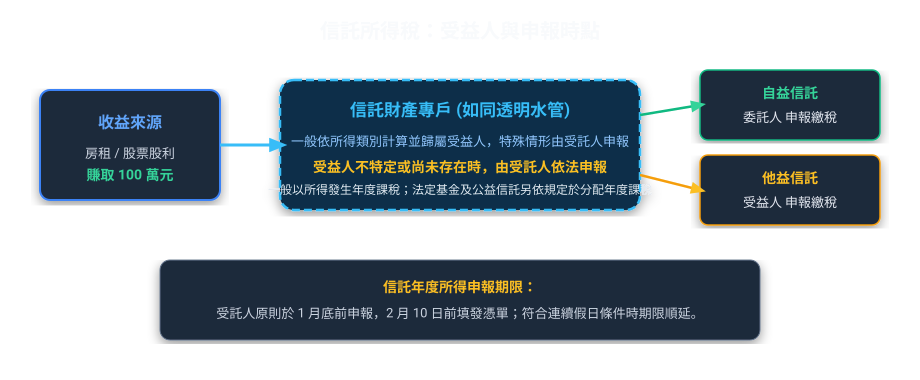
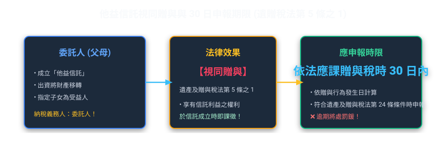
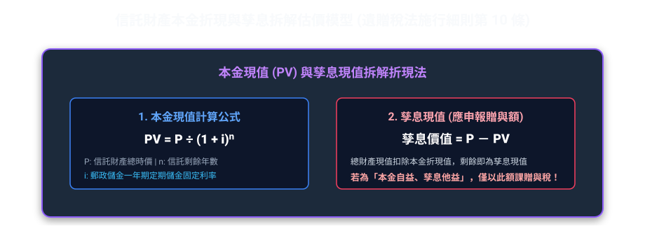
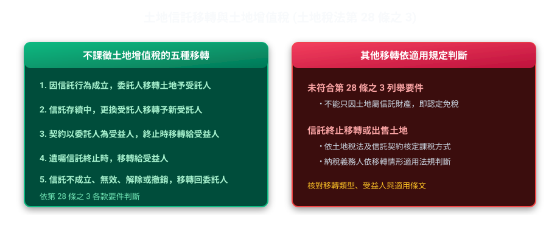

# 第 03 章：信託稅制

---

## 先建立本章的理解脈絡

信託課稅要先看所得實際由誰取得、誰有權享有，而不是只看款項經過誰的帳戶。先分清信託成立、信託存續、利益分配與信託終止等時點，再判斷所得稅、贈與稅或遺產稅，最後核對納稅義務人和申報方式。

##  本章學習導航與核心地圖

信託稅制是許多考生覺得最抽象的章節，但只要掌握核心哲學——「實質課稅原則」與「管道穿透理論（Conduit Theory）」，整套邏輯就完全通順！

---

##  一、所得稅：透明水管「管道穿透原則」

### 1. 所得稅課稅時點

《所得稅法》第 3 條之 4 原則上以所得發生年度計算各類所得，按信託約定或可得推知的比例歸屬受益人。若受益人不特定或尚未存在，由受託人依規定申報納稅。

符合條件的公益信託，以及經核准之共同信託基金、證券投資信託基金、期貨信託基金或其他信託基金，改於信託利益實際分配時由受益人併入分配年度所得。不可將一般原則套用到所有信託，也不宜將特定扣繳率說成固定的最高級距。

### 2. 申報與憑單期限

依《所得稅法》第 92 條之 1，受託人原則上應於每年 1 月底前申報上一年度信託資料，並於 2 月 10 日前填發相關憑單；每年 1 月遇連續 3 日以上國定假日者，申報期限延至 2 月 5 日、憑單填發期限延至 2 月 15 日。

> 例外信託之課稅時點、所得類別及扣繳處理，應依所得稅法各項規定分別判斷。

##  二、贈與稅與遺產稅：視同贈與與折現計算

在傳統觀念中，把房子「過戶給別人」才是贈與。但信託法規下，只要成立「他益信託」，法律就視同委託人把利益送給受益人了！

### 1. 贈與時點與申報期限
*   贈與時點：以信託契約成立日、或變更他益受益人日、或追加信託財產日為贈與行為發生日。
*   申報期限：他益信託依遺贈稅法第 5 條之 1 發生應課贈與稅情形時，委託人依第 24 條之 1 及第 24 條於贈與行為發生後 30 日內申報；公益信託依法律規定處理。

### 2. 贈與價值計算公式（計算題常見常見考點！）

當父母把 1,000 萬元信託，約定「期間 10 年，每年孳息給兒子，10 年期滿本金還給父母（孳息他益、本金自益）」，贈與金額該怎麼算？

>  實務精算案例【10年期本金他益信託之贈與稅折現】：
> 郭董交付 1,000 萬元現金信託，期間 10 年，約定「每年租金利息全由郭董自領（自益），10 年期滿 1,000 萬本金歸兒子小郭（本金他益）」：
> ① 贈與標的係「10 年後才拿到的 1,000 萬元本金」，依法按成立時中華郵政股份有限公司一年期定期儲金固定利率（僅為試算假設，非現行固定利率）年複利折現：
>    *   法定折現公式：`現值 (PV) = 本金 ÷ (1 + 郵儲利率)ⁿ`
>    *   本案數值試算：`10,000,000 元 ÷ (1 + 0.02)¹⁰ ≈ 8,203,483 元`
> ② 郭董僅須以折現後的現值約 820.3 萬元申報贈與稅，示範折現計算方式；實際金額依成立時法定利率與個案條件計算！

>  考古題常見考點關鍵字：
> *   折現利率採用什麼利率？
>     *    「中華郵政股份有限公司一年期定期儲金固定利率」（不可與其他銀行利率或活期存款利率混淆。）。

---

##  三、土地稅：地價稅與土地增值稅

土地信託是信託業務最大宗之一，土增稅動輒上百萬，課不課稅是最大關鍵！

### 1. 土地增值稅：信託關係人間五種不課徵情形

《土地稅法》第 28 條之 3 列有五種信託關係人間移轉不課徵土地增值稅：①信託成立時委託人移轉給受託人；②存續中更換受託人；③契約明定委託人為受益人，信託消滅時受託人移轉給受益人；④遺囑信託消滅時受託人移轉給受益人；⑤信託不成立、無效、解除或撤銷時委託人與受託人間的移轉。其他移轉須按實際關係與法令判斷，不能一概視為免稅。

### 2. 受託人賣土地時，誰繳稅？原地價怎麼算？（考超多次！）
*   納稅義務人：以受託人為納稅義務人。
*   原地價起算點：不是以「信託過戶當日」的地價算，而是以委託人當初取得該土地時之原地價作為基期計算漲價總數額！防止有人想用信託洗地價規避土增稅！

### 3. 地價稅之課徵主體與累進稅率
*   納稅義務人：以受託人為納稅義務人。
*   計稅方式（獨立分別計算）：
    受託人名下若有自己的土地，又有受託管理的信託土地，兩者不可合併累進！
    *   受託人的自有土地：算一份地價總額。
    *   受託人信託 A 的土地：獨立算一份地價總額。
    *   受託人信託 B 的土地：再獨立算一份地價總額。
    *    分別計算地價總額，各自適用累進稅率！

---

##  四、契稅、營業稅與印花稅速記

| 稅目 | 委託人交付信託給受託人時 | 受託人返還委託人（自益信託）時 |
| :--- | :--- | :--- |
| 契稅 | 不課徵契稅 | 不課徵契稅 |
| 營業稅 | 不課徵營業稅（非銷售貨物或勞務） | 不課徵營業稅 |
| 印花稅 | 辦理不動產移轉登記之書據，應按金額千分之一貼用印花稅票 | 返還登記書據，仍應貼用印花稅票 |

>  印花稅特殊記憶點：
> 雖然土地增值稅和契稅「不課徵」，但只要拿著公定契約書去地政事務所辦理物權移轉登記，印花稅就逃不掉，依規定貼用千分之一印花稅票！

---

##  法規原文對照庫

  
 查閱信託相關稅法關鍵條文原文（所得稅法、遺贈稅法、土地稅法）

  

    
<strong>所得稅法第 3 條之 4（導管穿透原則）</strong>：信託財產發生之收入，受託人應於所得發生年度，依所得稅法規定計算所得，並由受益人併入當年度所得額課徵所得稅。

    
<strong>所得稅法第 92 條之 1（信託資料申報與憑單填發）</strong>：受託人應於每年 1 月底前，將上一年度信託專戶之財產目錄、收支計算表及扣繳憑單或免扣繳憑單向該管稽徵機關申報，並於 2 月 10 日前填發予納稅義務人。

    
<strong>遺產及贈與稅法第 5 條之 1、24 條之 1</strong>：他益信託在法律規定的應課贈與稅情形，視為委託人贈與信託利益；申報期限依第 24 條為贈與行為發生後 30 日。不得將期限套用於所有信託。

    
<strong>土地稅法第 28 條之 3（不課徵土地增值稅）</strong>：列有五種情形：信託成立時委託人與受託人間移轉；存續中更換受託人；契約明定委託人為受益人而信託消滅時受託人與受益人間移轉；遺囑信託消滅時受託人與受益人間移轉；信託不成立、無效、解除或撤銷時委託人與受託人間移轉。

    
<strong>官方依據（查核至 2026 年 10 月 17 日）</strong>：<a href="https://law.moj.gov.tw/LawClass/LawAll.aspx?pcode=G0340096">土地稅法第 28 條之 3</a>。

  

