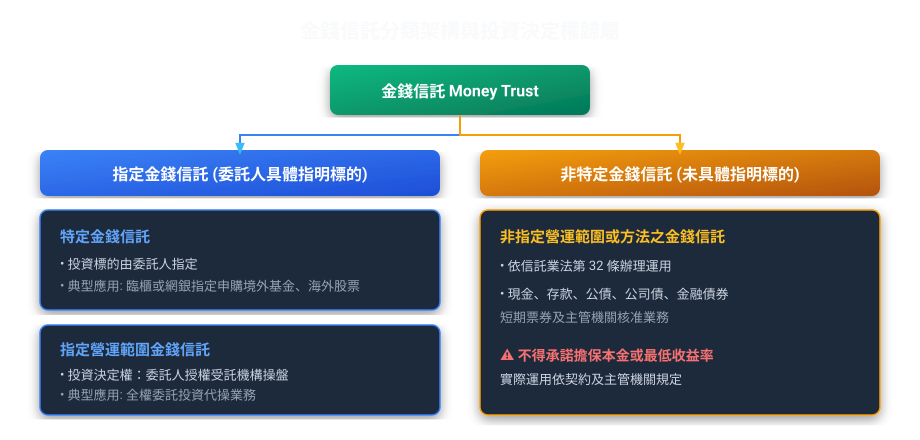
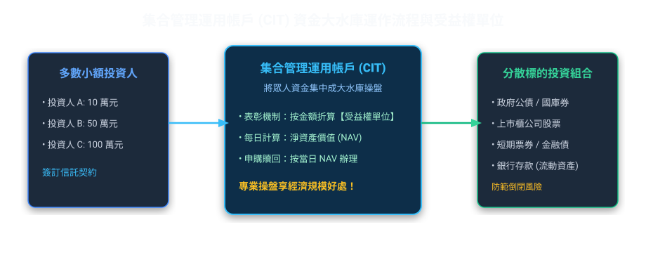
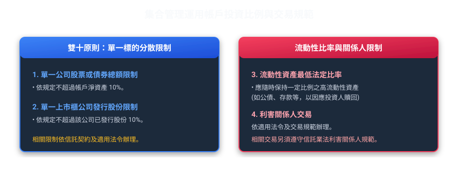

# 第 04 章：金錢信託與集合管理

---

## 先建立本章的理解脈絡

金錢信託的差別，常在委託人能決定多少投資內容，以及受託人是否把不同客戶的資金集合運用。讀題時先確認指示權、集合管理的成立方式和資產用途，再核對投資比例與禁止事項；相似名稱不代表權限相同。

##  本章學習導航與核心地圖

本章介紹金錢信託的指示權限、集合管理運用帳戶及其投資限制，並整理相關法規要件。
掌握了「運用決定權在誰手裡」與「集合管理帳戶（集管帳戶）的投資規範」，實務科目就已經拿下一大半！

---

##  一、金錢信託分類與投資決策權限

### 1. 什麼是特定金錢信託 vs 非指定金錢信託？
*   運用決定權情境：
    *   ① 特定金錢信託（委託人具體指示運用事項）：
        張先生填單指定「以 100 萬元申購聯博全球高收益債券基金 A 股」。標的、金額、時點完全由客戶具體下達指示，銀行純粹擔任交易通道與受託保管者，絕無擅自變更之權。
    *   ② 指定營運範圍金錢信託（委託人概括指定範圍，銀行選標的）：
        李董將 2,000 萬元交付信託，指示「資金限於投資臺灣前 50 大市值權值股與 AA 級金融債券」。至於挑選哪一檔股票、何時進場，全由銀行投資團隊在約定範圍內專業裁量。
    *   ③ 不指定金錢信託（委託人完全不指定，銀行全權決定但嚴限法定四類）：
        王奶奶交付 500 萬元安養，未指定營運範圍或方法。受託人依信託業法第 32 條及相關運用準則，在法定範圍內管理；範圍包括現金及銀行存款、公債、公司債、金融債券、短期票券及經主管機關核准的業務。

| 信託類別 | 運用標的指明度 | 投資決定權歸屬 | 實務最典型應用 |
| :--- | :--- | :--- | :--- |
| 特定金錢信託 | 具體指明（哪一檔基金/哪支股票） | 委託人保留（受託人無裁量權） | 國人透過銀行財富管理申購境內外共同基金、海外債券、ETF |
| 指定營運範圍金錢信託 | 概括指定（如約定投資台股大型權值股） | 受託人行使（信託業代為運用） | 信託業全權委託代操盤 |
| 非特定金錢信託 | 未指明任何標的 | 受託人行使（完全自主裁量） | 依信託業法第 32 條規定之法定安全標的運用 |

> 法規提醒（信託業法第 31 條）：信託業不得承諾擔保本金或最低收益率；違反時依相關法規處理。

---

##  二、信託資金集合管理運用帳戶（CIT）制度

「一個人拿 10 萬元買不起多檔優質標的，但一萬個人各拿 10 萬元就有 10 億元，能做分散風險的完美資產配置！」這就是集合管理運用帳戶（簡稱集管帳戶）的精髓。

### 1. 集管帳戶的設立與終止程序
*   設立主管機關：信託業應訂定「集合管理運用計畫」，經信託公會審查轉報金管會核准或備查後始得開辦。
*   帳戶獨立性：集管帳戶與信託業之自有財產或其他信託帳戶必須嚴格獨立設帳、分別管理。
*   受益人會議：集管帳戶之重大變更（如修改管理計畫、更換受託人、提前終止），應經受益人大會決議。

---

##  三、集管帳戶投資防暴比率（重點數字清單！）

主管機關為了避免集管帳戶踩雷或流動性不足爆發擠兌，設定了嚴格的「雙十比率」與「流動性資產限制」：

### 1. 核心投資比率速記對照表

| 限制項目 | 法定比率上限 / 規定 | 制定目的（為什麼這樣規定？） |
| :--- | :--- | :--- |
| 單一企業集中度 | 帳戶總資產的 10% | 不把所有雞蛋放在同一個籃子裡 |
| 單一公司股權控制度 | 該公司總發行股份的 10% | 防止信託機構假投資之名行介入經營權之實 |
| 存放於單一金融機構 | 帳戶淨資產之 10% 或新臺幣 5,000 萬元 | 避免銀行倒閉風險 |
| 流動性資產比率 | 由信託業同業公會訂定，報金管會核定 | 確保投資人隨時要贖回時帳戶裡有足夠現金應付 |

>  考古題常見陷阱（何者錯誤）：
> *   題目：集管帳戶得投資於單一公司股票達該集管帳戶淨資產價值 20%？
>     *    錯！ 法定上限為 10%！
> *   題目：集管帳戶之流動資產比率由個別信託業自行決定？
>     *    錯！ 應由信託公會擬定，並報請金管會核准！

---

##  四、外幣金錢信託實務規範

外幣金錢信託涉及新台幣兌換外幣，除了受金管會監管外，還必須遵守中央銀行（央行）的外匯管理條例：

1.  主管機關雙軌制：金管會（業務主管）＋ 中央銀行（外匯業務主管）。
2.  幣別轉換與申報：
    *   以新臺幣交付、結購外幣投資國外標的者，依外匯收支或交易申報辦法辦理。
    *   信託業辦理以外幣計價之金錢信託，本金與收益之交付及返還，均以外幣為之者，不計入委託人當年累積結匯額度。
3.  禁止外匯避險投機：受託人辦理外幣信託，未經中央銀行許可，不得從事非避險性質之槓桿衍生性金融商品交易。
