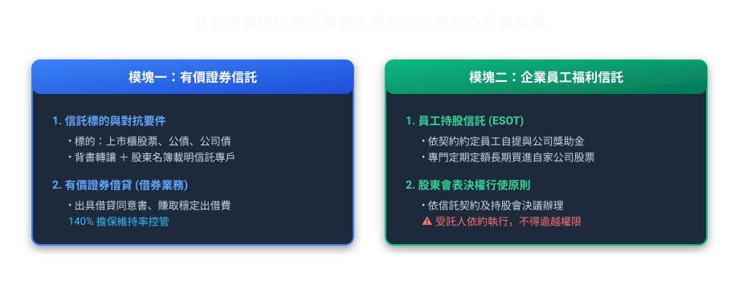
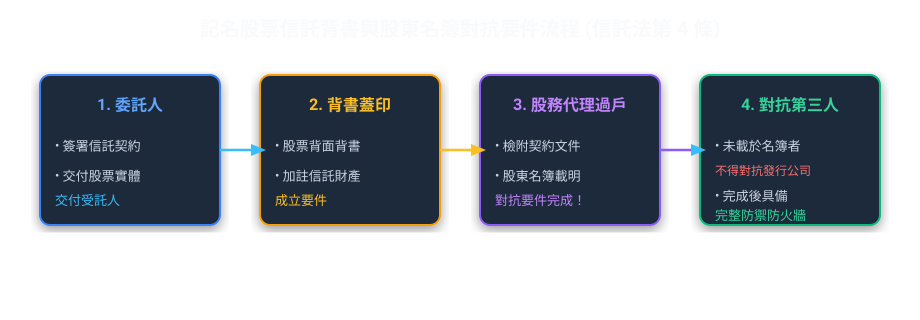
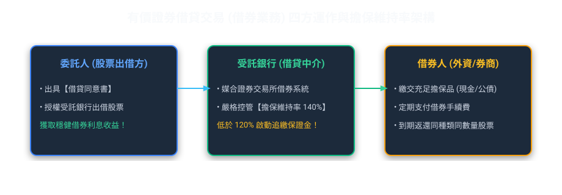
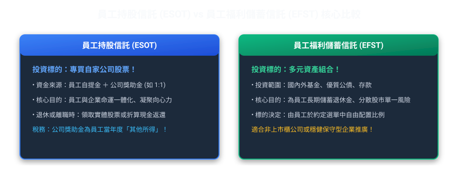
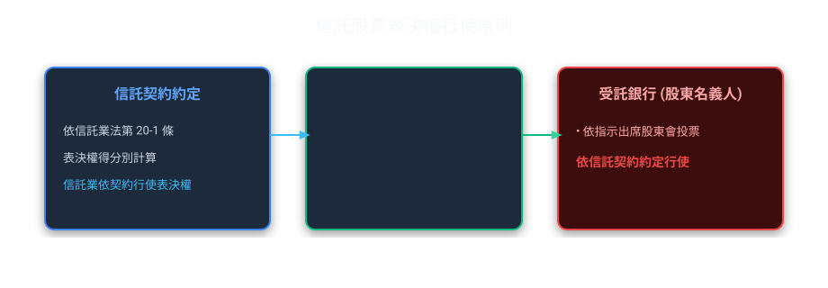

# 第 05 章：有價證券信託與企業員工福利信託（實務篇）

---

##  本章學習導航與核心地圖

本章說明有價證券信託與員工福利信託的運作方式、權利義務及常見契約差異。
本章說明股票表決權行使、證券借貸與員工持股信託的權利義務及契約安排。

---

##  一、有價證券信託核心制度

### 1. 對抗要件手續（曾於歷屆題目出現！）
信託財產為有價證券（如上市公司股票）時，必須完成**「兩手策略」**：
1.  **物理背書**：由受託人與委託人於股票背面之轉讓過戶申請書**背書載明為信託財產**。
2.  **登記備查**：檢附信託契約，通知發行公司並於**公司股東名簿載明「某某銀行受託某某人信託財產專戶」**。
*    **若未完成上述兩項，不得對抗發行公司及第三人！**

---

### 2. 有價證券借貸（借券業務）實務

把手頭上龐大的台積電股票信託給銀行，平時放著領股息，如果能借給外資放空或避險，還能多賺一筆「借券利息」，這就是有價證券借貸業務！

*   **法規關鍵要件**：
    1.  **事先授權**：信託契約中必須明訂，或事先取得**委託人（自益信託）或受益人（他益信託）的書面同意**。
    2.  **擔保維持率**：借券人必須繳交法定比率之擔保品（通常在 140% 以上），低於維持率時受託人應通知補繳，否則立刻處分擔保品買回股票（斷頭平倉）。
    3.  **除權除息補償**：借券期間若遇股票發放股利或現金增資，借券人必須按約定給予**權益補償**，不能損及信託財產利益。

---

##  二、企業員工福利信託：持股信託 vs 福儲信託

【員工持股信託與員工福儲信託示例】
下列為說明用途的假設案例，員工資格、提撥比例、投資標的及退會給付均依各持股會章程、信託契約及雇主辦法辦理：
① **組織與提撥**：員工依章程推選代表成立「員工持股會」，由代表與受託銀行簽約開立信託專戶。假設員工每月自提 1 萬元，雇主另依適用辦法提撥相對金額；實際比例並無通用固定值；
② **投資標的差異（重要考點）**：
   *   **員工持股信託（ESOT）**：信託資金依約定專門在市場持續買入「自營雇主公司（自家公司）的股票」；
   *   **員工福儲信託（EFST）**：投資標的多元化，除了自家股票外，更可配置於國內外基金、優質公債、金融債或定存，分散單一公司風險；
③ **稅務與返還**：雇主提撥及員工自提部分的所得與扣繳時點，依實際法律關係、給付條件及稅法判斷；提前離職、退會時各部分如何返還，依章程及信託契約約定，不預設員工自提款一定全數返還。

### 1. 員工持股信託 vs 員工福儲信託 差異對照表

| 比較維度 | 員工持股信託（ESOT） | 員工福儲信託（EFST） |
| :--- | :--- | :--- |
| **主要投資標的** | **純粹投資本公司或關係企業之上市櫃股票** | **不限於自家股票**，可投資基金、存款、債券等多元商品 |
| **主要目的** | 讓員工成為股東，同甘共苦、防止敵意併購、激勵士氣 | 著重於員工退休金準備、分散資產配置、避險保值 |
| **組織機制** | 設立「員工持股會」 | 設立「員工福利儲蓄會」 |

---

##  三、員工持股信託的表決權行使

信託業持有信託股票時，表決權可與其他信託財產及信託業自有財產分別計算；實際行使方式依信託契約約定。

### 1. 表決權行使依據
1. 依《信託業法》第 20 條之 1，信託業行使信託股票表決權應依信託契約約定。
2. 信託股票表決權得與其他信託財產及信託業自有財產分別計算。
3. 持股會、受益人或受託機構如何形成或執行表決意思，應查閱個別信託契約及適用規定，不預設由單一主體行使。

---

##  四、退會與解約處理（離職、退休怎麼分？）

當員工離職、資遣或退休時，累積在持股專戶裡的股票和現金如何拿回？

1.  **退休或逝世**：依契約約定，通常得選擇**請求交付現物股票**（將股票撥轉至其個人證券集保戶頭），或由受託人於集中市場賣出後**交付現金**。
2.  **中途自願退會或跳槽離職**：
    *   員工自行提撥金所購之股票與現金：依章程、信託契約及適用規定辦理。
    *   公司獎助金部分：依企業留才條款（歸屬比例 Vesting Schedule）約定，服務未滿特定年資者，公司補助部分可能依約收回或沒收！
