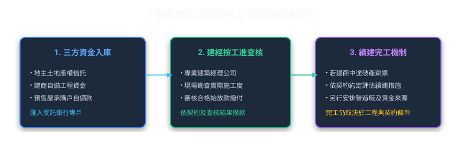
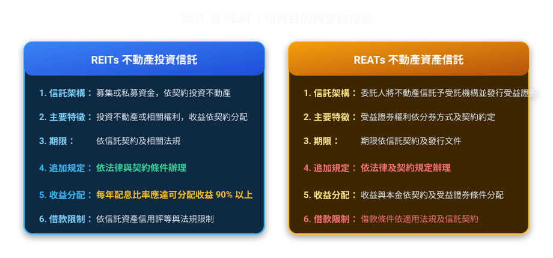
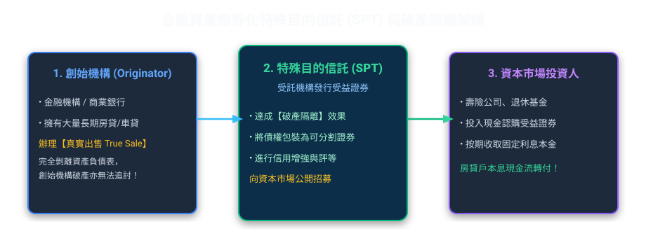
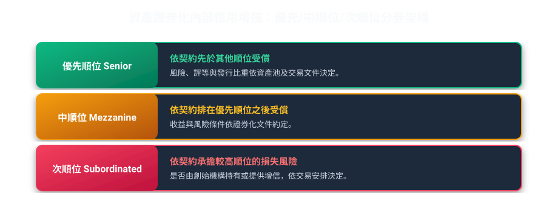

# 第 06 章：不動產信託與資產證券化

---

## 先建立本章的理解脈絡

不動產信託常用來管理開發資金、履行交易價金保管，或支援不動產投資。資產證券化則是把可預期的現金流轉成可投資的商品；讀題要分辨標的是土地或建物、債權或其他金融資產，並確認風險是否真正移出原持有人。

##  本章學習導航與核心地圖

本章說明不動產開發信託、不動產證券化及金融資產證券化的主要制度與風險隔離原則。
本章主要由兩大支柱構成：
1. 防止爛尾樓的「不動產開發與價金信託」。
2. 將不動產變現流動的「REITs vs REATs」與「金融資產證券化（SPT）」。

---

##  一、不動產開發信託與買賣價金信託（防爛尾防線）

買預售屋最怕遇到建商把買方繳的工程款拿去炒股、或者建商中途破產蓋一半落跑！
信託制度如何成為保護購屋族與地主的「定海神針」？

### 1. 不動產開發信託 vs 買賣價金信託 對照比較

| 項目 | 不動產開發信託 | 買賣價金信託 |
| :--- | :--- | :--- |
| 信託財產內容 | 土地所有權 ＋ 興建興造資金 ＋ 起造人名義 | 僅有買方所繳納之購屋預收款（價金） |
| 主要功能 | 依契約管理土地、興建資金及相關權利；資金撥付依信託契約與查核程序辦理 | 依契約管理買方所繳價金，依約定條件撥付或返還 |
| 續建安排 | 是否有續建安排及保證，依個案契約與相關機制判斷 | 不預設續建或全額返還；依信託契約及適用規定辦理 |

---

##  二、不動產證券化：REITs 與 REATs 制度比較

REIT 與 REAT 名稱相近，但法律架構、資產來源及受益證券性質不同：

### 1. REITs vs REATs 重點常見考點對照表

> 制度整理：
> ① REIT（不動產投資信託）：募集或私募資金後，依信託契約投資不動產、不動產相關權利及法定範圍內的標的。契約須載明收益分配方式；適用的處理辦法要求每年配息比率達可分配收益 90% 以上，並於會計年度結束後 6 個月內完成分配。
> ② REAT（不動產資產信託）：委託人移轉不動產或相關權利予受託機構，再依計畫募集或私募受益證券。現金流、期限、順位與到期安排依信託契約及受益證券條件判斷，不預設固定利率或全額還本。

| 比較項目 | 不動產投資信託（REITs） | 不動產資產信託（REATs） |
| :--- | :--- | :--- |
| 發起出資思維 | 投資型：先找投資人的錢，再去買房地產收租金 | 融資型：委託人手頭有現成大樓，為取得資金而信託發行證券 |
| 證券本質 | 受益權及收益依信託契約與適用規定辦理 | 受益權及收益依資產信託計畫、受益證券條件與適用規定辦理 |
| 期限 | 依信託契約及適用規定 | 依信託契約及發行文件 |
| 追加募集或發行 | 依適用法規及核准內容判斷 | 依適用法規及核准內容判斷 |
| 收益分配 | 契約應載明分配方式；特定處理辦法要求每年分配可分配收益 90% 以上 | 依信託契約及受益證券條件分配 |
| 借款限制 | 依適用法規及信託契約判斷 | 依適用法規及信託契約判斷 |

>  考古題解題口訣：
> *   判讀 REIT 時，應核對募集方式、契約及法定收益分配規範。
> *   判讀 REAT 時，應核對受託資產、受益證券條件及契約約定。

---

##  三、金融資產證券化：特殊目的信託（SPT）與破產隔離

銀行手上有上百億元的 30 年期房屋貸款，雖然每年有利息收入，但資金被死死卡住 30 年不能動。
如何把這 100 億房貸立刻變現？答案就是金融資產證券化！

### 1. 什麼是「真實出售（True Sale）」與「破產隔離（Bankruptcy Remoteness）」？

*   假設案例（不指涉特定金融機構）：
    某金融機構持有一組房貸債權，為籌措資金而評估辦理特殊目的信託（SPT）：
    ① 資產移轉：創始機構將房貸債權依契約移轉予受託機構；是否構成真實出售，須依契約、交易實質及適用法規判斷。
    ② 破產隔離：資產是否與創始機構破產財團區隔，須依移轉效力、契約及法令判斷。
    資產移轉後的現金流分配依信託契約及受益證券條件辦理。

*   真實出售：是否構成真實出售，須依資產移轉效力、交易實質與相關法律及會計規定判斷。
*   破產隔離：資產與創始機構破產財團的區隔效果，須視資產移轉是否有效及相關法令判斷。

---

### 2. 內部信用增強機制：切蛋糕分等級（優先與次順位）

為了讓投資人安心購買受益證券，SPT 會把發行的證券進行「分級切片」：

*   優先順位證券（Senior）：享有最優先分配本金利息的權利，風險最低、信評最高（通常 AAA 級）。
*   次順位證券（Subordinated）：又稱「劣後證券」或「吸收損失緩衝墊」。只要資產池有人房貸違約不繳，先扣次順位證券的錢！直到次順位全賠光了，才會傷到優先順位！
*   超額擔保（Over-collateralization）：信託資產總額（如 110 億）大於發行證券總額（如 100 億），多出來的 10 億就是額外的安全緩衝墊。
