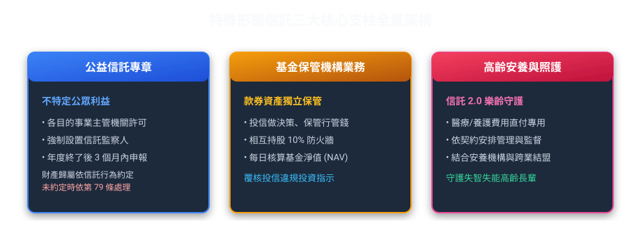
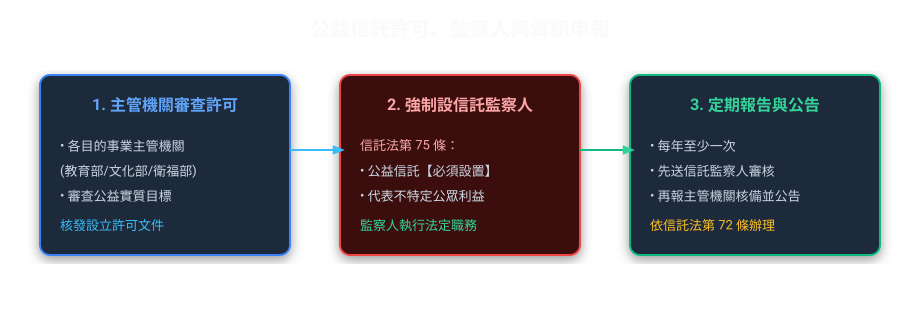
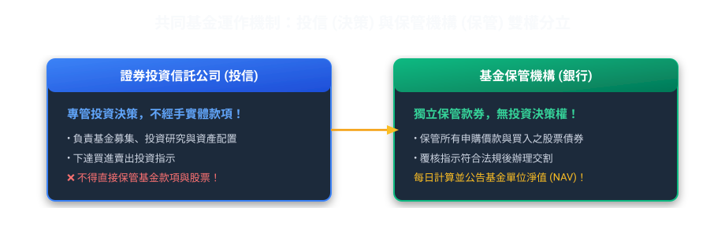
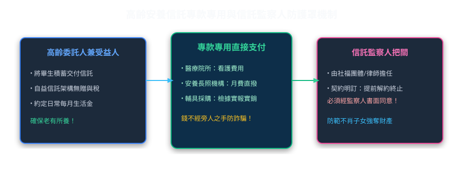

# 第 07 章：公益信託、基金保管與安養照護信託（實務篇）

---

##  本章學習導航與核心地圖

本章囊括了測驗中的三大常見考點常見模組：
1. **公益信託**：整理主管機關監督、信託監察人及信託消滅時財產歸屬等規定。
2. **保管機構業務**：說明證券投資信託基金及全權委託投資中保管機構的責任。
3. **「高齡安養與身障照護信託」**（信託 2.0 政策核心，現代社會保障安全網）。

---

##  一、公益信託：回饋社會的法定架構（信託法第 69~85 條）

設立公益信託可用於慈善、獎學金或環境保育等公益目的。是否適用稅務優惠，仍須符合各該稅法條件；信託法另規定主管機關的監督、信託監察人及資訊公開義務。

### 1. 公益信託 vs 私益信託 常見考點差異表

| 比較項目 | 私益信託（一般民事/商業信託） | 公益信託（信託法第 8 章） |
| :--- | :--- | :--- |
| **設立方式** | 契約信託、遺囑信託 | 契約信託、遺囑信託、**法人宣言信託** |
| **成立生效要件** | 雙方簽約即成立（遺囑信託於死亡時生效） | **必須經「目的事業主管機關」許可**始生效力 |
| **信託監察人設置** | **得**選設（自由決定） | **應**設置（**強制必須設立，法無例外！**） |
| **受託人辭任規定** | 經委託人及受益人同意得辭任 | **非有正當理由，並經主管機關許可，不得辭任** |
| **信託消滅財產歸屬** | 依信託法第 65 條及信託行為約定 | 信託行為未訂歸屬權利人時，目的事業主管機關得使信託關係為類似目的存續，或移轉財產至有類似目的的公益法人或公益信託（第 79 條） |

> ** 考古題常見考點三大陷阱（何者錯誤）**：
> *   **陷阱 1**：公益信託之主管機關一律為金融監督管理委員會？
>     *    **錯！** 是依其業務性質由各「**目的事業主管機關**」管轄（例：助學金歸教育部、醫療救助歸衛福部、環境保育歸環境部）。
> *   **陷阱 2**：公益信託得由委託人自由決定是否設置信託監察人？
>     *    **錯！** 法律明定**「應」**設置信託監察人，一人或數人均可。
> *   **陷阱 3**：公益信託目的無法達成終止時，信託財產得返還予出資之委託人？
>     *    **錯！** 信託行為未訂財產歸屬權利人時，依第 79 條由目的事業主管機關決定是否使信託為類似目的存續，或移轉至有類似目的的公益法人或公益信託。

---

##  二、保管機構業務：基金投資人的守門員

在台灣買「元大台灣50（0050）」或任何境內共同基金，你的錢並不是匯給投信公司，而是直接匯入獨立的**「基金保管機構」（通常為信託銀行）**！

### 1. 防弊防火牆：投信公司與保管機構持股限制
*   投信公司與基金保管機構之間，**不得具有實質控制關係**。
*   任一方持有他方股份總額超過 **10%** 者，**不得擔任該投信基金之保管機構**！

---

### 2. 全權委託保管銀行業務與越權交易監督防線

【全權委託代操經理人違法越權下單之保管行防線】
張董與大華投信簽訂 1 億元全權委託投資契約，契約明定「單一股票投資上限不得超過委託資產之 20%（即2,000萬元）」，並指定第一銀行為全權委託保管機構：
① **違法越權指示**：大華投信經理人看好某中小型飆股，竟向券商下單 3,500 萬元，並向第一銀行發出撥款交割指示；
② **保管銀行實質把關（拒絕盲從）**：第一銀行保管部在審核交割指示時，發現該筆交易超過契約 2,000 萬元上限達 1,500 萬元，構成法定之「越權交易」！
③ **法定處理程序**：第一銀行依規定必須立即出具書面「越權交易通知書」通知大華投信、委託人張董，並副知金管會及投信投顧公會；
④ **履行責任自負**：超出的 1,500 萬元交割款項，依規定必須由「大華投信以自有資金負履行交割之責」，該超額股票亦撥入投信自有帳戶處理，張董的委託資產專戶絲毫不受損害！這正是保管銀行設立的重點防火牆意義。
 **解題口訣**：「經理指示超上限，保管審核抓越權，拒絕撥款出通報，投信自掏腰包填」

---

##  三、高齡安養與身心障礙者信託（信託 2.0 守護神）

面對台灣超高齡社會與少子化，長輩最擔心的兩件事：
1. 萬一失智或生重病，辛苦存的養老金被不孝子孫騙走提領一空。
2. 留給身心障礙子女的照顧費用，在父母百年後被親戚霸佔挪用。

*   **專款專用機制**：長輩的生活費、護理院月費、醫療開銷直接由銀行受託帳戶撥付給安養院或醫院，不經由旁人之手，防止遭到金融剝削。
*   **信託監察人安排**：可在信託契約中約定監察人權限及須由其同意的事項；保障效果依契約內容與適用法律判斷。

## 個案推演：把安養需求寫成可執行的信託安排

### 情境

林先生希望退休後每月有生活費，入住照護機構時也能由信託支付費用；女兒協助聯絡，但不希望她能任意提領全部信託財產。

### 契約規劃與法規判讀

1. **先界定目的及受益人**：確認信託用途包含生活、安養照護或醫療給付，並在契約中寫明委託人、受託人、受益人及信託財產。金管會列舉安養信託財產可包括金錢（含保險金）、有價證券或不動產；實際可承作方式仍依受託機構業務及契約條件辦理。
2. **把支出變成可核對的指示**：約定生活費的給付頻率與金額、照護機構或醫療費用的付款方式、憑證要求、預備金及費用變動時的調整程序。若安排由受託人直接付款，應事先確認收款對象、核付文件及例外處理流程。
3. **安排聯絡、監督及報告**：契約可依個案需要安排聯絡人、信託監察人或其他監督方式，並寫明通知、查詢、異常支出及緊急聯絡流程。親屬協助聯絡不等於取得信託財產的提領權。
4. **保留受託人的法定責任**：受託人應依信託本旨以善良管理人注意處理事務；管理不當造成損害時，法律另有賠償或回復原狀等救濟。信託財產應與受託人自有財產及其他信託財產分別管理。信託安排不能取代照護服務本身，也不代表投資一定獲利或完全沒有詐騙風險。

### 易錯觀念

- 安養信託的功能是依契約管理及支付信託財產，不會只因設立信託就自動剝奪受益人的行為能力，或讓親屬成為法定代理人。
- 金管會資料中的安養信託政策與評鑑措施，不能直接推論成所有信託契約均適用的單一法定門檻；資格、權限及支付條件須看適用法規與契約。

**官方資料**：[信託法第 22 至 24 條](https://law.moj.gov.tw/LawClass/LawAll.aspx?pcode=I0020024)、[金管會：發展高齡化金融商品與服務](https://www.fsc.gov.tw/ch/home.jsp?id=495)。
