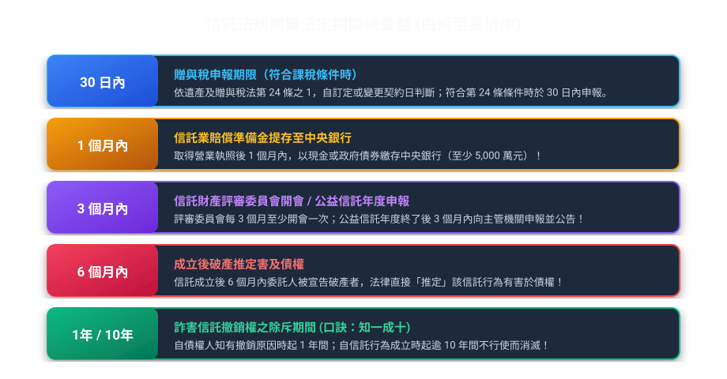
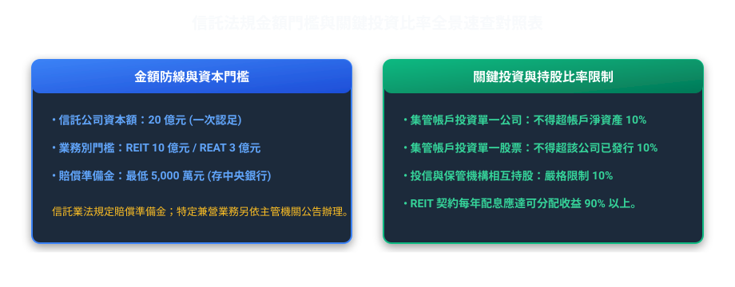
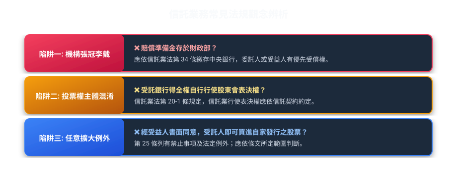

# 第 08 章：法規數字與易錯觀念

---

## 先建立本章的理解脈絡

本章把常見金額、比率、期限和容易混淆的制度放在一起。複習時不要只背孤立數字，應先記住數字適用的對象、起算點和例外，再用對照方式區分名稱相近的制度。

##  本章使用說明

本手冊整理信託法規與實務中常用的金額、比例、期限及易混淆觀念，供複習時快速查找。
歷屆題目的法規與制度可能依年度不同而改變；閱讀速查資料時，應同時核對題目年度及現行官方條文。

---

##  一、常見考點「時間與期間」速查金榜

| 法定期間 | 法規依據 | 核心事件與考點情境 | 陷阱防範提醒 |
| :--- | :--- | :--- | :--- |
| 20 日前 | 金融資產證券化條例第 24 條 | 受託機構或信託監察人召集受益人會議，應於開會 20 日前書面通知各受益人。 | 常被改成「10 日前」或「30 日前」 |
| 30 日 | 遺產及贈與稅法第 24 條、第 24 條之 1 | 他益信託發生依法應課贈與稅情形時，依贈與行為發生日計算申報期限；公益信託另依法律規定。 | 先判斷是否屬應課贈與稅情形，再核對申報期間。 |
| 1 個月 | 信託業法第 34 條 | 信託公司取得營業執照後，應於 1 個月內以現金或政府債券繳存賠償準備金於中央銀行。 | 常被改成「3 個月」或「營業前」 |
| 3 個月 | 信託業法施行細則第 12 條 信託法第 72 條 | 1. 信託業之信託財產評審委員會每 3 個月至少開會評審一次，並報告董事會。 2. 公益信託受託人於每會計年度終了後 3 個月內編具報告向主管機關申報並公告。 | 常被改成「每月」或「每半年」 |
| 6 個月 | 信託法第 6 條第 2 項 不動產證券化條例第 28 條 | 1. 信託行為成立後 6 個月內委託人受破產宣告者，推定該信託有害及債權。 2. REITs 依約定應分配之收益，應於會計年度結束後 6 個月內分配完畢。 | 常被改成「1 年內」或「3 個月內」 |
| 1 年 / 10 年 | 信託法第 7 條 | 詐害信託之撤銷權除斥期間： • 自債權人知有撤銷原因起，1 年間不行使而消滅。 • 自信託行為成立時起，逾 10 年者亦同。 | 歷屆常見！背法：知一成十！ |
| 1 月底前 | 所得稅法第 92 條之 1 | 信託受託人應於每年 1 月底前向稽徵機關申報上一年度信託所得申報書及扣繳憑單。 | 遇農曆春節等連假順延至 2 月 5 日 |
| 2 月 10 日前 | 所得稅法第 92 條之 1 | 信託受託人應於每年 2 月 10 日前將扣繳憑單或免扣繳憑單填發給受益人。 | 遇連續假期延長至 2 月 15 日 |

---

##  二、常見考點「金額、比率與避坑防線」速查金榜

| 項目門檻 | 正確法定數字 | 法規依據 | 記憶口訣與常見避坑陷阱 |
| :--- | :--- | :--- | :--- |
| 信託公司最低實收資本額 | 新臺幣 20 億元 • 僅辦理 REIT：10 億元 • 僅辦理 REAT：3 億元 | 信託業設立標準第 3 條 | 門檻極高！發起人出資以現金為限，且於發起時按實收資本額全額一次認足！ |
| 賠償準備金最低門檻 | 新臺幣 5,000 萬元 | 信託業法第 34 條 金管會公告標準 | 繳存中央銀行，專款專用於委託人或受益人損害賠償之優先受償。每年 5 月 20 日前按受託財產計提，逾資本額 50% 應即增資。 |
| 營業保證金與賠償準備金 | 信託業法第 34 條規範賠償準備金，未設一般信託業者按實收資本額 5% 提存的營業保證金制度。 | 信託業法第 34 條 | 實際規定應以信託業法第 34 條及金管會公告為準；特定兼營機構的部分營業保證金符合條件時，得充作賠償準備金。 |
| 信託業利害關係人持股標準 | 5%（主要股東） 10%（負責人持股企業） | 信託業法第 7 條 | 掌握「5%（持有信託業股份）」與「10%（負責人等持有企業股份）」兩大關鍵數字！ |
| 集管帳戶投資單一標的上限 | 10%（雙十原則） | 信託資金集合管理運用管理辦法第 9 條 | • 個別帳戶投資任一公司總額不得超過該帳戶淨資產 10% • 全體帳戶投資任一公司總額不得超過該公司實收資本額 10% |
| REITs 收益分配法定比率 | 90% 以上 | 受託機構募集或私募不動產投資信託受益證券處理辦法第 3 條 | 強制將收益分配給受益人，不得隨意保留作資本公積，且須於年度結束後 6 個月內分配。 |
| 全權委託投資業務資本額辨析 | 投信：3 億元 投顧：3 億元（免受 20 倍限制） | 投信事業設置標準第 7 條 全權委託投資業務管理辦法第 13 條 | 投信公司門檻為 3 億元；投顧代操若達 3 億元則接受委託金額不受淨值 20 倍限制。 |

---

##  三、常見考點「會議與表決權門檻」

| 會議與主體 | 事項與法規依據 | 法定出席門檻 | 法定決議同意門檻 |
| :--- | :--- | :--- | :--- |
| 銀行董事會 | 銀行法第 33 條：達法定金額的利害關係人擔保授信 | 董事三分之二以上出席（2/3） | 出席董事四分之三以上同意（3/4） |
| 土地信託受益人會議 | 信託業法第 26 條：以開發為目的之土地信託借入款項 | 受益權總數三分之二以上出席（2/3） | 出席表決權數過半數同意（二分之一以上） |
| 證券化受益人會議 | 金融資產證券化條例第 25 條：普通決議事項 | 表決權總數二分之一以上出席（過半數） | 出席受益人表決權過半數同意 |
| 證券化受益人會議 | 金融資產證券化條例第 26 條：決議有損害特定種類受益人之權利 | 該特定種類表決權總數二分之一以上出席 | 出席受益人表決權三分之二以上同意 |
| 受益人請求召集門檻 | 金融資產證券化條例第 24 條：受益人請求召集會議 | 持有本金持分總數 3% 以上 （請求後 15 日不召集得報主管機關許可自行召集） | 開會 20 日前書面通知；重大事項（解任、變更契約）不得以臨時動議提出！ |

---

##  四、「何者錯誤」三大逆向陷阱破題直覺法則

下列文字可能提示考生注意適用對象、原則及例外；仍應依題目事實與法規條文判斷，不能只憑關鍵字猜答案：

1.  先判斷信託業法第 25 條的禁止事項與例外：
    信託財產不具運用決定權，或標的為政府發行債券時，依條文有法定例外；不得把受益人書面同意單獨視為第 25 條的例外。
2.  「應」vs「得」文字遊戲：
    *   公益信託應設置信託監察人（寫「得設置」者錯誤）。
    *   受託人原則上應親自處理信託事務（寫「得隨意委託他人」者錯誤）。
3.  「獨立性例外」判斷：
    只要債權是「委託人一般的個人欠款」或「受託人自己的私人借貸」，想扣押信託財產？一律錯誤！ 只有「信託前已設定抵押」、「因處理信託事務產生（如修繕大樓費用）」才能強制執行！
