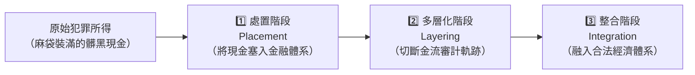

# 第 01 章：洗錢防制法核心要件與洗錢三階段生活圖解

---

##  本章學習導航與核心地圖

《洗錢防制法》用於防範不法資金漂白。本章命題有四個核心：
1. 法定洗錢行為態樣（依第 2 條四款辨認）
2. 前置重大犯罪（Predicate Offenses）之法定門檻
3. 洗錢三階段（處置、多層化、整合）生活白話金流情境
4. 「自洗錢」與「他人洗錢」同等處罰原則

---

##  一、洗錢三部曲：經典洗錢三階段（必考金流情境）

洗錢者將販毒、電信詐欺、貪污取得的「黑錢」，轉化為合法外觀「白錢」的標準三階段：

| 洗錢階段 | 英文術語 | 犯罪手法與生活寫照 | 歷屆必考典型手法 |
| :--- | :--- | :--- | :--- |
| 第一階段：處置 (入袋) | Placement | 把整麻袋的實體犯罪現金，首次塞進合法金融機構體系！ （最容易被行員現場逮獲的高風險期） | 1. 結構化交易 / 化整為零 (Smurfing)：為了規避 50 萬申報門檻，拆成 49 萬分多次到不同分行存入！ 2. 走私現金出境、買進黃金珠寶或高額賭場籌碼。 |
| 第二階段：多層化 (漂洗) | Layering | 製造複雜混亂的交易迷宮，切斷資金與原始犯罪的關聯！ （金流像洋蔥一樣層層包裹） | 1. 透過境外紙上公司跨國電匯輾轉數個避稅天堂銀行帳戶； 2. 購買虛擬貨幣(加密資產)在各去中心化交易所頻繁混幣互轉； 3. 頻繁買進賣出高流動性股票與外匯期貨。 |
| 第三階段：整合 (上岸) | Integration | 將漂白乾淨的資金以看似完全合法的投資收益名義拿出來花用！ （黑錢搖身一變成為合法企業盈餘） | 1. 設立空殼投資公司，出資向自己購買不動產豪宅； 2. 假借跨國貿易高報進口低報出口（虛假發票合法匯回）； 3. 開立合法連鎖洗車場或餐廳，虛增營業額報稅洗白。 |

---

##  二、洗錢罪之法定構成要件（洗錢防制法第 2 條）

本法所稱洗錢，指下列行為：
1. 隱匿特定犯罪所得或掩飾其來源。
2. 妨礙或危害國家對特定犯罪所得的調查、發現、保全、沒收或追徵。
3. 收受、持有或使用他人之特定犯罪所得。
4. 使用自己的特定犯罪所得與他人進行交易。

### 1. 前置特定犯罪之門檻（第 3 條）
- 最輕本刑為 6 個月以上有期徒刑之罪（重罪原則）；
- 以及雖非 6 個月以上，但法條特別明文列舉之重大經濟犯罪（如刑法詐欺罪、背信罪、證交法內線交易、操縱股價、銀行法不法吸金、智慧財產權侵害等）。

### 2. 「自洗錢」入罪化
- 過去舊法認為「自己犯罪自己藏錢」不另論洗錢罪；現行法明訂：自己犯特定犯罪後掩飾隱匿犯罪所得（自洗錢者），依然單獨成立洗錢防制法之洗錢罪，與前置犯罪數罪併罰！

### 3. 收集帳戶與交付帳戶（第 21 條、第 22 條）
- 無正當理由收集他人金融帳戶、虛擬資產或第三方支付帳號，且有冒用公務名義、對公眾散布、科技製作不實資料、期約或交付對價、強暴脅迫詐術等法定情形之一者（第 21 條）：處 5 年以下有期徒刑、拘役或科或併科新臺幣 3,000 萬元以下罰金；未遂犯亦罰。
- 交付、提供自己或他人的上述帳戶、帳號供他人使用（第 22 條）：符合一般商業、金融交易習慣、親友間信賴關係或其他正當理由者除外。
  - 違反規定者由警察機關裁處告誡；告誡後逾 5 年再違反，亦同。
  - 期約或收受對價、交付提供帳戶或帳號合計 3 個以上、或經告誡後 5 年內再犯，任一情形可成立刑責：處 3 年以下有期徒刑、拘役或科或併科新臺幣 100 萬元以下罰金。前兩種情形不必先受告誡，並應併予告誡。

### 4. 洗錢罪刑責與沒收（第 19 條、第 25 條）
- 第 19 條：處 3 年以上 10 年以下有期徒刑，併科新臺幣 1 億元以下罰金。
- 洗錢的財物或財產上利益未達新臺幣 1 億元者：處 6 個月以上 5 年以下有期徒刑，併科新臺幣 5,000 萬元以下罰金；未遂犯亦罰。
- 第 25 條：犯第 19、20 條之罪的洗錢財物或財產上利益，不問屬於犯罪行為人與否，沒收之；其他違法所得的沒收另依該條規定。

### 5. 受規範主體：金融機構與指定非金融事業或人員 (DNFBP)（第 5 條）
- 金融機構：銀行、信用合作社、農漁會信用部、票券金融、信用卡業務機構、信託業、郵政儲金匯兌、證券商、證券投資信託、證券金融、期貨商、保險業、電子支付機構、辦理外籍移工小額匯兌事業。
- 指定之非金融事業或人員（DNFBP，第 5 條第 3 項）：
  1. 銀樓業。
  2. 地政士及不動產經紀業（於從事不動產買賣交易之籌劃或執行時）。
  3. 律師、公證人、會計師（於為客戶準備或進行不動產買賣、客戶資金資產管理、銀行帳戶管理、公司籌設營運買賣時）。
  4. 信託及公司服務提供者。
  5. 提供第三方支付服務之事業或人員。
  6. 其他經指定之事業或從業人員，依其適用交易型態判斷。
- 提供虛擬資產服務之事業或人員（VASP）依第 5 條第 2 項適用金融機構規定，不能混列為上述 DNFBP。

---

##  歷屆常見易錯觀念

>  陷阱 1：洗錢三階段判定
> - 錯誤題目：「毒販將販毒取得的現金，分批以每筆 48 萬元存入五家不同銀行帳戶，此行為屬於多層化(Layering)階段。」
> -  正解：錯！將實體現金首次存入銀行體系的動作，屬於第一階段「處置 (Placement)」！將存款電匯到國外境外公司才進入第二階段多層化！
>
>  陷阱 2：洗錢罪是否處罰自己犯罪的所得？
> - 錯誤題目：「依我國現行洗錢防制法，只有幫別人洗錢才會被判刑，自己貪污後把贓款藏在床底下不構成洗錢罪。」
> -  正解：錯！現行法已經將自洗錢（Self-laundering）全面入罪化！自己犯罪後隱匿處置犯罪所得，同樣觸犯洗錢罪！

法規校核：2026-11-15，依[洗錢防制法（113年7月31日修正）](https://law.moj.gov.tw/LawClass/LawAll.aspx?pcode=G0380131)及[金融機構防制洗錢辦法](https://law.fsc.gov.tw/LawContent.aspx?id=GL002155)。歷史題目仍依原考期法規與官方答案判讀。
