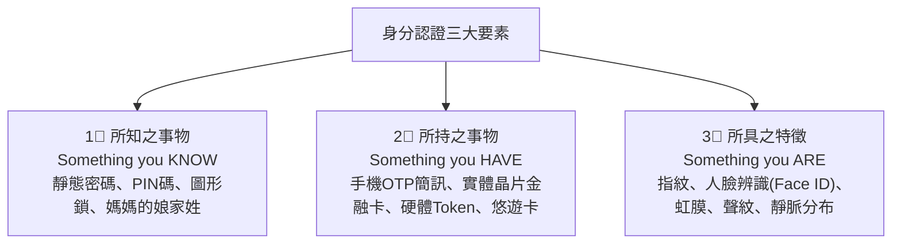

# 第 05 章：行動支付創新、數位身分認證與金融資安防線

---

##  本章學習導航與核心地圖

無現金社會（Cashless Society）的推進仰賴支付法規鬆綁、快速安全的數位身分認證與銅牆鐵壁般的資安防護體系。本章歷屆核心出題點：
1. **第三方支付 vs. 電子支付機構法定權限差異**（是否能「儲值」、「帳戶間轉帳」）
2. **電子支付機構條例全新整併亮點**（電支電票二合一、紅利點數整合）
3. **身分認證三大因數（3 Factors of Authentication）**
4. **FIDO（線上快速身分認證）免密碼標準與金融 FIDO 規範**
5. **零信任架構（Zero Trust）與金融資安三大組織（F-ISAC, F-CERT, F-SOC）**

---

##  一、第三方支付 vs. 電子支付機構（一張表對照業務邊界）

依據 2021 年新修正實施之《電子支付機構管理條例》（電支電票二合一新法），我國將電子支付與電子票證整併為單一專法管理：

| 比較項目 | 第三方支付業者 (Third-Party Payment) | 電子支付機構 (Electronic Payment Institutions) |
| :--- | :--- | :--- |
| **主管機關** | **數位發展部 (數產署)**（過去為經濟部） | **金融監督管理委員會 (金管會)** |
| **法律依據** | 一般商業法規與消費者保護法 | **《電子支付機構管理條例》專法管轄** |
| **法定最低資本額** | 無金融專法限制（依公司法辦理） | **依業務分級**： • 僅代理收付：**1 億元** • 兼營收受儲值：**3 億元** • 兼營小額匯兌（全功能）：**5 億元** |
| **代理收付實質款項** |  **可以**（代收買方款項轉付賣方） |  **可以** |
| **收受儲值款項** | **非電子支付機構原則不得經營**；是否屬儲值及是否適用例外，依交易模式與法規判斷 | **經主管機關許可後，得於核准業務及法定限額內辦理** |
| **國內外小額匯兌** (帳戶間轉帳) | **非電子支付機構原則不得經營**；須依主管機關核准業務判斷 | **經主管機關許可後，得於核准範圍內辦理** |
| **買賣外幣業務** | ❌ **不可** |  **經許可可辦理外幣買賣與跨境支付** |
| **輔導升格門檻** | 代理收付款項**一年日平均餘額逾新臺幣 20 億元**者，應自計算期間末日次日起 **6 個月內**向金管會申請電子支付機構許可 | 已領有金管會營業許可 |
| **代表業者** | 綠界科技 (ECPay)、藍新科技、早期未修法前的 LINE Pay（純代收付綁卡） | 一卡通(iPASS MONEY)、街口支付、悠遊付、全支付、全盈+PAY |

> **考題辨析提示**：依《電子支付機構管理條例》第 5 條，非電子支付機構原則上不得經營收受儲值款項或小額匯兌；例外依法律及許可判斷。第三方支付代理收付款項以一年日平均餘額計算，逾新臺幣 20 億元者，應依授權辦法在計算期間末日次日起 6 個月內申請電子支付機構許可。

---

##  二、數位身分認證三大要素（Authentication Factors）

為了防範冒名頂替與盜刷，多因子身分認證（MFA）必須結合下列**相異類型的兩項以上**要素：

---

##  三、FIDO 聯盟與金融 FIDO 標準

### 1. 什麼是 FIDO (Fast IDentity Online)？
- 解決傳統「死記長串密碼」的痛苦與密碼庫遭撞庫攻擊外洩的資安風險。
- **免密碼核心原理**：結合**「非對稱加密」**與**「裝置本機生物辨識」**。
  - 驗證器建立並使用私鑰簽署網站的隨機挑戰；服務端保存對應公鑰，用來驗證簽章。
  - 若使用生物辨識，辨識流程在使用者端完成，網站不會取得指紋或臉部樣本；驗證器的私鑰保護方式依平台而異，部分通行密鑰可透過平台服務同步。

### 2. 金融 FIDO（數位身分認證生態圈）
- 金管會推動金融機構建立跨機構、跨產業的統一身分認證標準。
- 實現「一個金融 FIDO 帳號，跨機構授權登入與線上申辦金融服務」。

---

##  四、零信任架構 (Zero Trust) 與金融資安聯防體系

### 1. 零信任架構的核心哲學
- **傳統防護（城堡護城河模式）**：假設內網內部都是安全的，只要擋住外網駭客即可。一旦駭客攻破邊界，內網便暢行無阻。
- **零信任三大原則**：
  1. **永不信任，始終驗證 (Never Trust, Always Verify)**。
  2. **最小權限原則 (Least Privilege)**：僅給予完成當前任務所需的最小存取權限。
  3. **假定已經遭到入侵 (Assume Breach)**：預設內網已有惡意程式潛伏，所有內部通訊全面端到端加密、持續性監控與行為分析。

### 2. 台灣金融資安鐵三角（常考英文縮寫）
- **F-ISAC (Financial Information Sharing and Analysis Center)**：**金融資安資訊分享與分析中心**，扮演各銀行與金管會間的資安情報交換中樞，即時通報最新勒索軟體與駭客攻擊手法。
- **F-CERT (Financial Computer Emergency Response Team)**：**金融電腦緊急應變小組**，於金融機構發生重大資安事故時，提供專業鑑識調查與應變支援。
- **F-SOC (Financial Security Operations Center)**：**金融資安監控中心**，7x24 小時全天候自動化蒐集與關聯分析金融資安日誌與威脅事件。

---

##  歷屆易錯觀念手冊

**官方依據**：[電子支付機構管理條例](https://law.moj.gov.tw/LawClass/LawAll.aspx?pcode=G0380237)、[第 5 條授權辦法](https://law.moj.gov.tw/LawClass/LawAll.aspx?pcode=G0380238)、[W3C WebAuthn](https://www.w3.org/TR/webauthn/)、[FIDO Alliance 規格](https://fidoalliance.org/specifications-overview/)

> **❌ 陷阱 1**：第三方支付能否收受客戶儲值金？
> - **錯誤題目**：「某新創電商設立第三方支付平台，為增加客戶黏著度，允許客戶先儲值 5 萬元現金於平台供日後購物扣抵。」
> - **正解**：非電子支付機構原則上不得經營收受儲值款項；電子支付機構須取得相應許可並遵守適用限額。實際交易是否屬儲值，應依款項用途與法律定義判斷。
>
> **❌ 陷阱 2**：輸入兩組密碼算不算雙因子認證（2FA）？
> - **錯誤題目**：「小明登入網銀時，先輸入第一道 8 碼英數密碼，系統接著要求輸入第二道 6 碼圖形鎖，此舉符合多因子認證(MFA)。」
> -  **正解**：錯！密碼與圖形鎖都屬於第一類別「**所知之事物 (Something you know)**」，本質上依然是單一因子（Single-factor）！真正的 MFA 必須跨越兩個不同類別（例如密碼 + 手機 OTP，或密碼 + 指紋辨識）！
>
> **❌ 陷阱 3**：FIDO 的生物辨識資料存在哪裡？
> - **錯誤題目**：「使用 FIDO 登入時，使用者的指紋特徵與人臉特徵會加密傳送並儲存於銀行的雲端伺服器資料庫以供比對。」
> - **正解**：錯。若使用生物辨識，使用者端的驗證器完成比對，網站不會取得生物特徵資料；公鑰由服務端用於驗證簽章。通行密鑰的私鑰儲存或同步方式依平台而異。
>
> **❌ 陷阱 4**：第三方支付代收付金額無限膨脹也無須申請特許執照？
> - **錯誤題目**：「只要業者自稱是第三方支付，哪怕一年代收代付幾千億元，也永遠歸數位發展部管轄，絕對無須向金管會申請電支執照。」
> - **正解**：非電子支付機構代理收付款項一年日平均餘額逾新臺幣 20 億元者，依《電子支付機構管理條例》第 5 條及授權辦法，自計算期間末日次日起 6 個月內向金管會申請電子支付機構許可。
