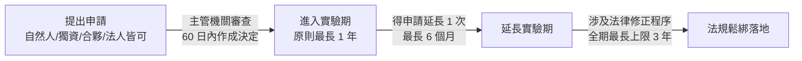

# 第 06 章：監理科技(RegTech)與金融監理沙盒法規

---

##  本章學習導航與核心地圖

法規遵循成本日益高昂，如何運用科技加速合規、又如何在不違反剛性金融法律的前提下鼓勵創新？本章是金融科技力測驗中的**法規核心觀念**，歷屆頻繁出題重點包括：
1. **RegTech（金融業者端）vs. SupTech（主管機關端）精準區辨**
2. **《金融科技發展與創新實驗條例》（金融監理沙盒條例）關鍵法定數字**（審查 60 日、實驗 1 年、展延 6 個月、修法上限 3 年）
3. **審查會議專家學者過半規範與申請人主體資格**
4. **法規排除適用及責任豁免範圍（條例第 25、26 條）**
5. **金融監理沙盒 vs. 金融業務試辦之重大差異**

---

##  一、RegTech vs. SupTech 雙劍合璧

| 科技術語 | 全稱 | 適用主體 | 核心目標 | 典型應用情境 |
| :--- | :--- | :--- | :--- | :--- |
| **RegTech** | **Regulatory Technology** 法遵科技 / 監理科技 | **金融機構自身** | 降低機構之合規與審查成本，避免遭主管機關重罰 | 自動化洗錢防制黑名單比對、可疑交易監控、內控異常稽核、法規異動自動追蹤 |
| **SupTech** | **Supervisory Technology** 監理機關科技 | **金管會 / 中央銀行**等主管監理機構 | 提升金檢效能、及早發現系統性風險、實現即時數位化金檢 | 自動化金檢報表抓取、API 實時風險監控、市場異常交易警示演算法 |

---

##  二、金融監理沙盒條例精粹（歷屆曾於歷屆題目出現的法定數字）

我國於 2018 年 1 月 31 日正式制定公布《金融科技發展與創新實驗條例》（俗稱金融監理沙盒條例），為全球少數以**「專法位階」**落實沙盒機制之國家！

### 1. 什麼是監理沙盒（Regulatory Sandbox）？
創新團隊可在核准的範圍、期間及參與者保護措施下測試金融服務。主管機關得依條例核准排除特定法規命令或行政規則，並免除相關行政責任；法律第 26 條另列出實驗行為不適用的特定處罰規定，並非一概免除刑事或民事責任。

### 2. 沙盒條例核心觀念要素大盤點（數字絕對要背熟！）：

1. **申請人資格（條例第 4 條）**：
   - 自然人、獨資、合夥事業、法人（不論本國人或外國人）**皆具有申請資格**！
   - *考點陷阱*：並非只有大型金融機構或資本額破億的股份有限公司才能申請！
2. **主管機關審查時限（條例第 7 條）**：
   - 主管機關應自受理申請之日起 **60 日內**完成審查並作成決定（必要時得延長一次，並以延長 60 日為限）。
3. **審查會議組成（條例第 8 條）**：
   - 置審查委員 15 人至 21 人；主管機關首長為召集人。
   - **外部專家學者及社會公正人士之人數，不得少於委員總數之二分之一**（確保客觀公正，不被既有金融利益壟斷）！
4. **實驗期間與延長限制（條例第 9 條，最愛考！）**：
   - **基本實驗期間**：原則上以 **1 年**為限。
   - **一般延長限制**：實驗屆滿前得申請延長，**以延長 1 次為限，最長不得逾 6 個月**。
   - **特殊法律修正上限**：若創新實驗評估具可行性，且其業務經營需「修正相關金融法規條文」者，得不受前述 1 次 6 個月之限制，但**全部創新實驗期間合計最長不得逾 3 年**！
5. **責任豁免與排除例外（條例第 25 條、第 26 條，核心觀念陷阱）**：
   - 依第 25 條，主管機關經相關機關同意後，得核准排除特定法規命令或行政規則全部或一部之適用，並免除相關行政責任；第 26 條僅列明特定處罰條文不適用。
   - ⚠ **法定排除範圍**：《洗錢防制法》、《資恐防制法》及其相關法規命令或行政規則不得排除；實驗仍須依適用規定辦理客戶審查及申報。
6. **參與者保障機制（條例第 13、14 條）**：
   - 申請人必須事前告知參與者風險並取得**書面同意**；並應投保**責任保險**或提撥適當之**補償準備金**。

**官方依據**：[金融科技發展與創新實驗條例第 25、26 條](https://law.moj.gov.tw/LawClass/LawAll.aspx?pcode=G0380254)。

---

##  三、金融監理沙盒 vs. 金融業務試辦

| 比較維度 | 金融監理沙盒 (Regulatory Sandbox) | 金融業務試辦機制 (Trial Run) |
| :--- | :--- | :--- |
| **法源依據** | **《金融科技發展與創新實驗條例》（立法院法律位階）** | 主管機關頒布之**行政命令/作業要點**（如銀行業業務試辦作業要點） |
| **法律排除與責任** | 得排除核准範圍內的特定法規命令／行政規則；第 26 條另列特定不適用處罰規定 | 試辦仍應依適用法規及核准條件辦理 |
| **適用對象** | 金融機構、科技新創、自然人、跨界業者皆可 | **既有金融機構**（金管會已開放金融機構得與科技業者聯合試辦） |
| **審查程序** | 需經跨部會與外部專家過半之審查會議審核 | 流程相對敏捷，由金管會業務局直接核定 |

---

##  歷屆易錯觀念手冊

> **❌ 陷阱 1**：沙盒申請人限制
> - **錯誤題目**：「依《金融科技發展與創新實驗條例》，只有資本額達新台幣一億元以上且登記為股份有限公司之金融業者，始得提出沙盒申請。」
> -  **正解**：錯！法規明訂**自然人、獨資、合夥或法人**皆得提出申請，保護個人發明家與早期新創團隊的創新權利！
>
> **❌ 陷阱 2**：創新實驗的最長合計年限
> - **錯誤題目**：「創新實驗若涉及法律修訂，只要立法院未三讀通過，就可以無限制連續展延 10 年。」
> -  **正解**：錯！即便涉及立法院修法程序，條文明文規定**全部創新實驗期間合計最長不得超過 3 年**！超過 3 年即必須退場或停止實驗！
>
> **❌ 陷阱 3**：沙盒實驗期間連洗錢防制法刑責都一併豁免？
> - **錯誤題目**：「經金管會核准進入監理沙盒之創新實驗，為鼓勵創新，在實驗期間全面豁免洗錢防制法與資恐防制法之通報與處罰規定。」
> -  **正解**：錯！**洗錢防制法與資恐防制法為國際金融防線，絕對不在豁免條款範圍之內**！實驗期間違反洗錢防制法仍會依法追訴刑事責任！
>
> **❌ 陷阱 4**：RegTech 與 SupTech 角色顛倒
> - **錯誤題目**：「SupTech 是指各家商業銀行用來檢查內部員工是否落實個資法規的內部資訊系統。」
> -  **正解**：錯！商業銀行內部使用的是 **RegTech（監理/法遵科技）**；**SupTech** 的專屬使用者是**主管監理機關（Supervisory Authority，如金管會）**！
