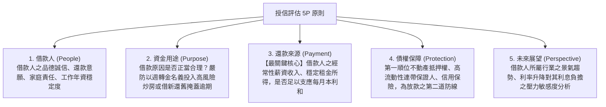

# 第 02 章：消費金融授信徵信、擔保品鑑價與放款審查

---

##  本章學習導航與核心地圖

個人消費性貸款（房屋貸款、信用貸款、汽車貸款、留學貸款）涉及巨量自然人授信。本章出題最密集的四大常見考點計算與準則：
1. **授信「5P 原則」在消金之具體落實**
2. **無擔保授信「DBR 22 倍」天花板鐵律與計算題**
3. **不動產擔保品估價原則與第一順位最高限額抵押權**
4. **聯徵中心（JCIC）個人信用紀錄揭露期限規範**

---

##  一、授信評估 5P 原則（消金實務對照）

---

## 二、無擔保債務與 DBR 22 倍指引

金管會以 DBR（Debt-to-Income Ratio）22 倍作為無擔保債務授信審慎指引，適用範圍與計算依主管機關函令及個案條件判斷：

> **授信參考**：金融機構評估全體金融機構無擔保債務與平均月收入的比率時，應依金管會指引及授信規範審慎辦理；「22 倍」屬指引，不宜描述為一律適用的法律硬性上限。

###  經典計算範例：
- 小張每月平均月薪為 50,000 元。
- 小張在全體銀行的無擔保債務最高上限為：$50,000 \times 22 = 1,100,000$ 元（110 萬元）。
- 若小張目前在 A 銀行有信貸 50 萬元，在 B 銀行有信用卡循環未結清 20 萬元（合計已動用 70 萬元）。
- 則 C 銀行最多只能再核准小張信用貸款：$110萬 - 70萬 = 40 萬元$！

> 是否納入計算及例外情形依金管會函令、授信產品類型與個案條件判斷，辦理時應查核現行指引。

---

##  三、不動產擔保品鑑價與抵押權設定

1. **鑑價三方法**：比較法（市價比較法，消金最常用）、成本法、收益法。
2. **最高限額抵押權 vs. 普通抵押權**：
   - 消金房貸**絕大多數採用「最高限額抵押權」**！
   - 特性：在設定之最高限額範圍內，擔保借款人對銀行現在及將來所發生之一定法律關係之不特定債權，借款還清後抵押權不消滅，循環動用不需每次重跑地政事務所重設！
3. **火險與地震險強制投保**：
   - 房屋抵押時，借款人必須投保住宅火災及地震基本保險，並將抵押權人銀行列為**第一順位優先受償受益人（特約質權條款）**。

---

##  四、銀行法利害關係人授信三大鐵律（銀行法第 12、32、33 條）

1. **法定擔保品之範圍（銀行法第 12 條）**：
   - 不動產抵押權或動產抵押權。
   - 動產或權利質權（定存單質押、股票質押）。
   - 借款人營業交易所發生之應收票據。
   - 各級政府公債、庫券、金融債券。
   - 各級政府或中央主管機關核准設立之信用保證機構（如中小企業信保基金）之保證。
2. **利害關係人無擔保授信「不得」（銀行法第 32 條）**：
   - 銀行原則上不得對下列對象辦理無擔保授信（銀行法第 32 條另將消費性貸款及政府貸款列為例外）：
     ① 銀行負責人、辦理授信之職員；
     ② 主要股東（持股 1% 以上或排名前十名之自然人/法人股東）；
     ③ 與負責人或辦理授信職員有利害關係者（配偶、三親等以內之血親、二親等以內之姻親）；
     ④ 銀行持有資本達 3% 以上之企業。
3. **利害關係人擔保授信「嚴格限制」（銀行法第 33 條）**：
   - 利害關係人借款必須有**充分擔保品**；
   - **條件不得優於其他同類授信對象**（不得特權降息或寬限期放水）；
   - 達主管機關規定金額以上者（無擔保 1 億元/擔保 2 億元，或資本 1%），必須經**董事會三分之二以上董事出席，出席董事四分之三以上同意**之「重度特別決議」！

---

##  五、聯徵中心（JCIC）個人信用資料法定揭露期限

| 信用資料類別 | 聯徵中心資料揭露期限（自事實發生或清償日起算） |
| :--- | :--- |
| **逾期、催收及呆帳紀錄** | 自**清償之日起揭露 3 年**；呆帳未清償者，自轉銷之日起最長揭露 5 年 |
| **退票紀錄** | 自退票日起揭露 **3 年**；已辦妥清償註記自註記日起揭露 6 個月 |
| **破產宣告紀錄** | 自破產宣告日起揭露 **10 年** |
| **信用卡強制停卡未清償** | 自停卡日起最長揭露 **7 年**；清償後依規定更新，清償紀錄揭露 6 個月；揭露期間最長不超過停卡日起 7 年 |
| **就學貸款逾期紀錄** | 清償後揭露 **1 年**；未清償自逾期起最長揭露 3 年 |
| **前置協商 / 調解成立紀錄** | 履約完成自完成日起揭露 **1 年** |

##  歷屆易錯觀念手冊

> **❌ 陷阱 1**：DBR 22 倍的計算分母
> - **錯誤題目**：「DBR 22 倍是指無擔保債務總額不得超過個人每年年薪收入之 22 倍。」
> -  **正解**：錯！分母是**平均「月」收入**，不是年收入！
>
> **❌ 陷阱 2**：自住購屋貸款計入 DBR 22 倍？
> - **錯誤題目**：「老王剛買了總價 1,000 萬元的房屋並向銀行辦理 800 萬元房貸，因此老王已經嚴重超過 DBR 22 倍，不能再辦信用卡。」
> -  **正解**：錯！房屋貸款屬於**有足額不動產擔保品之授信**，完全不計入無擔保 DBR 22 倍的計算限額中！
