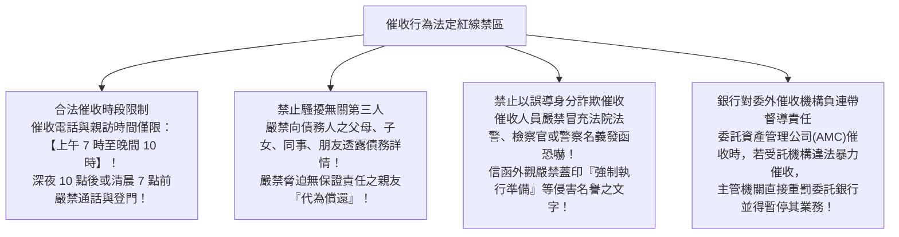

# 第 04 章：逾期放款催收準則、呆帳轉銷與個資保護防線

---

##  本章學習導航與核心地圖

當貸款出現逾期，如何合法維護債權、計提充足備抵呆帳，同時堅守法規防線不踩暴力催收紅線？本章出題四大重點：
1. **放款資產五大分類與最低備抵呆帳提撥比率**
2. **金融機構催收債權行為規範（紅線禁區與法定催收時間）**
3. **不良資產轉銷呆帳之法定授權程序**
4. **個人資料保護法在消金行銷與催收之外包防線**

---

##  一、銀行資產品質五大分類與提存比率（重點整理百分比）

依金管會《銀行資產評估損失準備提列及逾期放款催收款呆帳處理辦法》，授信資產分為五類：

| 資產等級 | 名稱 | 定義與逾期徵狀 | 法定最低備抵呆帳提存比率 |
| :--- | :--- | :--- | :--- |
| **第一類** | **正常授信資產** | 債務人正常繳息、本金未逾期、信用健全 | **最低 1%**（適用類別與提列方式依現行辦法及主管機關規定） |
| **第二類** | **應予注意資產** | 評估有足額擔保，但本金或利息**逾期 1 個月至 12 個月**；或無擔保逾期 1~3 個月 | **最低 2%** |
| **第三類** | **可望收回資產** | 評估有足額擔保，但本利**逾期超過 12 個月**；或無擔保逾期 3~6 個月 | **最低 10%** |
| **第四類** | **收回困難資產** | 評估收回困難，無擔保**逾期 6 個月以上** | **最低 50%** |
| **第五類** | **收回無望資產** | 評估完全無法收回，債務人失聯、破產或逃逸 | **100% 全數提存** |

---

##  二、金融機構與委外催收合法規範（催收紅線禁區）

依銀行公會與金管會頒布之《金融機構作業委託他人處理內部作業應注意事項》與催收自律規範：

---

##  三、轉銷呆帳之法定程序（銀行法規範）

1. **轉銷條件**：
   - 債務人因破產、解散、逃匿、死亡或合解，致債權全部或一部不能收回；
   - 經合法催繳取具法院債權憑證；
   - 擔保品拍賣分配完畢後不足清償之餘額。
2. **核決層級（常見考點考點）**：
   - 逾期放款及催收款經催繳無著，**應由董事會授權之常務董事會或董事會決議通過，並通知監察人（或審計委員會）後，始得轉銷為呆帳**！
   - 轉銷呆帳後，**銀行對該筆債務之請求權並未消滅**，仍應列入帳外備查簿列管並繼續追償！

---

##  四、個人資料保護法在消金之落實（個資法第 19、20、28 條）

1. **法定蒐集與處理要件（第 19 條）**：
   - 金融機構於客戶辦理消金貸款時蒐集身分證明、所得扣繳憑單、財產清冊，係基於**「與當事人間有契約或類似契約之關係」**；
   - 目的外之共同行銷（如金控旗下跨業行銷），**必須經客戶「單獨、明確之書面同意」**，不得包裹於定型化契約中強制勾選！
2. **行銷拒絕權（Opt-out）**：
   - 金融機構於首次進行電話或簡訊行銷時，**必須主動向客戶告知其得表示拒絕接受行銷**，並提供免費拒絕管道。客戶一旦表示拒絕，銀行必須立即停止行銷，不得再以任何藉口推銷！
3. **外包作業之個資洩密責任（委外辦法第 8 條）**：
   - 金融機構將催收或行銷業務委外時，**受託機構視同委託機構之使用人**；受託催收公司若外洩客戶個資，**金融機構應負連帶賠償責任**！
   - **催收委外事前書面通知**：金融機構將不良債權委外催收前，**必須以書面正式通知債務人**受託催收機構之名稱、催收金額與催收範圍！
   - **催收人員專業證照**：受託機構之催收人員**必須取得「債權催收人員專業能力測驗」合格證照**始得從業！
4. **個資侵害之法定損害賠償限額（個資法第 28 條）**：
   - 被害人不易證明其實際受損害額時，得請求法院依侵害情節，以**每人每一事件新臺幣 500 元以上 2 萬元以下**計算；
   - 對於同一原因事實造成多數人權益受侵害者，**合計最高總額以新臺幣 2 億元為限**！

---

##  歷屆易錯觀念手冊

> **❌ 陷阱 1**：合法催收時限
> - **錯誤題目**：「只要債務人欠錢不還，銀行催收人員即可在凌晨 2 點打電話到其住家催款。」
> -  **正解**：錯！催收時間嚴格限制於**上午 7 時至晚間 10 時**！其他時段催收屬於重大違規騷擾！
>
> **❌ 陷阱 2**：呆帳轉銷後債務是否一筆勾銷？
> - **錯誤題目**：「銀行一旦將逾期放款轉銷為呆帳，代表銀行放棄該筆債權，債務人日後不必再償還。」
> -  **正解**：錯！轉銷呆帳只是銀行會計帳務上的沖銷處理，**法律上的債權依然完全有效**，銀行仍應列入帳外專簿列管，隨時向法院聲請換發債權憑證並繼續追索！
