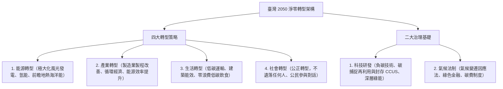

# 第 01 章：ESG 核心概念與國內外永續規範發展

---

##  本章學習導航與核心地圖

ESG（環境 Environment、社會 Social、公司治理 Governance）已從企業道德責任躍升為資本市場投資定價之法定核心指標。本章命題三大熱點：
1. **聯合國永續發展目標（SDGs 17 項領域）**
2. **國際氣候公約與巴黎協定（1.5C 防線目標）**
3. **我國「2050 淨零排放路徑」與《氣候變遷因應法》法制架構**

---

##  一、國際氣候公約演進里程碑

| 國際公約 / 倡議 | 簽訂年 | 核心里程碑與法定承諾 | 歷屆常見亮點 |
| :--- | :--- | :--- | :--- |
| **京都議定書** (Kyoto Protocol) | 1997 | 首次對**已開發國家**設定具法律約束力之溫室氣體減量目標 | 引入三大市場機制（清潔發展機制 CDM、共同減量 JI、排放交易 ET） |
| **巴黎協定** (Paris Agreement) | 2015 | 取代京都議定書，**所有締約國（不論開發中或已開發）**皆需提出自主貢獻(NDC) | **核心控溫目標：致力將全球平均升溫控制在工業化前水準之 1.5C 以內**，最差不超過 2C！ |
| **格拉斯哥氣候協定** (COP26) | 2021 | 首次在氣候決議文中明確納入**「逐步減少未裝設減碳設備的燃煤發電 (Phase down coal)」** | 完成巴黎協定第 6 條國際碳市場實施細則 |

---

##  二、我國 2050 淨零轉型核心戰略架構

我國國發會於 2022 年 3 月正式公布「臺灣 2050 淨零排放路徑及策略總說明」：

---

1. **淨零目標法制化（第 4 條）**：將我國「**2050 年溫室氣體淨零排放**」之長期目標明文寫入法律，具強制性法定拘束力！
2. **主管機關**：升格為**「環境部」**；並由行政院國家永續發展委員會（永續會）統籌協調跨部會重大氣候政策。
3. **階段管制目標（第 10 條）**：中央主管機關應會商中央目的事業主管機關，**以每 5 年為一期**，訂定國家與各部門之階段管制目標。
4. **碳費（Carbon Fee）機制（第 28 條）**：
   - 採**「碳費先於碳稅」**原則，由環境部對直接與間接排放溫室氣體達指定門檻（年排放量達 2.5 萬公噸以上）之排碳大戶徵收碳費；
   - 碳費收入納入**「溫室氣體管理基金」**，專款專用於輔導減量技術研發、執行公正轉型與獎勵自主減量。
5. **自主減量計畫與優惠費率（第 29 條）**：企業若主動提出符合國內外減量標準之自主減量計畫，得向環境部申請核定適用「優惠費率」。

---

##  四、上市櫃公司永續揭露接軌調整（2026 年公告）

金管會與環境部於 2026 年 9 月 23 日公告調整 IFRS 永續揭露接軌路徑。下列為主管機關公告的政策安排；年報準則與相關函令預計於 2026 年底前修正，正式適用仍應以生效條文為準。

| 調整項目 | 2026 年公告內容 |
| :--- | :--- |
| **強制適用範圍** | 實收資本額達新臺幣 20 億元以上的上市櫃公司，以及環境部列管應盤查及查驗的上市櫃公司；未達 20 億元且非環境部列管者，仍揭露氣候治理、風險管理及範疇一、二等基本資訊 |
| **第三階段揭露內容** | 接軌前兩年以氣候資訊為主；自第三年起依準則考量氣候以外的重大永續議題 |
| **範疇三** | 第三階段公司暫採自願揭露 |
| **溫室氣體確信** | 第二、三階段公司免辦母公司個體範疇一、二確信；資本額未達 20 億元者可自願確信，但環境部列管者仍依環境部規定辦理 |
| **申報時限過渡** | 接軌前兩年，未能與 3 月財報同時申報永續專章者，得延至股東會前 14 日的年報期限申報 |

---

本次調整不適用金融業、保險業及證券期貨業，相關業別依金管會行動方案另行規劃。

**官方依據**：[2026 年金管會與環境部接軌調整公告](https://esg.fsc.gov.tw/News/Detail/-%E6%8E%A5%E8%BB%8C%E5%9C%8B%E9%9A%9B-%E8%A1%8C%E7%A9%A9%E8%87%B4%E9%81%A0-%E7%92%B0%E5%A2%83%E9%83%A8-%E9%87%91%E7%AE%A1%E6%9C%83%E5%85%B1%E5%90%8C%E5%84%AA%E5%8C%96%E6%B0%B8%E7%BA%8C%E6%8F%AD%E9%9C%B2%E6%8E%A5%E8%BB%8C%E8%B7%AF%E5%BE%91-%E5%85%BC%E9%A1%A7%E8%B3%87%E8%A8%8A%E5%93%81%E8%B3%AA%E8%88%87%E7%94%A2%E6%A5%AD%E7%AB%B6%E7%88%AD%E5%8A%9B/)。

##  歷屆易錯觀念手冊

> **❌ 陷阱 1**：巴黎協定控溫目標數字
> - **錯誤題目**：「巴黎協定的長期目標是將全球地表升溫控制在 3.5C 以內。」
> - **正解**：錯。巴黎協定要求將全球平均升溫控制在「遠低於 2°C」，並努力限制在 1.5°C；不是將 1.5°C 說成絕對不得逾越的法定上限。
>
> **❌ 陷阱 2**：我國氣候法規主管機關
> - **錯誤題目**：「《氣候變遷因應法》主管徵收碳費之中央目的事業主管機關是財政部賦稅署。」
> -  **正解**：錯！碳費的主管機關是**環境部**！財政部主管的是「稅」，而我國目前實施的是由環境部主管之「碳費（Carbon Fee）」！
