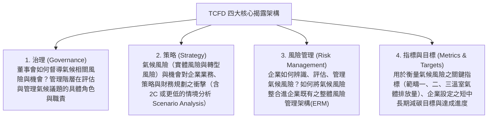

# 第 04 章：企業永續資訊揭露(IFRS 永續準則)與反漂綠

---

##  本章學習導航與核心地圖

投資人如何看穿企業到底是「真減碳」還是「表面作秀」？永續揭露標準的全球大整合已然成形。本章命題核心聚焦：
1. **氣候相關財務揭露（TCFD）四大核心架構支柱與情境分析**
2. **國際永續準則理事會（ISSB）發布之 IFRS S1 與 IFRS S2 核心要件**
3. **金管會「我國接軌 IFRS 永續揭露準則藍圖」三階段期程與「年報同步」法定義務**
4. **GRI 準則 vs. SASB 準則重大性思維差異**
5. **防範漂綠（Anti-Greenwashing）與 ESG 基金揭露要求**

---

##  一、TCFD 氣候財務揭露四大核心支柱

國際金融穩定委員會（FSB）成立之氣候相關財務揭露工作小組（TCFD），要求企業從「氣候變遷對企業財務損益之實質衝擊」角度出發，揭露四大維度：

---

## 二、IFRS 永續準則與我國接軌安排

### (一) IFRS S1 與 S2

ISSB 於 2023 年發布 IFRS S1（永續相關財務資訊揭露一般規定）及 IFRS S2（氣候相關揭露）。S1 聚焦企業永續風險與機會對前景的影響；S2 規範氣候相關治理、策略、風險管理、指標與目標。範疇三揭露及過渡安排依準則與我國主管機關規定判斷。

### (二) 金管會 2026 年接軌調整公告

金管會與環境部於 2026 年 9 月 23 日公告調整接軌路徑：強制適用對象為實收資本額達新臺幣 20 億元以上的上市櫃公司，以及環境部列管應盤查及查驗的上市櫃公司；未達 20 億元且非環境部列管者仍須揭露基本氣候資訊。第三階段公司接軌前兩年以氣候資訊為主，範疇三暫採自願揭露，確信及申報時限亦有過渡安排。上述為公告政策；年報準則相關修正預計於 2026 年底前辦理。本次調整不適用金融業、保險業及證券期貨業，相關業別依金管會行動方案另行規劃。

- 上述為主管機關已公布的調整方向；截至 2026 年 10 月 17 日，相關正式規則修正細節仍待後續公告，適用年度與申報方式應以正式修正條文為準。
- 原先按 100 億、50 億資本額分三階段推動的期程已不宜作為最新制度摘要。

##  三、GRI vs. SASB 兩大準則核心差異

| 評估維度 | 全球報告倡議組織 (GRI Standards) | 永續會計準則委員會 (SASB Standards) |
| :--- | :--- | :--- |
| **目標受眾** | **多元利害關係人**（員工、社區、公民團體、消費者、主管機關） | **資本市場投資人與機構債權人** |
| **重大性原則** | **衝擊重大性**：評估企業對經濟、環境與人的實際或潛在影響 | **財務重大性**：著重永續議題如何影響企業價值與財務結果 |
| **架構特性** | 共通性標準（Universal Standards）與主題準則 | **依 77 個細分產業別**量身打造專屬量化指標（Industry-Specific） |

---

##  四、反漂綠（Anti-Greenwashing）法律防線與基金審查

> ** 什麼是「漂綠（Greenwashing）」？**
> 企業透過**誇大不實、具誤導性、選擇性揭露或虛偽陳述**之環保宣傳，塑造其商品、服務或投資策略具備環境永續效益之假象，欺騙消費者與 ESG 基金投資人！

### 金管會反漂綠監理四大鐵律：
1. **ESG 主題投信基金審查原則**：
   - **沒有適用所有 ESG 基金的統一 70% 法定門檻**。基金須於發行計畫、公開說明書及投資人須知揭露投資目標、策略、ESG 標準、符合其投資重點之最低投資比重、風險及排除政策。
   - 投信公司應依監理原則定期揭露基金實際投資比重及策略執行情形；個別基金適用比率以其公開說明書及相關規範為準。
2. **不得避重就輕**：宣稱「全產品綠色淨零」卻刻意隱匿主要範疇三高碳供應鏈，屬於誤導性陳述。
3. **法律責任追究**：
   - 不實揭露的責任須依文件類型、行為人、重大性及個案事實判斷；可能涉及《證券交易法》第 20 條、第 32 條或第 171 條等規定，不能概括認定所有錯誤都適用同一刑度。
   - 一般商品不實廣告則依《公平交易法》第 21 條最高可處新臺幣 2,500 萬元罰鍰。

---

**官方依據**：[金管會 ESG 基金資訊揭露審查監理原則](https://esg.fsc.gov.tw/SinglePage/Criterion/Product/)、[2026 年 IFRS 永續揭露接軌調整公告](https://esg.fsc.gov.tw/News/Detail/-%E6%8E%A5%E8%BB%8C%E5%9C%8B%E9%9A%9B-%E8%A1%8C%E7%A9%A9%E8%87%B4%E9%81%A0-%E7%92%B0%E5%A2%83%E9%83%A8-%E9%87%91%E7%AE%A1%E6%9C%83%E5%85%B1%E5%90%8C%E5%84%AA%E5%8C%96%E6%B0%B8%E7%BA%8C%E6%8F%AD%E9%9C%B2%E6%8E%A5%E8%BB%8C%E8%B7%AF%E5%BE%91-%E5%85%BC%E9%A1%A7%E8%B3%87%E8%A8%8A%E5%93%81%E8%B3%AA%E8%88%87%E7%94%A2%E6%A5%AD%E7%AB%B6%E7%88%AD%E5%8A%9B/)。

##  歷屆易錯觀念手冊

> **❌ 陷阱 1**：TCFD 四大支柱包含什麼？
> - **錯誤題目**：「TCFD 四大核心支柱分別為：行銷宣傳、產品定價、公共關係與慈善捐贈。」
> -  **正解**：錯！TCFD 四大支柱是**「治理 (Governance)」、「策略 (Strategy)」、「風險管理 (Risk Management)」、「指標與目標 (Metrics and Targets)」**！
>
> **❌ 陷阱 2**：ESG 基金投資比率限制
> - **錯誤題目**：「基金只要有買過一張太陽能股票，即使占比極低，即可合法更名為全球 ESG 綠色永續旗艦基金。」
> - **正解**：錯。監理原則要求基金揭露其設定的最低投資比重與實際配置，沒有一體適用所有 ESG 基金的 70% 法定門檻；應查核個別基金公開說明書。
>
> **❌ 陷阱 3**：我國接軌 IFRS 永續揭露準則後，永續資訊放在哪裡揭露？
> - **錯誤題目**：「依照金管會藍圖，上市櫃公司接軌 IFRS 永續準則後，應在每年 12 月底前獨立出版一本永續宣傳月曆即可。」
> -  **正解**：錯！永續資訊必須移入**「股東會年報」**中同步公告揭露，與年度財務報表申報時效一致！
>
> **範疇三揭露**：我國接軌初期前兩年採自願揭露的調整，與 IFRS S2 一般要求及國際過渡安排應分開理解；正式適用方式以後續修正規定為準。
