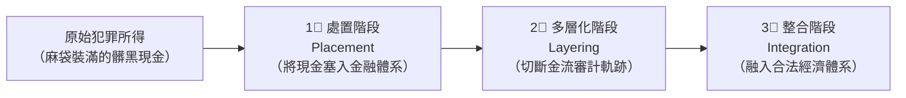

# 第 01 章：洗錢防制法核心要件與洗錢三階段生活圖解

---

##  本章學習導航與核心地圖

《洗錢防制法》是防範地下不法資金漂白的法律盾牌。本章命題四大核心：
1. **洗錢罪的三大客觀行為態樣（掩飾、隱匿、收受、持有）**
2. **前置重大犯罪（Predicate Offenses）之法定門檻**
3. **洗錢三階段（處置、多層化、整合）生活白話金流情境**
4. **「自洗錢」與「他人洗錢」同等處罰原則**

---

##  一、洗錢三部曲：經典洗錢三階段（常見考點金流情境）

洗錢者將販毒、電信詐欺、貪污取得的「黑錢」，轉化為合法外觀「白錢」的標準三階段：

| 洗錢階段 | 英文術語 | 犯罪手法與生活寫照 | 歷屆常見典型手法 |
| :--- | :--- | :--- | :--- |
| **第一階段：處置** (入袋) | **Placement** | 犯罪所得首次進入金融體系或其他可交易管道的階段。交易模式異常時，應結合客戶背景、資金來源與行為目的判斷風險。 | 可能出現刻意拆分、利用多個管道或購買高流動性資產等異常型態；單一金額或交易本身不能直接推定犯罪。 |
| **第二階段：多層化** (漂洗) | **Layering** | **製造複雜混亂的交易迷宮，切斷資金與原始犯罪的關聯！** （金流像洋蔥一樣層層包裹） | 1. 透過境外紙上公司跨國電匯輾轉數個避稅天堂銀行帳戶； 2. 購買虛擬貨幣(加密資產)在各去中心化交易所頻繁混幣互轉； 3. 頻繁買進賣出高流動性股票與外匯期貨。 |
| **第三階段：整合** (上岸) | **Integration** | **將漂白乾淨的資金以看似完全合法的投資收益名義拿出來花用！** （黑錢搖身一變成為合法企業盈餘） | 1. 設立空殼投資公司，出資向自己購買不動產豪宅； 2. 假借跨國貿易高報進口低報出口（虛假發票合法匯回）； 3. 開立合法連鎖洗車場或餐廳，虛增營業額報稅洗白。 |

---

##  二、洗錢罪之法定構成要件（洗錢防制法第 2 條）

本法所稱洗錢，指下列行為：
1. **意圖掩飾或隱匿特定犯罪所得來源，或使他人逃避刑事追訴，而移轉或變更特定犯罪所得**。
2. **掩飾或隱匿特定犯罪所得之本質、來源、去向、所在、所有權、處分權或其他權益者**。
3. **收受、持有或使用他人之特定犯罪所得**。

### 1. 前置特定犯罪之門檻（第 3 條）
- **最輕本刑為 6 個月以上有期徒刑之罪**（重罪原則）；
- 以及雖非 6 個月以上，但法條特別明文列舉之重大經濟犯罪（如刑法詐欺罪、背信罪、證交法內線交易、操縱股價、銀行法不法吸金、智慧財產權侵害等）。

### 2. 自洗錢

- 行為人實施特定犯罪後，若另有掩飾、隱匿、收受、持有或使用犯罪所得等符合法定構成要件的行為，仍可能成立洗錢罪；不能只因前置犯罪與洗錢行為由同一人實施，就排除洗錢罪。

### 3. 收集與交付帳戶的規範（第 21、22 條）

- **收集帳戶（第 21 條）**：無正當理由收集他人金融帳戶、虛擬資產帳號或第三方支付帳號，且具法定列舉情形（例如以不正方法、對價或媒體散布等）時，依條文處罰；不能簡化成所有「收集」一律同一刑度。
- **交付或提供帳戶（第 22 條）**：無正當理由交付、提供帳戶，原則上依規定先予告誡；符合收受對價、提供三個以上帳戶或五年內再犯等法定情形時，另涉刑事責任。
- 適用要件、刑度與行政程序請以現行條文全文為準。

### 4. 洗錢罪刑度與沒收（第 19、25 條）

| 洗錢標的 | 法定刑度 |
| :--- | :--- |
| 未達新臺幣 1 億元 | 6 個月以上 5 年以下有期徒刑，得併科新臺幣 5,000 萬元以下罰金 |
| 達新臺幣 1 億元以上 | 3 年以上 10 年以下有期徒刑，併科新臺幣 1 億元以下罰金 |

- 洗錢標的物的沒收依第 25 條及相關規定判斷；不得把沒收概括成「所有犯罪所得一律不問歸屬全部沒收」。

### 5. 受規範主體：金融機構與指定非金融事業或人員 (DNFBP)（第 5 條）
- **金融機構及依法適用金融機構規定者**：依《洗錢防制法》第 5 條所列類別及主管機關指定規定辦理；提供虛擬資產服務及辦理融資性租賃者，依法適用金融機構規定。
- **指定之非金融事業或人員（DNFBP，歷屆常見）**：
  1. **銀樓業**。
  2. **地政士及不動產經紀業**（於從事不動產買賣交易之籌劃或執行時）。
  3. **律師、公證人、會計師**（於為客戶準備或進行不動產買賣、客戶資金資產管理、銀行帳戶管理、公司籌設營運買賣時）。
  4. **信託及公司服務提供者**。
  5. **提供第三方支付服務之事業或人員**。

---

**官方依據**：[洗錢防制法第 5 條](https://law.moj.gov.tw/LawClass/LawAll.aspx?pcode=G0380131)。

##  歷屆易錯觀念手冊

> **❌ 陷阱 1**：洗錢三階段判定
> - **錯誤題目**：「某客戶將犯罪所得現金分批存入金融機構，此行為屬於多層化(Layering)階段。」
> -  **正解**：錯！將實體現金首次存入銀行體系的動作，屬於**第一階段「處置 (Placement)」**！將存款電匯到國外境外公司才進入第二階段多層化！
>
> **❌ 陷阱 2**：洗錢罪是否處罰自己犯罪的所得？
> - **錯誤題目**：「依我國現行洗錢防制法，只有幫別人洗錢才會被判刑，自己貪污後把贓款藏在床底下不構成洗錢罪。」
> -  **正解**：錯！現行法已經將**自洗錢（Self-laundering）全面入罪化**！自己犯罪後隱匿處置犯罪所得，同樣觸犯洗錢罪！
