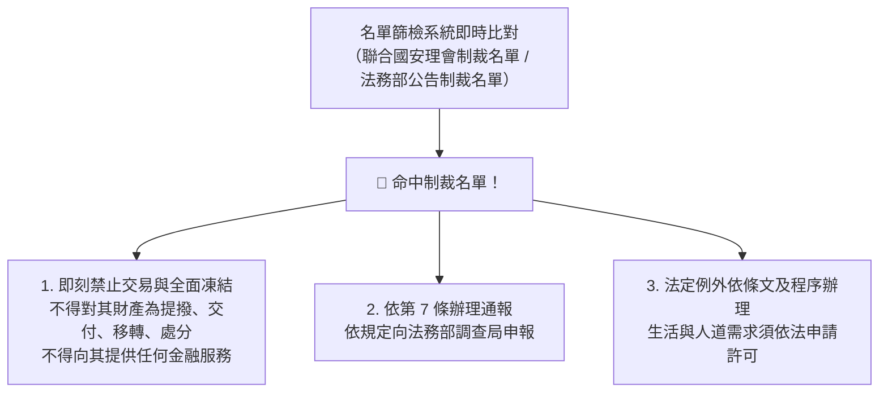

# 第 04 章：資恐防制法要件與目標性金融制裁名單篩檢

---

##  本章學習導航與核心地圖

《資恐防制法》規範資恐犯罪、目標性金融制裁、資產凍結與通報義務。本章依現行法條說明主管機關、法定要件及例外程序。
1. **《資恐防制法》主管機關與「資恐防制審議會」**
2. **資恐罪之成立要件（不問恐怖活動是否真正發生）**
3. **目標性金融制裁（TFS）名單篩檢與資產即刻凍結處分**

---

##  一、《資恐防制法》主管機關與審議機制

- **主管機關**：**法務部**。
- **資恐防制審議會**：
  - 由**法務部長擔任召集人**，成員涵蓋國安局、內政部、外交部、國防部、經濟部、金管會等部會副首長組成。
  - 職權：審議指定制裁名單、除名名單與酌留生活費用之專案許可。

---

##  二、資恐罪之特殊法律要件（常見考點法理）

資恐防制法第 8 條、第 9 條規範之資恐罪，其最大特色在於：
1. **不以發生恐怖活動為前提**：
   - 行為人只要直接或間接提供、募集財產或財產上利益，意圖供恐怖組織、恐怖分子從事恐怖活動，**不論該恐怖活動最終是否真正發生，罪名即完全成立**！
2. **不論資金來源是否合法**：
   - 傳統洗錢是漂白「非法黑錢」；**資恐資金往往來自「完全合法的捐款、募款、個人薪資或小額積蓄」**，只要資金流向是為了支持恐怖活動，即構成資恐！

---

##  三、目標性金融制裁（TFS）與即刻凍結作業

### 1. 目標性金融制裁（TFS）之法律效果（資恐防制法第 7 條）
- **全面性資產禁止處分（凍結）**：
  1. 不得對受制裁之個人、法人或團體為**直接或間接**之財產或財產上利益之提撥、交付、移轉、變更、處分、利用或為其他足以變動其數量、品質、價值及移轉其所有權或管理權之行為。
  2. 不得為其受任或受託管理財產或財產上利益。
  3. 不得為其提供任何金融交易、商業交易或資產管理等服務。
- **善意第三人之權利保障（第 7 條第 4 項）**：受制裁處分前，善意第三人已取得之既有債權或擔保物權，其依法行使權利（如實行抵押權求償）不受凍結處分之影響！

### 2. 違反制裁規定的責任

- 違反第 7 條資產凍結或通報義務，依第 12 條等現行規定處理；具體法律效果視行為人、行為態樣及適用條文而定。
- 第 8 條與第 9 條涉及各自要件的刑事責任。不能將所有違反凍結規定的行為一概寫成相同的 1 至 7 年刑責；應逐條核對現行法。

##  歷屆易錯觀念手冊

> **❌ 陷阱 1**：資恐罪是否需要等到炸彈引爆才成立？
> - **錯誤題目**：「某人匯款 10 萬元給國外恐怖組織，但該組織尚未策劃任何恐怖行動即遭瓦解，因此該匯款人不構成資恐罪。」
> -  **正解**：錯！資恐防制法明文規定**不以恐怖活動之實際發生為必要**，只要提供資金意圖支持恐怖主義，罪名即行成立！
>
> **❌ 陷阱 2**：凍結資產的通報主管機關
> - **錯誤題目**：「金融機構一旦發現客戶被列為聯合國制裁名單，應立即向行政院國家安全會議提出申報。」
> -  **正解**：錯！依據資恐防制法第 7 條規定，金融機構凍結受制裁資產後，應即向**法務部調查局**辦理申報！
