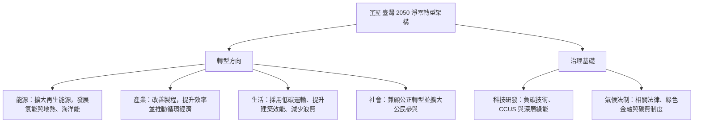
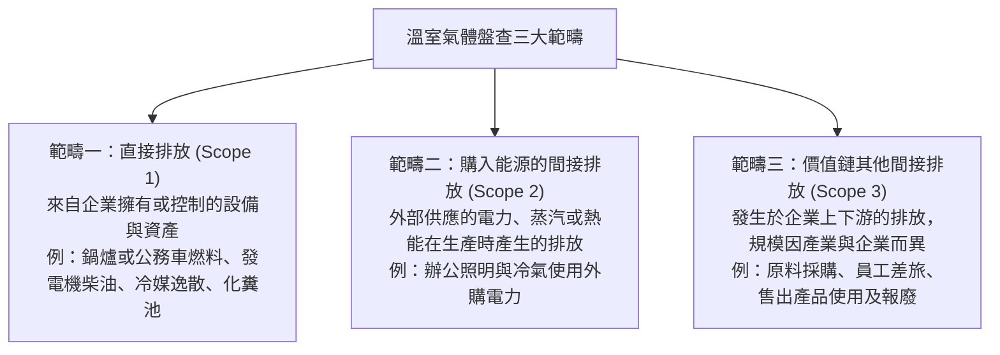
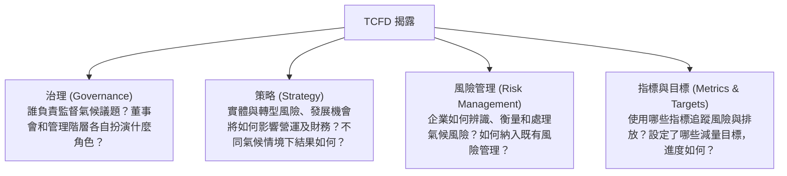

# 永續發展基礎能力：整合學習教材

先讀概念與比較表，再關閉教材作答，最後查看答案。答錯時回查條件，再練本章題目。可於隔日、第3、7、14天重答，依掌握程度調整間隔。數字與期限須連同適用主體及版本記憶。

## 永續發展基礎能力：教材總覽

### 學習範圍

永續發展可從環境、社會與治理三個面向理解，再連結溫室氣體盤查、永續金融、資訊揭露和風險管理。各章可依需要查閱，章末練習用於檢查理解。

### 教材地圖

- **第 01 章：永續概念與規範** — ESG、國際氣候公約、臺灣淨零政策與氣候治理。
- **第 02 章：盤查與碳定價** — 排放範疇、溫室氣體、盤查查驗、碳費與 CBAM。
- **第 03 章：永續金融** — 責任金融倡議、赤道原則、永續債券及金融行動方案。
- **第 04 章：資訊揭露與漂綠** — TCFD、IFRS S1／S2、GRI、SASB 與 ESG 宣稱。
- **第 05 章：名詞與數字速查** — 常見數字、英文縮寫及題目判讀。
- **第 06 章：社會、治理與金融風險** — 勞動人權、外部確信、永續評等、授信與保險。

### 使用提醒

題庫包含歷屆試題與標示為「【自編】」的補強題。歷屆題目與答案反映當時考期；涉及規範版本或適用日期，請核對當期官方資料。

## 第 01 章：ESG 核心概念與國內外永續規範發展

### 先懂什麼

國際共識 → 國家目標 → 法制與政策工具 → 企業行動；盤查與碳成本見第02章，金融工具見第03章。

---

評估企業永續議題時，可分別檢視環境（Environment）、社會（Social）與公司治理（Governance）面向。本章會帶你掌握聯合國 17 項永續發展目標、國際氣候協議，以及我國 2050 淨零政策與相關法制。

---

###  一、永續概念與國際氣候治理

**永續、ESG、CSR與SDGs先分清楚。**永續發展要滿足當代需要，同時保留後代滿足需要的能力，兼顧經濟、社會與環境。ESG是企業及投融資的評估框架；CSR是企業承擔社會責任的理念；SDGs則是全球發展目標。三者相關，但用途不同。利害關係人觀點要求同時考慮股東、員工、顧客、供應商、社區及環境，不能只看短期股東利益。

| 比較 | 判斷關鍵 | 教學例子 |
| --- | --- | --- |
| 減緩 Mitigation | 減少暖化來源與排放 | 節能設備、再生能源 |
| 調適 Adaptation | 降低氣候衝擊與損害 | 防洪設施、耐旱作物 |
| 淨零 Net Zero | 深度減排後，平衡剩餘人為溫室氣體排放與移除 | 不能只靠購買碳權取代實質減量 |
| 碳中和 Carbon Neutrality | 在指定邊界與標準下平衡碳排放 | 仍須確認範圍、減量與抵換規則 |

**全球目標的演進。**1987年《我們共同的未來》提出經典永續發展定義；2000年MDGs著重貧窮、教育、健康等議題，目標年為2015。2015年9月25日通過2030永續發展議程：SDGs有17項目標、169項細項，面向所有國家，強調全球性、整合性與轉型性。企業使用SDG Compass的順序是：了解 → 排定優先順序 → 設定目標 → 整合營運 → 報告與溝通。

**循環經濟不只回收。**線性模式是開採、製造、使用、丟棄；循環模式則優先保留材料與產品價值。

| 模式 | 教學例子 |
| --- | --- |
| 循環供應 | 使用再生或可再生原料 |
| 資源回收 | 廢材料回收再製 |
| 延長產品生命 | 維修、翻新及二手使用 |
| 共享平台 | 多人共用單車或閒置設備 |
| 產品即服務 | 依使用量付費取得功能，搭配產品維護與回收安排 |

再生能源應按能源來源與適用認定判斷，例如太陽、風力、地熱、生質及海洋能；不能只見「氫」便認定一定來自再生能源。裝置容量GW與發電占比%也不能混用。

**國際治理先辨角色。**UNEP與WMO共同於1988年成立IPCC，提供氣候科學評估；UNFCCC為全球氣候公約，COP為締約方大會，負責協商與行動安排。IPCC不直接替各國立法或分配相同配額。

**協定比較。**京都議定書於1997年通過、2005年生效，側重特定已開發國家的量化義務；巴黎協定於2015年通過、2016年生效，各國提出NDC（國家自主貢獻）。NDC原則上每五年提出新一輪，全球盤點GST也採五年週期；計畫提出不等於一定達成該減量數字。巴黎協定是條約，不能把「個別減量結果的約束方式不同」簡化成整部協定沒有法律拘束力。

**重要節點與名詞。**COP26關注1.5°C與未減排煤電逐步減少；phase down是逐步減少，phase out是逐步淘汰。COP27涉及損失與損害基金安排，COP28完成首次全球盤點並提出2030年再生能源裝置容量增為三倍的方向。全球甲烷承諾的2030年較2020年減少至少30%是參與國倡議，不能推論所有締約方都加入。

GCF是支援開發中國家減緩與調適的綠色氣候基金；GFANZ是金融機構淨零合作聯盟；損失與損害基金則處理脆弱國家面臨的氣候損失與損害，三者不能互換。

**公約速查**

| 國際公約 / 倡議 | 簽訂年 | 核心里程碑與法定承諾 | 重點 |
| :--- | :--- | :--- | :--- |
| 京都議定書 (Kyoto Protocol) | 1997 | 建立第一套具法律拘束力的減量承諾，對象為已開發國家 | 允許透過 CDM、JI 與排放交易 ET 等市場機制達成承諾 |
| 巴黎協定 (Paris Agreement) | 2015 | 各國依本身情況訂出減量承諾，並定期提出更新版 NDC | 全球升溫須維持在遠低於 2°C 的範圍，並以 1.5°C 為努力方向。 |
| 格拉斯哥氣候協定 (COP26) | 2021 | COP26 首次把減少未設置減碳設備之燃煤發電寫入氣候決議 | 完成巴黎協定第 6 條下國際碳市場的執行細節 |

---

### 🇹🇼 二、我國 2050 淨零轉型核心戰略架構

國發會於 2022 年 3 月發布「臺灣 2050 淨零排放路徑及策略總說明」，內容以四種轉型方向和兩項治理基礎組成：

---

**十二項關鍵戰略。**風電／光電、氫能、前瞻能源、電力系統與儲能、節能、CCUS、運具電動化及無碳化、資源循環零廢棄、自然碳匯、淨零綠生活、綠色金融、公正轉型。它們是落實轉型的工具，不要與四項轉型或兩項治理基礎混成同一分類。

**政策目標與成果分開讀。**教材中的2025年再生能源占比20%、太陽光電20GW、離岸風電5.6GW，以及2030年綠色投融資逾5兆元，都屬來源版本的政策目標，不能直接表述為實際達成。

### 三、氣候治理與碳費制度

1. **淨零入法（第 4 條）**：《氣候變遷因應法》將 2050 年溫室氣體淨零列為法定長期目標。
2. **政策協調**：環境部主管氣候相關業務；行政院國家永續發展委員會負責協調跨部會政策。
3. **分期目標（第 10 條）**：中央主管機關會同相關部會，每五年訂定國家及部門的階段管制目標。
4. **碳費適用範圍**：對象須同時符合公告列管排放源、年排放量達 2.5 萬公噸 CO2e，以及屬電力、燃氣供應業或製造業等條件；計算包含直接排放與外購電力的間接排放。個別企業是否須繳費，仍應核對現行規定。
5. **自主減量計畫（第 29 條）**：事業提出減量計畫並經環境部核定後，得按適用條件申請優惠費率。

資料來源：[氣候變遷因應法](https://oaout.moenv.gov.tw/law/LawContent.aspx?id=GL005511)、[碳費收費辦法第 2、3 條](https://oaout.moenv.gov.tw/law/LawContent.aspx?id=GL007914)。

---

### 四、IFRS 永續揭露：2026 年 9 月調整重點

IFRS 永續揭露的公司分級、適用年度及過渡例外，集中於第 04 章。這裡先掌握國際準則如何轉為國內企業的揭露義務；作答時須分清政策方案與已生效規定。

---

###  潛在易錯點

> 易混淆 1：巴黎協定的升溫界線
> - 誤讀：把協定目標說成「升溫不得超過 2°C」。
> - 正確理解：目標是維持在遠低於 2°C，並努力控制在 1.5°C；這是共同努力的方向，不是保證全球升溫絕不越線。

資料來源：[UNFCCC《巴黎協定》第 2 條](https://unfccc.int/sites/default/files/resource/parisagreement_publication.pdf)。
>
> 易混淆 2：碳費由誰主管？
> - 誤讀：將碳費徵收工作歸給財政部賦稅署。
> - 正確理解：現行碳費制度由環境部主管；「費」與財政部主管的「稅」是不同制度。

### 主動回憶

1. 京都與巴黎的承諾設計有何不同？
2. IPCC能否直接替企業訂法定配額？
3. 臺灣四項轉型與兩項治理基礎是什麼？
4. 2050與每五年分別代表什麼？
5. 企業說符合巴黎協定，是否足以證明履行國內法定義務？
6. ESG、CSR與SDGs的用途有何不同？
7. 防洪與節能分別偏向調適或減緩？
8. SDGs的目標數、細項數與目標年？
9. 共享平台與產品即服務如何區分？
10. NDC與全球盤點的五年週期是否代表一定達標？

作答後查看答案

1. 京都側重特定工業化國家承諾；巴黎透過各國NDC。
2. 不能；科學評估與法定權限不同。
3. 能源、產業、生活、社會；科技研發、氣候法制。
4. 長期淨零目標與階段管制目標期間。
5. 不足；仍須逐一確認適用義務與證據。
6. 企業評估框架、企業責任理念、全球發展目標。
7. 防洪降低氣候衝擊屬調適；節能降低排放屬減緩。
8. 17項、169項、2030年。
9. 前者協調多人共用；後者提供產品功能與使用服務，仍須看實際安排。
10. 不代表；提出計畫與檢視進展不等於保證減量結果。

### 考前快速複習

國際公約提供合作架構，國內法規才決定企業具體義務。京都1997、巴黎2015、COP26為2021；巴黎目標是遠低於2°C並努力限制於1.5°C。臺灣2050淨零，四項轉型是能源、產業、生活、社會；治理基礎是科技研發與氣候法制。遇法規題先圈出年度、主體與條件。 ESG、CSR、SDGs用途不同；SDGs記17／169／2030。減緩降低排放、調適降低衝擊，循環經濟涵蓋供應、回收、延壽、共享與產品即服務。

## 第 02 章：溫室氣體盤查(GHG)與碳定價機制

### 先懂什麼

先定組織或產品 → 定邊界 → 蒐集活動數據 → 計算CO₂e → 查驗；資料再進入第04章的揭露。 排放量 × 適用碳價形成成本；先辨制度、主體、產品及年度，再談額度或扣減。

---

本章整理企業盤查排放、適用的管理規則，以及碳成本如何形成。內容涵蓋：
1. GHG Protocol 三大範疇與 ISO 14064-1:2018 六類排放的對照
2. 七種列管溫室氣體及其全球暖化潛勢 (GWP)
3. 台灣盤查、登錄與查驗的對象及申報期限
4. 碳定價方式與臺灣碳權交易所 (TCX) 的業務
5. 歐盟碳邊境調整機制（CBAM）的適用產業與時程

---

###  一、溫室氣體盤查三大範疇與 ISO 14064-1:2018 六大類別

#### (一) GHG Protocol 三大範疇（生活實務情境對照）

GHG Protocol 依排放來源與企業價值鏈位置，將排放分成三組：

| 判斷線索 | 範疇 |
| :--- | :--- |
| 公司車燃油、鍋爐燃料、冷媒逸散 | 1：公司控制來源的直接排放 |
| 外購電力、蒸汽或熱能 | 2：購入能源帶來的間接排放 |
| 差旅、供應商原料、外購製程氣體 | 3：價值鏈中的其他間接排放 |

**先定邊界，再分排放類別。**

| 判斷項目 | 回答的問題 |
| --- | --- |
| 組織邊界 | 哪些設施算進來？可依控制權或股權比例；控制權須辨識財務或營運控制。 |
| 排放範疇 | 排放屬於直接排放、購入能源或其他價值鏈排放？ |

盤查五原則：相關性、完整性、一致性、準確性、透明度。

**跨年度比較先看基準年。**併購或分割等組織邊界變化、計算方法或排放係數改變、發現重大錯誤，以及排放源或吸收匯重大變化，都可能影響基準年可比性；須依適用標準與既定重算準則判斷，不能看見總量變動便認定減碳有成。

#### (二) ISO 14064-1:2018 六大排放類別對照

ISO 14064-1:2018 把組織排放再分為六類。與 GHG Protocol 的對照如下：
1. **類別 1**：組織自身的排放與移除，對應範疇一。
2. **類別 2**：購入電力、熱力等能源造成的排放，對應範疇二。
3. **類別 3**：運輸活動的排放，例如貨運、通勤與商務旅行，屬範疇三。
4. **類別 4**：組織採購或處理的產品所帶來的排放，例如商品、資本財與廢棄物，屬範疇三。
5. **類別 5**：組織產品在使用及生命終結階段產生的排放，屬範疇三。
6. **類別 6**：不在前五類中的其他間接排放，歸入範疇三。

#### (三) ISO 14067 產品碳足跡 (Carbon Footprint of Products, CFP)
- 定義：產品碳足跡把特定產品或服務在生命週期內的溫室氣體排放加總，並以二氧化碳當量 ($CO_2e$) 表示。
- 評估範疇邊界：
  - 搖籃到大門 (Cradle-to-Gate)：計算範圍從原料取得到產品離開工廠，常用於 B2B 中間品。
  - 搖籃到墳墓 (Cradle-to-Grave)：從原料、製造與運輸，延伸至使用和最終處理，常用於 B2C 消費品。
- 功能單位 (Functional Unit)：比較碳足跡時採用的共同計量基準，例如一本書、一瓶 600 ml 飲料或一台筆電。

---

###  二、七種主要列管溫室氣體（GHGs）

根據《京都議定書》與台灣《氣候變遷因應法》，列管之主要溫室氣體共七種：

| 氣體名稱 | 化學符號 | 主要來源 | 全球暖化潛勢 (GWP, 以 100 年為基準) |
| :--- | :--- | :--- | :--- |
| 二氧化碳 | $CO_2$ | 煤、油、天然氣燃燒及水泥製程 | 1，作為比較基準 |
| 甲烷 | $CH_4$ | 天然氣洩漏、掩埋場、反芻動物及稻田 | 約 28 倍（IPCC AR5） |
| 氧化亞氮 | $N_2O$ | 施用氮肥、石化製程與污水處理 | 約 265 倍 |
| 氫氟碳化物 | $HFCs$ | 冷媒、泡棉發泡與部分滅火設備 | 依化合物而異，數百至數千倍 |
| 全氟碳化物 | $PFCs$ | 半導體製程與鋁冶煉 | 數千倍至近萬倍 |
| 六氟化硫 | $SF_6$ | 高壓電力設備的絕緣介質 | 約 23,500 倍，常見工業氣體中偏高 |
| 三氟化氮 | $NF_3$ | 面板及薄膜太陽能製程的清潔作業 | 約 16,100 倍；2012 年增列為第七種 |

---

###  三、台灣環境部《溫室氣體排放量盤查登錄及查驗管理辦法》法定規範

1. **列管方式**：第一批包括發電、鋼鐵、石油煉製、水泥、半導體及薄膜電晶體液晶顯示器等產業；其他不屬第一批的事業，如全年直接排放加外購電力間接排放達 2.5 萬公噸 $CO_2e$，列入第二批管理。
2. **申報節點**：每年 4 月 30 日前登錄上一年度排放清冊；列管對象另須在 10 月 31 日前提交許可查驗機構出具的總結報告與查證聲明。

---

###  四、碳定價工具與臺灣碳權交易所 (TCX)

#### (一) 四大碳定價工具比較

| 碳定價工具 | 運作機制 | 價格決定方式 | 優缺點與實施地 |
| :--- | :--- | :--- | :--- |
| 碳稅 (Carbon Tax) | 依排放量計算稅額並納入國庫 | 法定稅率先確定；實際減量結果則不預先固定 | 瑞典、新加坡採用；費率可預期，但減量幅度不保證 |
| 碳費 (Carbon Fee) | 環境部向符合條件的列管排放源收取，款項用於溫室氣體管理基金 | 費率由主管機關審議，並有不同適用費率 | 台灣依《氣候變遷因應法》實施，基金用於減碳相關用途 |
| 總量管制與排放交易 (ETS) | 設定排放總額並發放配額，事業可於市場交易配額 | 總量上限明確，交易價格隨市場供需變動 | 歐盟 EU ETS、加州與中國等地使用；價格可能波動 |
| 內部碳定價 (ICP) | 企業自行設定內部碳價，作為投資或資本支出評估參考 | 由企業依管理需求決定，例如每噸 50–100 美元 | 可採影子價格 (Shadow Price) 或內部碳費 (Internal Carbon Fee) |

**配額與碳信用。**Allowance來自總量管制下的配額核配；Carbon Credit來自符合規則的減量或移除專案。名稱都與碳有關，來源及允許用途仍不同，不能無條件互換。

碳費數字與試算：來源教材版本

下列按教材時點保留，不代替現行個案核算。先確認是否納入收費，再判斷免徵額、係數及費率。

| 項目 | 教材記載與判斷 |
| --- | --- |
| 費率 | 一般300元／公噸CO₂e；符合指定減量條件者優惠A為50元、B為100元，不可任選 |
| 免徵額K | 一般教材示例25,000公噸；經認定高碳洩漏風險者K為0 |
| 調整係數 | 教材列特定高碳洩漏風險對象各期0.2、0.4、0.6；其餘為1，並非K值 |
| 抵減與申報 | 教材列國內額度原則上不逾收費排放量10%、次年5月底前申報；須連同適用條件辨認 |

教學假設：排放40,000公噸，可扣25,000公噸、係數1、費率300元。收費量＝(40,000－25,000)×1＝15,000公噸；碳費＝15,000×300＝4,500,000元。若題目不允許扣免徵額，不能照抄此例。

#### (二) 臺灣碳權交易所 (TCX) 核心業務
1. **設立**：2023 年由證交所與國發基金共同出資，總部設於高雄，資訊中心位於台北。
2. **主要工作**：
   - 國內碳權：辦理自願減量額度交易，可採定價、拍賣或協議方式。
   - 國際碳權：引進 Gold Standard (GS) 等國際額度，供企業因應供應鏈需求或作自願性宣稱；現行規定下，國外自願額度不能直接抵繳台灣法定碳費。
   - 專業服務：推廣碳管理知識、國際標準查驗與相關人才培訓。

---

### 🇪🇺 五、歐盟碳邊境調整機制（CBAM）

1. **政策目的**：降低「碳洩漏（Carbon Leakage）」；避免企業因 EU ETS 碳成本而把高排放生產移往管制較寬鬆地區，維持競爭條件一致。
2. **目前列入的六類產品**：
   - 水泥 (Cement)
   - 鋼鐵 (Iron and Steel)
   - 鋁 (Aluminium)
   - 化肥 (Fertilisers)
   - 電力 (Electricity)
   - 氫氣 (Hydrogen)
3. **時程**：2023 年 10 月至 2025 年底的過渡期以按季申報排放為主，無須購買憑證。正式制度於 2026 年開始；進口商自 2027 年 2 月起可購買憑證，並須在 2027 年 9 月 30 日前完成涵蓋 2026 年進口的首份年度申報及憑證繳交。
4. **已付碳價處理**：原產地已實際繳納且有證明的碳價，可依歐盟規則申請扣減，扣減金額按規定計算。

資料來源：[歐盟執委會 CBAM 正式制度](https://taxation-customs.ec.europa.eu/carbon-border-adjustment-mechanism/cbam-definitive-regime_en)、[CBAM 憑證價格及購買時間](https://taxation-customs.ec.europa.eu/carbon-border-adjustment-mechanism/price-cbam-certificates_en)、[首份年度申報期限](https://taxation-customs.ec.europa.eu/carbon-border-adjustment-mechanism/cbam-communication-and-news_en)。

---

###  潛在易錯點

> 易混淆 1：範疇一與範疇二
> - 判斷時看能源在哪裡燃燒：公司自己燃燒燃料或冷媒逸散列範疇一；外購電力、熱力或蒸汽列範疇二。
>
> 易混淆 2：CBAM 轉型期何時開始繳費？
> - 轉型期（2023/10/1–2025/12/31）要求申報排放，正式制度於 2026/1/1 啟動；憑證購買安排自 2027 年 2 月開始。
>
> 易混淆 3：國際自願碳權與台灣碳費
> - 國際自願額度可有自願性用途，但不能因此推定可直接抵繳台灣法定碳費；須依國內規定核對可扣抵的額度種類。
>
> 易混淆 4：不要把其他製品當成首波品項
> - 首波名單是水泥、鋼鐵、鋁、化肥、電力與氫；紡織、塑膠等不在這份六類清單內。

### 主動回憶

1. 自有車燃油屬何範疇？
2. 外購蒸汽屬何範疇？
3. 供應商原料排放屬何範疇？
4. ISO 14064-1與14067各看什麼？
5. 為何兩瓶飲料不能只比碳足跡數字？
6. 碳稅與ETS何者先定價格、何者先定總量？
7. 內部碳價是否必然等於碳費？
8. 碳洩漏是什麼？
9. CBAM原教材列哪六類產品？
10. 買了國際自願碳權是否必然可抵臺灣碳費？

作答後查看答案

1. 一：控制來源的直接排放。
2. 二：購入能源間接排放。
3. 三：其他價值鏈排放。
4. 組織盤查與產品碳足跡。
5. 功能單位及生命週期邊界可能不同。
6. 碳稅先定稅率；ETS先設總量，市場形成配額價格。
7. 否，企業自行用於管理決策。
8. 生產因碳成本差異移往管制較寬鬆地區等情形。
9. 水泥、鋼鐵、鋁、化肥、電力、氫。
10. 否，須符合國內適用扣抵規則。

### 考前快速複習

先定邊界再算排放：自有燃燒與冷媒逸散是範疇一；購入能源是二；其他價值鏈是三。ISO 14064-1看組織，14067看產品；產品比較須統一功能單位與生命週期邊界。碳稅先定稅率，ETS先設總量；內部碳價是企業決策工具。自願碳權不必然能抵法定碳費。CBAM須分清過渡申報、正式適用與憑證購買時點，日期回查本章版本。

## 第 03 章：綠色金融、永續債券與責任投資原則

### 先懂什麼

金融主體 → 投融資工具 → 資金用途或績效條件 → 外部評估與存續揭露。

---

本章說明金融機構如何將永續因素納入投資、放款、保險與債券管理，並整理相關倡議及台灣政策。

---

###  一、國際責任金融四大倡議對照

#### 先看資金與資訊的循環

企業向銀行或市場取得資金，投入營運及轉型；金融機構則利用揭露、評比與持續追蹤，判斷風險和成效。國際倡議提供實踐方向，評比提供分析資訊，兩者都不能取代金融機構自己的判斷。

| 名詞 | 關注的範圍 | 判斷例子 |
| --- | --- | --- |
| 永續金融 | 環境、社會與治理相關的金融活動 | 同時考量排放、人權與公司治理 |
| 綠色金融 | 環境議題 | 污染防治、生態保護、節能 |
| 氣候金融 | 氣候變遷減緩與調適 | 減排設備與防洪設施 |
| 低碳金融 | 著重減排、降低碳排放 | 改善製程能源效率 |
| 社會金融 | 社會需求與權益 | 可負擔住宅、醫療與金融可近性 |
| 轉型金融 | 支持企業沿可信路徑改善 | 高排放工廠依科學目標改造設備 |
| 混合金融 | 運用開發性或公共、慈善資金，帶動民間資金 | 以保證或承擔部分風險，吸引私人投資 |

轉型金融看的是改善路徑；混合金融看的是資金如何組合。兩者可能出現在同一個計畫中。高碳企業有融資需求，不代表任何貸款都能稱為轉型金融；仍須有可衡量目標、時程、執行與追蹤。

教學例：銀行貸款協助工廠更新製程，依減碳進度調整利率；政府另提供部分信用保證。前者可能涉及轉型與績效連結，後者則是以風險分擔帶動資金，不能只選一個名稱就概括全部設計。

#### 分類標準與資訊揭露各做什麼

| 工具 | 解決的問題 |
| --- | --- |
| 永續分類標準或認定指引 | 哪些經濟活動符合指定條件？ |
| 商品資訊揭露 | 商品承諾什麼、採何方法、有哪些限制？ |
| 企業永續報導 | 企業有哪些影響、風險、機會及管理成果？ |
| 外部評估或驗證 | 某項資訊或架構是否符合指定評估基準？ |

歐盟 Taxonomy、SFDR、CSRD 與綠色債券標準處理的對象及功能不同，不是同一張「永續認證」。臺灣永續經濟活動認定參考指引也須依其活動範圍、環境貢獻及其他條件判斷，不能把一家企業所有活動一律視為永續。

| 國際倡議 | 英文縮寫與發起單位 | 適用之金融行業別 | 核心承諾目標 |
| :--- | :--- | :--- | :--- |
| 責任投資原則 | PRI (Principles for Responsible Investment) | 資產管理公司、基金與退休基金 | 投資研究及資產配置時納入 ESG 因素 |
| 責任銀行原則 | PRB (Principles for Responsible Banking) | 商業銀行 | 使放款與銀行業務方向符合巴黎協定及 SDGs |
| 永續保險原則 | PSI (Principles for Sustainable Insurance) | 保險公司 | 在核保、定價、理賠及準備金管理中考慮 ESG 風險 |
| 赤道原則 | EP (Equator Principles) | 參與大型聯貸的銀行 | 評估專案融資可能造成的環境與社會影響 |

慈善以捐助達成目的；投資則涉及資金配置與財務回報。影響力投資同時有意圖創造正面社會或環境影響，並追求財務回報，且重視影響的衡量。報酬目標可因策略不同而不同，不能一概視為低報酬或保證市場報酬。

#### 七種策略放在同一張表比較

以下七類策略可搭配使用；不同框架的分類可能不同。

| 策略 | 正在做的決定 | 例子 |
| --- | --- | --- |
| 負面／排除篩選 | 哪些標的不投資？ | 排除特定爭議活動 |
| 正面／同業最佳篩選 | 在同類公司中選誰？ | 選擇同業 ESG 表現相對佳者 |
| 國際規範篩選 | 是否符合指定國際規範？ | 檢查人權或勞動規範違反情形 |
| ESG 整合 | ESG 因素如何改變估值與決策？ | 將碳成本納入現金流與風險分析 |
| 永續主題投資 | 專注哪個永續主題？ | 清潔能源、水資源或社會需求 |
| 影響力／社區投資 | 希望創造並衡量何種正面影響？ | 衡量服務不足族群取得服務的改善 |
| 企業議合與股東行動 | 持有後如何促使企業改變？ | 與管理階層對話、提案及投票 |

排除是改變可投資範圍，整合是改變分析方式，議合是運用持有或投資關係施加影響。正面篩選也不等於只投資原本就屬低碳的產業。

教學例：基金先排除爭議武器，再把碳價納入估值，最後對高排放持股設定議合目標。這是多策略並用，不應硬分成單一類型。採 ESG 策略仍有市場、集中度與執行風險，不能由「永續」推導必然有較高報酬。

BIS所稱「綠天鵝」強調氣候風險的不確定性、系統性及複雜連鎖影響，不代表每次氣候事件必然導致金融危機。

#### PRI：投資人如何落實責任

PRI 是自願性的責任投資原則，六項可依工作流程記憶：

- 把 ESG 放入投資分析與決策。
- 以積極所有權，把 ESG 納入持有及治理作法。
- 要求被投資者適當揭露 ESG 資訊。
- 促進投資業接受並實踐原則。
- 透過合作改善執行成效。
- 報告實踐活動及進展。

簽署是一項承諾，不是投資績效或企業永續品質的認證。

#### 買進以後，仍須管理受託資金

盡職治理是機構投資人為客戶、受益人等資金提供者的長期利益，持續關注投資標的、管理利益衝突、對話及行使權利。議合是其中的方法之一，不是盡職治理的全部。

臺灣盡職治理守則包含七項：訂政策、管衝突、持續關注、對話互動、揭露投票、報告履行情形、服務提供者協助。適用範圍不只股票，也可涉及債券、不動產及其他資產。

有效議合應有議題、目標、追蹤方式及結果。例如，要求公司改善供應鏈人權管理，不能只記「已開會」，還要追蹤政策、申訴機制與改善進展。投票顧問提供研究及建議，不能免除機構投資人本身的判斷與責任。行使股東權利也仍受各業法規限制，不能把盡職治理視為任意介入經營權的授權。

#### ESG 基金要看揭露，而不是只看標籤

| 揭露項目 | 讀者要找的資訊 |
| --- | --- |
| 目標與衡量標準 | 想達成什麼，如何判斷達成程度？ |
| 策略與方法 | ESG 如何進入選股及管理？ |
| 投資配置 | 哪部分資產符合策略？比例如何計算？ |
| 參考績效指標 | 有無參考指標，與目標是否一致？ |
| 排除政策 | 不投資哪些活動，條件為何？ |
| 風險警語 | 資料、方法、集中度等有哪些風險？ |
| 盡職治理參與 | 如何關注、對話及投票？ |
| 定期揭露 | 實際達成情形與重大變動為何？ |

這八項是揭露項目。境內基金審查規範所列「ESG相關投資配置至少六成」、年度結束後兩個月內揭露定期評估資訊，須連同適用對象與版本判讀，不能直接套用至所有海外商品。

###  二、赤道原則（Equator Principles, EP4）

**適用條件摘要。**主要涵蓋大型基礎建設的專案融資，例如風電、鐵路或天然氣接收站。專案成本達 1,000 萬美元通常進入適用範圍；專案相關公司貸款 (PRCL) 則看單一承貸額是否達 5,000 萬美元且期限至少兩年。

赤道原則 EP：管理專案的環境與社會風險**

赤道原則是金融機構採用的自願性風險管理框架，涵蓋符合條件的專案相關金融產品，不是所有銀行貸款都自動適用。EP4 於2020年10月1日起實施。

| 風險等級 | 核心條件 |
| --- | --- |
| A | 可能有重大不利影響，且可能多樣、不可逆或前所未見 |
| B | 不利影響較有限，通常較在地、多可逆且能以措施處理 |
| C | 不利風險或影響極低，或沒有不利影響 |

A、B、C 描述環境與社會風險，不是銀行對借款人信用好壞的評等，也不是綠色程度排名。

#### 十項原則依融資流程理解

| 步驟 | 做法 |
| --- | --- |
| 1 審查與分級 | 先辨識風險與影響，再決定審查深度 |
| 2 環境與社會評估 | 調查影響並提出減少、減緩與必要補償措施 |
| 3 適用標準 | 依所在國規範及框架要求，核對適用標準 |
| 4 管理系統與行動計畫 | 把評估結果轉成可執行的管理及改善計畫 |
| 5 利害關係人參與 | 讓受影響社區、勞工等能有效參與 |
| 6 申訴機制 | 建立可使用的申訴管道，不取代司法或行政救濟 |
| 7 獨立審查 | 由獨立專業者依適用條件檢視資料及管理安排 |
| 8 承諾條款 | 將義務寫入契約，未遵守時依約處理 |
| 9 獨立監督與報告 | 融資後持續追蹤，而非簽約即結束 |
| 10 報告與透明度 | 依適用要求公開資訊及銀行執行情形 |

各項要求依專案類別及情況適用，不能把 A 類的所有義務不加區別地套到 C 類。EP4 中年排放超過10萬公噸 CO₂e 的條件，口徑是專案範疇一與範疇二合計，與轉型風險評估、排放揭露有關；這不是臺灣所有企業的一般法定盤查門檻，也不是 EP 的融資金額門檻。

#### PRB：管理整家銀行的影響

責任銀行原則 PRB 把銀行策略及實踐連結到 SDGs、巴黎協定及相關社會目標。六項原則是：一致性、影響與目標、客戶、利害關係人、治理與文化、透明與當責。落實流程可記為「分析影響 → 設定並實施目標 → 揭露及追蹤」。

EP 以符合範圍的專案風險審查為主，PRB 看銀行整體策略、產品與影響；簽署其中之一不代表另一套已完成。PRB 的簽署後時程須以指定文件版本為準。早期文件列一般12個月設定目標（初階銀行可有不同安排）；官方簽署頁列最遲18個月首次報告、四年內落實要求。目標設定、首次報告與完整落實是不同義務，不可混記。

###  三、櫃買中心（TPEx）《永續發展債券作業要點》四大券種

櫃買中心 (TPEx) 將永續發展債券依資金用途及績效連結方式分成以下類型：

| 債券類別 | 資金用途限制 (Use of Proceeds) | 專案性質範例 | 特徵與管理要點 |
| :--- | :--- | :--- | :--- |
| 綠色債券 (Green Bond) | 全數募集資金須投入符合條件的環境計畫 | 再生能源、軌道運輸、節能建築、污染防治 | 發行前須取得外部評估；發行後按規定揭露資金運用，不得轉作一般週轉。 |
| 社會責任債券 (Social Bond) | 全數資金用於具社會效益的計畫 | 社會住宅、偏鄉照護、弱勢融資及公共衛生 | 需說明受益對象及預期效益，並辦理發行前外部評估。 |
| 可持續發展債券 (Sustainability Bond) | 同時支應環境與社會效益相關用途 | 例如節能醫院並提供偏鄉醫療服務 | 結合綠色及社會項目，資金配置可分別涵蓋兩類用途。 |
| 可持續發展連結債券 (SLB, Sustainability-Linked) | 資金不限定特定專案，可供一般營運使用 | 可用於薪資、擴產或研發等企業活動 | 債券條件連結永續 KPI/SPT；若未達約定目標，利率可能依條款調升 (Step-up)。 |

#### 發行前後的查核與揭露
1. 申請資格認可前，發行人須提出計畫書，並取得合格外部評估機構的評估意見。
2. 債券存續期間，發行人須每年於規定期限內說明資金流向及相關環境或社會效益。

> 判斷債券時，先看資金用途：綠色、社會及可持續發展債券須符合各自用途；SLB 可用於一般營運，但其債券條件會與 KPI/SPT 連結。

---

永續標籤不會取消信用、利率、流動性或匯率風險。專款專用描述資金配置，不必然表示投資人只能向該專案求償。

#### 用途型債券的四個核心要素

- 資金用途：合格計畫及預期環境或社會效益。
- 計畫評估與選擇：依哪些標準選案、如何管理相關風險。
- 資金管理：追蹤募集款的配置與餘額。
- 報告：說明配置及效益，讓投資人能持續檢視。

債券框架及外部評估是重要建議，但「建議」與特定市場規則要求的「必須」應分清楚。

#### SLB 的五個核心要素

| 要素 | 要回答的問題 |
| --- | --- |
| KPI 選擇 | 衡量什麼？是否對企業業務具有重要性？ |
| SPT 設定與校準 | 何時達到何種水準？是否有企圖心及比較基礎？ |
| 債券特性 | 達標或未達標時，財務或結構條件如何變動？ |
| 報告 | 如何定期提供績效資訊？ |
| 驗證 | 誰依什麼基準核對績效？ |

KPI 是量尺，SPT 是目標值及期限。「碳排強度」是指標；「2029年底前比2025年降低20%」是教學用目標。還要確認邊界、計算方法、基準年與驗證方式，不能只看百分比。

| 架構 | 主要功能 | 不要混淆 |
| --- | --- | --- |
| ICMA 原則／指引 | 提供用途型或績效連結型債券的市場框架 | 原則本身不等於個別債券已獲認證 |
| CBI 氣候債券標準 CBS | 結合氣候科學、產業技術條件與認證機制 | 列在某產業類別中，不代表所有技術都合格 |
| 歐盟綠色債券標準 | 自願採用的歐洲綠色債券規範，重視分類標準及外部審查 | 法規已制定，不表示所有歐盟債券都必須採此標章 |
| 臺灣永續發展債券制度 | 提供國內資格認可、發行與後續資訊管理要求 | 永續資格認可不等於取消一般債券發行程序 |

CBS 分類包含八類：能源、運輸、水、建築、土地利用與海洋資源、工業、廢棄物、資訊通訊技術。細項資產仍需查對應條件；同一產業的活動不一定全部合格。CBS 4.0 將適用工具拓展至轉型、績效連結及實體層級。

歐盟綠色債券規則與較早的提案並非同一階段；正式規則自2024年12月21日起適用。採用標準屬自願，選擇使用相應名稱後須遵守要求。

國內流程可先記為：準備計畫及評估文件 → 申請永續資格 → 依適用制度發行與櫃檯買賣 → 持續揭露及追蹤。審查天數與申請期限有前提，不應當作所有發行人、所有案件的總耗時保證。

轉型金融面對的是目前排放仍高、但必須改變的活動。判斷重點是：目標是否符合氣候方向、計畫能否落地、資本支出是否配合、治理與揭露能否持續追蹤。

ICMA 轉型手冊有四個揭露方向：轉型策略與治理、營運模式的環境重要性、科學基礎的目標與路徑、執行透明度。這是檢視發行人轉型可信度的架構，不能僅憑公司宣布淨零就認定合格。

#### CBI 白皮書的五個判斷原則

路徑符合1.5°C方向、以科學設定目標、不靠抵換作為主要成果、優先考量技術可行性、以實際行動落實承諾。此為2020年白皮書架構，個別活動仍須依適用條件評估。

| 經濟活動類別 | 問題與判斷 |
| --- | --- |
| 近零排放 | 已接近零排放，仍可再改善效率 |
| 有零排放路徑 | 長期仍有需求，且已有符合氣候目標的可行路徑 |
| 尚無明確零排放路徑 | 長期仍有需求，但達標技術或路徑尚不明確 |
| 過渡型 | 目前仍有需求，但需在轉型過程中逐步淘汰 |
| 無轉型方案／擱淺 | 無法符合氣候目標，且已有可行低碳替代方案 |

教學例：鋼鐵公司提出設備投資、分年減排目標及獨立檢核，與只購買抵換額度後宣稱「已轉型」，可信度不同。轉型標籤可以搭配不同融資工具，不能用「轉型」兩字推斷一定是專款專用或一定連結利率。

貸款由銀行等貸款人提供資金，條件以契約約定；債券則透過發行籌資。兩者可採相似的永續設計，但適用文件與程序不同。

| 類型 | 核心設計 | 判斷線索 |
| --- | --- | --- |
| 綠色貸款 | 資金用於合格綠色計畫 | 能追蹤到節能、再生能源等用途 |
| 社會責任貸款 | 資金用於合格社會效益計畫 | 說明受益對象及社會效益 |
| 永續績效連結貸款 SLL | 貸款條件連結 KPI／SPT | 有目標、追蹤、驗證及契約後果 |
| 轉型貸款 | 支援可信的轉型計畫 | 看減排路徑及執行，而非只看產業名稱 |

綠色及社會責任貸款的四要素，可與用途型債券對照：資金用途、計畫評估與選擇、資金管理、報告。綠色計畫不只綠能，也可涉及水、污染防治或生態；是否可包含研發或其他支出，須看適用原則及合格用途，不能一律限縮成綠能資本支出。

SLL 的五要素與 SLB 相近：KPI、SPT、貸款特性、報告、驗證。通常不以限定用途作為主要分類依據，但不代表資金沒有契約限制。利率調升或調降依約定，不能說所有達標案件都必然獲得相同折扣。

教學例：甲貸款專門支付污水改善工程，依用途型架構管理。乙貸款可供一般營運，但未達經驗證的節水目標會調整利率，依績效連結型架構判斷。兩者都談節水，分類依據仍不同。

| 商品 | 永續設計可能在哪裡？ | 不可直接推論 |
| --- | --- | --- |
| 綠色信用卡 | 綠色消費回饋、捐助、卡片材質或行為誘因 | 用回收卡材不表示每筆消費已零碳 |
| 綠色存款 | 銀行依框架配置等額資金支持合格活動，並提供相關報告 | 標籤不表示存款人直接持有綠色專案，也不是所有市場均有相同驗證義務 |
| 綠色消費貸款 | 支持符合條件的節能設備、車輛或建築 | 利率、補貼與申請資格須依方案，不能保證一定低於所有一般貸款 |

看一項商品時，依序確認：承諾對象 → 資金或行為 → 衡量方式 → 檢核與揭露。這個順序也適用於債券、基金與保險。

###  四、金管會「綠色金融行動方案 3.0」與永續金融評鑑

#### (一) 綠色金融行動方案 3.0 五大核心推動面向
「綠色金融行動方案 3.0」以金融資源支持淨零轉型，分成以下五個工作方向：
1. **布局 (Deployment)**：盤點投融資組合排放，並進行氣候情境分析及壓力測試。
2. **資金 (Capital)**：增加投向綠色及永續轉型的資金，包括債券與授信。
3. **資料 (Data)**：整合 ESG 資料及氣候實體風險資訊，改善資訊可用性。
4. **賦能 (Empowerment)**：培養金融業永續金融所需的專業能力。
5. **生態 (Ecosystem)**：連結公私部門及金融相關機構，推動共同評鑑與合作。

#### (二) 永續金融評鑑
- 目的：檢視金融機構推動 ESG 及淨零相關工作的表現。
- 辦理單位：金管會指導，金融研訓院、保發中心及證券暨期貨市場發展基金會共同執行。
- 評鑑面向：綜合永續指標加上環境、社會、公司治理三面向；依銀行、證券期貨與保險業分別評估。

---

**金融政策演進。**來源教材依2017綠色金融1.0、2020永續金融2.0、2022淨零金融3.0、2024綠色及轉型金融的方向整理。2024方案列五大策略、六大面向、三十項措施；六面向為資金、資料、揭露、培力、生態、提升國際影響力。不要與3.0的五面向混用。

**永續占比先看分母。**放款、投資、資產管理及產物承保應各依其制度口徑計算。

| 比率 | 計算 |
| --- | --- |
| 適用比率 | 適用分類標準活動規模 ÷ 該類全部業務規模 |
| 符合比率 | 符合標準活動規模 ÷ 該類全部業務規模 |
| 符合／適用比率 | 符合標準活動規模 ÷ 適用標準活動規模 |

教學例子：全部100、適用60、符合24，三比率依序是60%、24%、40%。40%不是整體業務的符合占比。允許保險資金投入某類ESG或公共建設項目，也不等於免除投資限額與資格要求。

###  潛在易錯點

> 易混淆 1：SLB 的資金使用方式
> - SLB 不要求把募集資金限定投入綠色專案；其重點是債券條件與企業永續績效相連。
>
> 易混淆 2：赤道原則適用對象
> - 赤道原則用於銀行評估大型專案融資的環境與社會風險；保險業的相關倡議是 PSI。
>
> 易混淆 3：發行前評估
> - 董事會通過計畫不會取代規定的外部評估；申請永續債券資格認可時仍須提交合格機構的意見。

### 主動回憶

1. 綠色債券與SLB判斷軸何異？
2. PRB與PSI各對應何業別？
3. 負面篩選與議合何異？
4. EP的A級與C級影響何異？
5. 發行前有評估，是否代表之後不需揭露？
6. 全部100、適用60、符合24，符合／適用比率是多少？
7. 3.0五面向是否等於2024方案六面向？
8. 配額與碳信用的來源是否相同？

作答後查看答案

1. 指定用途與績效連結條件。
2. 銀行與保險。
3. 排除特定活動與持續互動影響企業。
4. 重大複雜影響與極小或無影響。
5. 否，仍有存續期間資訊義務。
6. 24÷60＝40%；整體符合比率才是24%。
7. 不是；版本與推動架構不同。
8. 不同；配額源於總量管制制度，碳信用源於合格減量或移除專案。

應用練習（27題自編）

01｜轉型金融與混合金融，分別在辨認什麼？

查看解析

轉型金融看企業如何沿可信路徑改善；混合金融看如何用開發性、公共或慈善資金帶動民間資金。兩者可以共存。

04｜負面篩選、ESG整合及議合，差在哪個決策環節？

查看解析

負面篩選決定不投資誰；整合改變分析及估值；議合運用投資關係促成改善。

05｜盡職治理是否等於委託投票顧問？

查看解析

不是。顧問提供研究，投資人仍要管理利益衝突、關注標的、判斷如何行使權利並揭露履行情形。

06｜KPI與SPT有何差異？

查看解析

KPI是衡量指標；SPT是指標在指定期限要達成的目標。還需有基準、方法、邊界及檢核。

07｜ICMA原則與CBS認證，為何不能畫等號？

查看解析

原則是市場架構；CBS另有氣候技術條件及認證程序。依原則設計不代表已獲特定認證。

08｜只有2050淨零口號，還缺少哪些轉型證據？

查看解析

需要科學路徑、近期目標、時程、資本及執行安排、治理、揭露與追蹤；不能以抵換取代主要減排行動。

09｜綠色貸款與SLL如何區分？

查看解析

綠色貸款以合格資金用途為核心；SLL以KPI、SPT及貸款條件的連結為核心，兩者的義務仍依適用原則與契約。

10｜EP與PRB分別處理哪個層次？

查看解析

EP管理符合範圍之專案的環境社會風險；PRB管理整家銀行策略、產品及對環境社會的影響。

13｜綠色信用卡使用回收材料，可否宣稱所有消費零碳？

查看解析

不可。卡材只涵蓋部分生命週期或活動，不能概括持卡人所有消費的排放。

15｜資金同時支持減排與防洪，哪個名稱最能涵蓋兩者？ A. 僅低碳金融 B. 氣候金融 C. 只有社會金融 D. 投票顧問

查看解析

答案：B。 氣候金融涵蓋減緩與調適；低碳金融通常著重減排。

16｜高排放公司借款後仍照舊營運，只有轉型名稱，應如何判斷？ A. 高碳產業一定不得融資 B. 名稱足以證明轉型 C. 須查可信路徑、目標與執行 D. 利率越低越可信

查看解析

答案：C。 轉型需有可衡量路徑與實際行動，不能由名稱認定。

20｜把預估碳成本納入現金流模型，主要是哪種作法？ A. 只有捐款 B. 指數複製 C. ESG整合 D. 純粹負面篩選

查看解析

答案：C。 整合是把ESG因素放進財務分析及決策，不一定排除企業。

21｜哪一敘述符合影響力投資？ A. 不需衡量影響 B. 同時有意圖創造可衡量正面影響並追求財務回報 C. 等於無償捐款 D. 必須放棄所有報酬

查看解析

答案：B。 影響力投資兼有影響意圖、衡量及財務回報，報酬目標依策略不同。

22｜機構投資人收到投票顧問建議，下一步最適當的是？ A. 一律照辦且不留紀錄 B. 不再需要利益衝突政策 C. 依自身政策及受益人利益作判斷並記錄 D. 可不受任何法規限制

查看解析

答案：C。 顧問服務不會免除投資人的盡職治理責任。

23｜ESG基金的八項揭露是什麼？ A. 八種保證收益 B. 八個固定持股產業 C. 八種互斥投資策略 D. 讓投資人理解目標、方法、配置及成效的資訊架構

查看解析

答案：D。 八項揭露不是策略分類，也不是保證。

24｜資金同時用於綠色工程與社會效益計畫，應先辨認為哪類？ A. 可持續發展債券 B. 一定為SLB C. 所有用途均不受限制 D. 一定是股權

查看解析

答案：A。 用途型的可持續發展債券同時結合綠色及社會計畫。

25｜下列哪項是SPT而非單純KPI？ A. 每單位產量碳排 B. 年度耗水量 C. 2029年底前耗水強度較2025年降低20% D. 員工訓練時數

查看解析

答案：C。 有目標幅度、比較基準及期限，才是具體績效目標；本題數字為教學假設。

26｜用途型債券四要素不包括哪一個必然條件？ A. 資金用途 B. 固定保證高報酬 C. 計畫評估與選擇 D. 資金管理及報告

查看解析

答案：B。 永續原則不保證投資報酬；仍有信用及市場風險。

27｜看到CBS表中列有某產業，可否直接認定該產業所有活動合格？ A. 可以，產業名稱即足夠 B. 只要高排放就自動合格 C. 只要有外部顧問就合格 D. 不可，仍需核對技術條件及認證要求

查看解析

答案：D。 分類目錄不等於逐項合格認定。

28｜下列哪一項最支持轉型可信度？ A. 只公布遙遠目標 B. 僅更換宣傳名稱 C. 近期目標、設備投資與經檢核的執行進度相互一致 D. 以抵換取代全部主要減排行動

查看解析

答案：C。 可信度來自科學路徑及可追蹤的行動。

29｜SLL最主要的分類依據為何？ A. 一定只能購買太陽能板 B. 績效指標及目標與貸款條件連結 C. 一律零利率 D. 不用報告及驗證

查看解析

答案：B。 SLL重點是績效連結，並有報告與驗證要求；一般用途仍受契約拘束。

30｜EP的A、B、C分類代表？ A. 環境及社會風險程度 B. 企業信用評等 C. 銀行獲利排名 D. 基金收益等級

查看解析

答案：A。 專案風險分級不能當成信用評等。

31｜EP4的年排放10萬公噸條件，應如何理解？ A. 所有企業的通用法定門檻 B. 貸款必須超過10萬美元 C. 只計範疇三 D. 特定專案範疇一加範疇二的CO₂e條件，須讀其適用要求

查看解析

答案：D。 排放條件、融資金額門檻及臺灣法規門檻是不同事項。

35｜公司發債供一般營運，約定減碳未達標時票面利率增加。如何分類？應核對哪些資料？

查看解析

屬績效連結型的判斷線索。核對KPI、SPT、期限、基準與計算邊界、條款調整、報告及獨立驗證；不是只因未限定用途就否定其永續設計。

36｜銀行甲貸款全部用於節能設備；銀行乙依借款人的職業安全目標調整利率。兩者可否都稱為綠色貸款？

查看解析

不可直接如此概括。甲先依綠色計畫合格條件判斷用途型貸款；乙的主要設計是永續績效連結，社會KPI不會因此變成綠色專案。

37｜銀行已簽署PRB，準備承作可能嚴重影響社區的專案。能否以PRB簽署取代個案審查？

查看解析

不能。PRB是銀行整體框架；仍須確認專案適用法規、是否落入EP範圍、風險等級、評估、利害關係人參與、契約及後續監督。

39｜銀行用回收材質信用卡，並將手續費一部分捐作植樹，宣稱全部持卡消費都已碳中和。需要補查什麼？

查看解析

回收材質及捐款不能證明所有消費的碳中和。須核對宣稱邊界、排放計算、減排及抵換機制與證據，並縮限無法證明的宣稱。

### 考前快速複習

先看金融主體：PRI投資、PRB銀行、PSI保險、EP專案融資。再看工具：綠色、社會、可持續發展債券按用途區分；SLB看KPI/SPT與契約條件連結。EP的A/B/C反映影響程度，適用門檻仍須連同完整條件閱讀。發行前評估不能取代存續揭露。綠色金融3.0五面向為布局、資金、資料、賦能、生態。 適用與符合比率須先寫分母；符合／適用不能當成整體符合比率。

## 第 04 章：企業永續資訊揭露(IFRS 永續準則)與反漂綠

### 先懂什麼

風險或影響 → 對誰重大 → 適用準則 → 指標與揭露 → 外部確信（第06章）。

---

本章整理氣候資訊如何影響財務判斷、IFRS 永續準則的揭露內容，以及企業宣稱永續時應提出的依據。

---

###  一、TCFD 氣候財務揭露四大核心支柱

TCFD 建議企業說明氣候風險與機會如何進入決策、影響營運及財務。閱讀揭露時，可用以下四個問題檢視：

---

**自然風險：TNFD與LEAP。**TNFD關注組織對自然的依賴、影響、風險與機會；與TCFD的氣候焦點相關，但不能將自然議題縮成碳排。其揭露涵蓋治理、策略、風險與影響管理、指標與目標，並須考慮地點及價值鏈。

| LEAP步驟 | 要回答的問題 |
| --- | --- |
| Locate 定位 | 營運及價值鏈在哪些地點與自然互動？ |
| Evaluate 評價 | 依賴哪些自然資源或生態系服務，又造成哪些影響？ |
| Assess 評估 | 依賴與影響如何形成組織的風險與機會？ |
| Prepare 準備 | 如何回應、設定目標並報導？ |

教學例子：飲料廠需要水是「依賴」，取水改變當地水資源狀況是「影響」，缺水導致停產及成本增加才進一步形成企業風險。

###  二、IFRS 永續準則與金管會接軌藍圖

#### (一) ISSB IFRS S1 與 S2 核心架構
ISSB 於 2023 年 6 月發布 IFRS S1 與 S2。兩者都著眼於可能影響企業前景的永續資訊，涵蓋範圍不同：
1. **IFRS S1** 建立一般揭露原則，聚焦合理預期會影響企業現金流、融資取得或資金成本的永續風險與機會。
2. **IFRS S2** 聚焦氣候議題，包含海平面上升、極端天氣等實體風險，以及碳成本、法規變動與技術轉換等轉型風險；也規範範疇一、二、三排放資料的揭露。

#### (二) 接軌安排：2026 年 9 月公告調整

2026 年 9 月公布的調整方案，將適用範圍集中在較大型公司及環境部列管對象；其他上市櫃公司仍須提供基本氣候資訊。下表列出原接軌階段及本次調整後的對象判讀方式：

| 適用對象 | 現行安排重點 |
| :--- | :--- |
| 第一階段 | 實收資本額 100 億元以上；自 2026 會計年度起適用。 |
| 第二階段 | 實收資本額 50 億元以上、未達 100 億元；自 2027 會計年度起適用。 |
| 第三階段 | 實收資本額 20 億元以上、未達 50 億元，以及未達 20 億元但屬環境部公告應盤查登錄及查驗對象；原時程為自 2028 會計年度起適用。 |
| 資本額未達 20 億元且非環境部納管 | 暫不強制完整適用 IFRS 永續準則，但仍須揭露氣候治理、風險管理、範疇一與範疇二等基本資訊。 |

第三階段採取分年銜接：初期優先準備氣候資訊，範疇三暫採自願揭露；第二、三階段在特定條件下免為母公司個體範疇一、二取得確信。若接軌前兩年無法同步申報永續專章，可依年報申報期限（股東會前 14 日）辦理。金管會規劃於 2030 年檢視安排；金融、保險及證券期貨業另依各自方案處理。考題涉及時程時，先確認公司類別及規則生效情況。

資料來源：[金管會與環境部 2026 年 9 月 23 日公告及修正路徑圖](https://esg.fsc.gov.tw/News/Detail/-%E6%8E%A5%E8%BB%8C%E5%9C%8B%E9%9A%9B-%E8%A1%8C%E7%A9%A9%E8%87%B4%E9%81%A0-%E7%92%B0%E5%A2%83%E9%83%A8-%E9%87%91%E7%AE%A1%E6%9C%83%E5%85%B1%E5%90%8C%E5%84%AA%E5%8C%96%E6%B0%B8%E7%BA%8C%E6%8F%AD%E9%9C%B2%E6%8E%A5%E8%BB%8C%E8%B7%AF%E5%BE%91-%E5%85%BC%E9%A1%A7%E8%B3%87%E8%A8%8A%E5%93%81%E8%B3%AA%E8%88%87%E7%94%A2%E6%A5%AD%E7%AB%B6%E7%88%AD%E5%8A%9B/)；[2026 年調整措施附件](https://esg.fsc.gov.tw/uploads/aba90162-57a2-42af-a015-c57b6d704855_%E9%99%84%E4%BB%B61-%E4%B8%8A%E5%B8%82%E6%AB%83%E5%85%AC%E5%8F%B8%E9%81%A9%E7%94%A8IFRS%E6%B0%B8%E7%BA%8C%E6%8F%AD%E9%9C%B2%E6%BA%96%E5%89%87%E8%AA%BF%E6%95%B4%E6%8E%AA%E6%96%BD.pdf)。

#### (三) 過渡措施讀法

舊題可能沿用先前路徑及過渡期安排；作答時先辨別題目所屬年度與公司類別，再核對當期公告。2026 年 9 月調整方案的年報準則及相關函令仍待後續檢討修正，新聞稿所述方案與已生效法規應分開辨讀。

---

###  三、GRI vs. SASB 兩大準則核心差異

| 評估維度 | GRI Standards | SASB Standards |
| :--- | :--- | :--- |
| 主要讀者 | 員工、社區、消費者、主管機關等不同利害關係人 | 投資人及機構債權人 |
| 重要資訊 | 企業對經濟、環境與人的實際或可能影響；歐盟 ESRS 另結合衝擊與財務兩種重大性。 | 會影響企業價值或投資決策的產業永續議題。 |
| 編製方式 | 通用準則搭配主題準則 | 依 77 個產業設計對應指標 |

---

**GRI 三類準則如何搭配？**通用準則是共同基礎，行業準則協助辨識所屬行業的議題，主題準則則用於報導所選重大主題。

- GRI 1：基礎。
- GRI 2：一般揭露。
- GRI 3：重大主題。

不能把「行業準則」與「主題準則」當成同一層分類。

重大主題的判斷順序：

1. 了解組織脈絡。
2. 鑑別實際及潛在衝擊。
3. 評估衝擊顯著程度。
4. 排定報導優先順序。

正面行動不代表可以略去負面衝擊。

**「依循」與「參考」GRI有別。**依循報導需符合相關全部要求，包含報導原則、GRI 2與GRI 3揭露、重大主題相關揭露、省略理由、內容索引、使用聲明及通報GRI。未符合全部要求時，可以依適用方式參考準則報導，不能直接宣稱完整依循。GRI 2 的 2-1 至 2-5不允許使用省略理由；其餘允許省略的項目仍須說明，不能解讀成隨意不揭露。

**SASB的學習分類。**議題可整理為環境、社會資本、人力資本、商業模式與創新、領導與治理五面向。判斷時以議題功能為準，例如客戶隱私與資料安全關注客戶資料的使用與保護，員工安全及多元屬人力議題，商業道德與競爭行為屬治理議題；不能因都會影響聲譽便全部歸為治理。

#### 歐盟制度按用途辨識。

| 名稱 | 對象與功能 |
| --- | --- |
| EU Taxonomy | 判斷經濟活動是否符合環境永續分類標準 |
| SFDR | 金融市場參與者及商品的永續資訊揭露 |
| CSRD | 企業永續報告指令 |
| ESRS | 企業執行揭露的報告準則 |
| EFRAG | 參與制定ESRS的諮詢組織 |

**Taxonomy六目標與符合條件。**六目標為氣候減緩、氣候調適、水與海洋資源、循環經濟、污染防治、生物多樣性與生態系統。落入涵蓋活動（eligible）不等於實際符合（aligned）；還須對至少一項目標有實質貢獻並符合技術篩選標準、對其他目標不造成重大損害（DNSH），以及符合最低社會保障。DNSH不要求對每個目標都產生實質貢獻。

企業可按制度口徑揭露營業額、資本支出CapEx及營運支出OpEx的適用／符合比例；比率判讀見第03章。

**SFDR商品揭露。**Article 6為一般永續風險揭露；Article 8促進環境或社會特徵；Article 9以永續投資為目標。「淺綠、深綠」僅為教材記憶稱呼，不是政府對報酬或永續成效的保證。機構層級還涉及永續風險與主要不利影響PAIs。

**雙重重大性。**影響重大性看企業對人及環境的影響，例如排污影響社區；財務重大性看永續議題對企業財務的影響，例如淹水造成資產減損。方向不同，可同時存在。

CSRD歷史時程與Omnibus提案：版本比較

此為來源教材的原始安排與提案紀錄，未判定現行效力，不能套用為所有企業今日的共同期限。

| 原始對象 | 資料年度 | 報告年度 |
| --- | --- | --- |
| 原NFRD大型公益實體 | 2024 | 2025 |
| 其他大型企業 | 2025 | 2026 |
| 上市中小企業 | 2026 | 2027 |
| 特定非歐盟企業 | 2028 | 2029 |

來源將Omnibus I的縮小CSRD範圍、部分報告延後兩年、簡化ESRS與Taxonomy、CBAM年度進口50公噸門檻等列為提案或修法討論。若考題指定原制度、草案或生效規則，須分開判斷；門檻與最終適用範圍仍待按考期查證。

###  四、反漂綠（Anti-Greenwashing）法律防線與基金審查

> 「漂綠（Greenwashing）」是以不實、片面或容易令人誤解的環保說法，讓產品、服務或投資看起來比實際更永續。

#### ESG 基金揭露與反漂綠：
1. ESG 主題投信基金審查原則：
   - 公開基金實際採用的 ESG 投資比重門檻及策略執行情形；個別契約中的 70% 標準不可直接視為所有 ESG 基金的共同法定要求。
   - 在公開說明書交代投資方法、排除條件、篩選依據及持續議合方式。
   - 於年報揭露最低比重實際達成情形及資產組合的減碳相關資訊。
2. 宣稱產品全面綠色，卻不交代高排放供應鏈等重要資訊，可能造成誤導。
3. 不實廣告與資訊揭露涉及的責任，須依行為、主體及適用法規分別判斷。

資料來源：[金管會 ESG 基金揭露事項](https://esg.fsc.gov.tw/SinglePage/Criterion/Product/)、[GRI 重大主題準則](https://www.globalreporting.org/publications/documents/english/gri-3-material-topics-2021/)、[GRI 關於雙重重大性說明](https://www.globalreporting.org/media/zauil2g3/public-faqs-universal-standards.pdf)。

---

漂綠不只是假造數據。真實資訊若缺少邊界、比較基礎或重要限制，也可能讓人誤解。依金管會參考指引，先檢查宣稱是否真實正確、清楚易懂、完整，及比較是否有意義；並持續檢視是否仍有證據支持。

| 情境 | 判斷問題 |
| --- | --- |
| 說全部資金用於綠色用途，實際有其他配置 | 宣稱與配置是否一致？ |
| 支持轉型，但客戶沒有可信計畫或未追蹤款項 | 是否有計畫、執行與持續審查？ |
| 宣稱所有對象都經查核，實際只有部分 | 證據能否支持宣稱的全部範圍？ |
| 用森林圖片統稱整頁商品為永續 | 圖文會否讓一般商品也被誤認有永續特徵？ |
| 只談淨零，隱藏抵換或其他重要限制 | 是否漏掉足以改變理解的資訊？ |
| 引用 ESG 評等卻不說明方法及門檻 | 投資人能否理解評分意義與採用原因？ |
| 宣稱最環保，沒有比較證據 | 與誰比、比什麼、如何證明？ |
| 只比較範疇一，卻概括宣稱整體減碳更佳 | 比較的排放邊界是否完整且一致？ |
| 永續配置會隨時間下降，卻只宣稱長期永續 | 宣稱是否反映配置的後續變化？ |
| 把所有同類機構都應遵守的規定說成獨有優勢 | 有無把基本合規包裝成領先表現？ |

有揭露、有外部評比或有簽署倡議，均不代表完全沒有漂綠風險。

###  潛在易錯點

> 易混淆 1：TCFD 要回答哪些問題？
> - 依序確認監督責任、策略影響、風險處理方式，以及用來衡量成果的指標與目標。
>
> 易混淆 2：ESG 基金的最低投資比重
> - 不同基金可能採用不同比重，應查看該基金契約、公開說明書及主管機關要求。
>
> 易混淆 3：永續準則資訊的揭露位置
> - 適用公司須依規定在年報的永續資訊專章揭露；申報時點則看公司階段及過渡規則。
>
> 易混淆 4：範疇三揭露豁免
> - 不要假設所有公司首年都適用同一要求；依接軌階段與當期過渡規定確認範疇三的揭露義務。

### 主動回憶

1. 董事會監督屬哪個支柱？
2. 淹水與碳法規改變各屬什麼風險？
3. S1與S2有何差別？
4. GRI與SASB主要觀察角度何異？
5. 查接軌期限前應先確認哪三件事？
6. GRI通用、行業及主題準則如何搭配？
7. 參考GRI是否等於完整依循GRI？
8. TNFD的LEAP四步驟是什麼？
9. Taxonomy的eligible是否等於aligned？
10. SFDR Article 8與9如何區分？

作答後查看答案

1. 治理。
2. 實體風險與轉型風險。
3. 一般永續風險機會與氣候議題。
4. 影響重大性與產業別投資相關資訊。
5. 題目年度、公司類型及適用規則版本。
6. 通用準則建立共同基礎，行業準則協助找行業議題，主題準則依重大主題報導。
7. 不等於；完整依循須符合相關全部要求，不能以選用部分內容代替。
8. 定位Locate、評價Evaluate、評估Assess、準備Prepare；先辨識自然互動與依賴影響，再評估風險機會並準備回應報導。
9. 不是；仍需符合實質貢獻、技術篩選、DNSH及最低社會保障等要求。
10. 促進環境或社會特徵，以及以永續投資為目標。

應用練習（3題自編）

14｜真實資訊也可能造成漂綠嗎？

查看解析

可能。省略重要邊界、比較限制或配置變化，仍可能使讀者形成錯誤印象。

34｜宣稱減碳優於所有同業，卻只揭露範疇一，最直接的問題為何？ A. 比較邊界及限制未充分說明 B. 商品一定違約 C. 沒有使用綠色圖片 D. 所有同業排放必相同

查看解析

答案：A。 比較應有清楚且一致的邊界，不能以部分資料概括整體。

40｜基金宣稱長期支持永續股票，但契約預定隨時間逐步轉持一般公債。應如何修正資訊？

查看解析

清楚揭露配置會變動、何時調整及對永續特徵的影響，避免讓人誤認所有期間都維持相同永續配置。

### 考前快速複習

TCFD依序問誰監督、如何影響策略、如何管理風險、用什麼指標與目標追蹤。實體風險來自物理氣候影響；轉型風險來自政策、技術、市場與聲譽變化。S1一般永續、S2氣候；GRI看組織影響，SASB看產業投資資訊。臺灣接軌時程與過渡措施須同時核對公司類別和版本；基金比重看個別契約，不能一概套用70%。 GRI分通用、行業與主題準則；參考不等於完整依循。TNFD看自然依賴、影響、風險機會，LEAP依序為定位、評價、評估、準備。 Taxonomy適用不等於符合；SFDR看金融商品，CSRD看企業報告，ESRS是揭露準則。

## 第 05 章：永續發展關鍵名詞與數字

### 先懂什麼

概念判斷 → 主體與條件 → 數字與日期 → 回查原章節

### 法規與數字

| 主題 | 判斷依據 |
| :--- | :--- |
| 巴黎協定 | 升溫控制在遠低於 2°C，並努力限制於 1.5°C；不是保證不會超過 2°C。 |
| 台灣淨零目標 | 《氣候變遷因應法》第 4 條：2050 年溫室氣體淨零排放。 |
| 階段管制目標 | 同法第 10 條：每五年訂定一期。 |
| 淨零政策架構 | 四項轉型為能源、產業、生活、社會；治理基礎是科技研發與氣候法制。 |
| 盤查列管門檻 | 環境部公告對象中，符合條件的事業年排放量達 2.5 萬公噸 $CO_2e$。 |
| 盤查申報期限 | 前一年度排放資料於每年 4 月 30 日前登錄；第三方查驗資料於 10 月 31 日前提交。 |
| GHG Protocol | 三個排放範疇：直接排放、購入能源排放、價值鏈其他間接排放。 |
| 列管氣體 | 七種：$CO_2$、$CH_4$、$N_2O$、$HFCs$、$PFCs$、$SF_6$、$NF_3$。 |
| 六氟化硫 | $SF_6$ 的 GWP 約為 $CO_2$ 的 23,500 倍。 |
| ESG 基金 | 投資比重依基金契約及公開說明書；不能把某基金的 70% 套用到所有基金。 |
| 台灣碳費 | 現行制度由環境部主管；「碳費」不能與財政部主管的「碳稅」混稱。 |
| 赤道原則 EP4 | 專案融資門檻常見考點為專案成本 1,000 萬美元；PRCL 另看承貸額及年期。 |
| CBAM 過渡期 | 2023/10/1–2025/12/31 以排放申報為主，尚不需購買憑證。 |
| CBAM 正式期 | 2026/1/1 起適用；憑證自 2027 年 2 月起購買。首份年度申報與憑證繳交期限為 2027/9/30。 |
| CBAM 首波品項 | 鋼鐵、鋁、水泥、化肥、電力、氫，共六類。 |
| IFRS 永續準則第一階段 | 實收資本額 100 億元以上；2026 年編製，於 2027 年年報揭露。 |
| 盤查與確信時程 | 先確認公司類型、適用年度及金管會／環境部當期規定。 |

### 常見縮寫

- **ESG**：Environment、Social、Governance，分別指環境、社會與公司治理面向。
- **SDGs**：聯合國提出的 17 項永續發展目標。
- **TCFD**：氣候相關財務揭露架構，分為治理、策略、風險管理、指標與目標。
- **ISSB**：IFRS 基金會下的國際永續準則理事會，發布 IFRS S1、S2。
- **GRI**：全球報告倡議組織；著重組織對經濟、環境與人的影響。
- **SASB**：永續會計準則委員會；提供依產業區分的投資人資訊指標，共 77 個產業。
- **PRI / PRB / PSI**：分別對應投資、銀行及保險業的責任或永續原則。
- **EP**：赤道原則，用於專案融資的環境與社會風險管理。
- **CBAM**：歐盟碳邊境調整機制，用於處理進口商品的內含排放。
- **ETS**：總量管制與排放交易制度，透過配額及市場交易管理排放。
- **SLB**：可持續發展連結債券，資金可用於一般營運，債券條件連結 KPI/SPT。
- **PCAF**：碳核算金融聯盟，提供金融機構計算投融資排放的方法。
- **SBTi**：科學基礎減量目標倡議，協助企業設定符合 1.5°C 控溫方向的減量路徑。
- **CCUS**：碳捕捉、再利用與封存技術。

### 題目判讀

| 題目線索 | 判斷方向 |
| :--- | :--- |
| 公司燃料、冷媒逸散 | 範疇一 |
| 購入電力、蒸汽或熱能 | 範疇二 |
| 差旅、供應鏈或售出產品 | 範疇三 |
| 債券募集資金限定用途 | 綠色、社會或可持續發展債券 |
| 債券資金不限專案且條件連結績效 | SLB |
| ESG 基金最低投資比重 | 查該基金契約及公開說明書 |
| 金融機構類型 | 投資看 PRI、銀行看 PRB、保險看 PSI；大型專案融資看 EP |
| IFRS 永續資訊時程 | 依接軌階段、適用年度及當期規定確認 |

資料來源：[UNFCCC 巴黎協定](https://unfccc.int/sites/default/files/resource/parisagreement_publication.pdf)、[金管會 ESG 基金揭露事項](https://esg.fsc.gov.tw/SinglePage/Criterion/Product/)、[歐盟 CBAM 憑證時間](https://taxation-customs.ec.europa.eu/carbon-border-adjustment-mechanism/price-cbam-certificates_en)、[金管會 2026 年接軌調整](https://esg.fsc.gov.tw/News/Detail/-%E6%8E%A5%E8%BB%8C%E5%9C%8B%E9%9A%9B-%E8%A1%8C%E7%A9%A9%E8%87%B4%E9%81%A0-%E7%92%B0%E5%A2%83%E9%83%A8-%E9%87%91%E7%AE%A1%E6%9C%83%E5%85%B1%E5%90%8C%E5%84%AA%E5%8C%96%E6%B0%B8%E7%BA%8C%E6%8F%AD%E9%9C%B2%E6%8E%A5%E8%BB%8C%E8%B7%AF%E5%BE%91-%E5%85%BC%E9%A1%A7%E8%B3%87%E8%A8%8A%E5%93%81%E8%B3%AA%E8%88%87%E7%94%A2%E6%A5%AD%E7%AB%B6%E7%88%AD%E5%8A%9B/)。

### 主動回憶

1. 為何不能只背2.5萬公噸這個數字？
2. PRI、PRB、PSI各對應誰？
3. CBAM申報起日是否等於憑證購買起日？
4. S1與S2的範圍如何區分？
5. 遇到舊考題與新時程不同應如何處理？

作答後查看答案

1. 盤查與碳費各有適用對象及完整條件，不能只依單一門檻判斷。
2. 投資、銀行、保險。
3. 不同義務須分別確認。
4. 一般永續風險與機會，以及氣候議題。
5. 保留原考期答案並辨識版本差異，不直接以新規則改寫舊答案。

### 考前快速複習

數字要連同對象、行為、期限起點與版本記憶。先分清氣候目標、盤查義務、碳費義務與資訊揭露，不能因同樣出現排放量就互套門檻。縮寫先還原制度功能，再判斷適用主體；日期題回查原考期，不把新公告套入舊題。

## 第 06 章：社會與治理風險、第三方確信及永續保險

### 先懂什麼

企業行動 → 量化資訊 → 有範圍的外部結論 → 對外宣稱；每一步都要保留限制。

本章把社會與治理議題、外部查核、永續評等及保險放在同一脈絡整理。判讀時先分清所談資訊及適用制度；盤查、查驗、確信與評等各有範圍，不能互換。

### 一、社會與治理風險

| 面向 | 看什麼 | 常見題目情境 |
| :--- | :--- | :--- |
| 社會（S） | 勞動條件、職業安全、員工多元與平等、人權、供應鏈勞工、產品安全、顧客隱私及社區影響 | 童工、工安或個資外洩都可能構成重大社會議題，不能因企業碳排偏低就忽略。 |
| 治理（G） | 董事會監督、內部控制、法遵、利益衝突、反貪腐、資訊透明與股東權益 | 高階主管獎酬未連結長期風險、關係人交易欠缺審議、揭露造假。 |

風險辨識須涵蓋自身營運及重要價值鏈；「公司沒有被裁罰」不等於沒有社會或治理風險。金融機構評估客戶時，也要看企業改善計畫、治理能力與可驗證證據，不能只憑宣示。

**治理、透明、數位、創新。**上市櫃公司永續發展行動方案的四主軸，對應淨零、治理文化、資訊揭露、利害關係人溝通、ESG評鑑與數位化五面向。董事會監督、專責執行、薪酬與目標連結及可靠資料流程，應互相支援。

**委員會範例不等於一律強制。**來源組織規程參考範例列至少3人、至少1名董事參與督導，向董事會負責；不能直接推論所有公司都適用相同設置義務。來源另記2025年1月1日起永續資訊管理納入內控及年度必要稽核的安排，應依適用公司與版本判斷。

### 二、第三方驗證與資訊品質

- **盤查**：組織依適用標準蒐集活動數據、界定邊界並計算排放量；企業自行盤查不代表數字已由外部機構查驗。
- **查驗／確信**：具適格性且保持獨立的外部機構，依適用準則對資訊執行程序並出具結論。應檢查對象、期間、範圍、準則、結論及限制；對個別指標形成的結論只適用於該資訊及既定程序，不能推及報告內其他內容。
- **資訊品質**：揭露時應說明涵蓋對象、採用方法、比較基準與估值處理；跨年度或跨企業比較前，先確認計算口徑相同。查證範圍則按適用制度及當期規定判定。

**確信先辨三個名詞。**標的是被衡量的項目；標的資訊是衡量結果；基準是使用的衡量規則。教學例子：企業排放量是標的，依指定準則計算出的年度排放數字是標的資訊，該計算準則是基準。負責方對標的負責，執業人員取得證據並出具結論，委任方則是委託案件者；角色可以不同，不能只看誰付費就認定誰計算數字。

| 比較 | 合理確信 | 有限確信 |
| --- | --- | --- |
| 風險與程序 | 將案件風險降到可接受的低水準 | 可接受風險高於合理確信，程序的性質、時間及範圍有差異 |
| 結論辨識 | 對資訊依基準編製的結果表達意見 | 依所做程序與證據，表達是否注意到重大不實表達 |
| 共同限制 | 均有範圍與基準，不能當作絕對保證 | 均有範圍與基準，不能當作完全未檢查 |

**3000與3410如何分？**確信準則 3000 號適用於非歷史性財務資訊查核或核閱以外的確信案件，3410 號則針對溫室氣體聲明。要先看被確信的資訊，再看適用準則、程序及結論，不能把確信準則直接當作排放計算標準。

### 三、永續評等與指數

ESG 評比會蒐集資料、選擇議題、設定權重，再形成分數或等級。不同機構可能在評估風險、企業管理能力、資訊揭露或影響，因此同一家公司出現不同評等並不罕見。

常見環境資料包括排放、能源、水與廢棄物；社會資料包括職業安全、人權及勞動條件；治理資料包括董事會、內控、誠信及揭露。議題在不同評比中的歸類可能不同，應依題目指定的方法判斷。

#### 讀評等先問四件事

- 評估對象是公司、基金、特定議題，還是單一專案？
- 衡量的是風險、表現、管理能力，還是揭露程度？
- 分數越高越好，還是越低越好？
- 與哪些對象比較，資料屬於哪個期間？

| 評比 | 核心判讀 |
| --- | --- |
| MSCI ESG Ratings | AAA 至 CCC；著重與產業同儕相比的 ESG 風險及機會管理能力 |
| Sustainalytics ESG Risk Ratings | 衡量尚未被管理的 ESG 風險；分數越低，代表這類風險越少 |
| FTSE、S&P Global、Bloomberg、Refinitiv 等 | 各有資料來源、議題與計分方式；不可把不同量尺直接相減 |

MSCI 的高評等不表示企業在所有環境議題上都是絕對最佳；Sustainalytics 也不是「分數越高越永續」。；

教學例：甲評比顯示 8 分，乙評比顯示 18 分。未查量尺與方向前，不能因為 18 大於 8 就判定乙的結果較佳。

#### 國內兩類評鑑不要混用

| 制度 | 主要對象及用途 |
| --- | --- |
| 公司治理評鑑／轉型後的 ESG 評鑑 | 評估上市櫃公司的治理及永續作為 |
| 永續金融評鑑 | 評估銀行、證券、保險業的永續金融實踐，兼顧共通與分業特性 |

永續金融評鑑包含綜合指標及 E、S、G 支柱，可兼有質化、量化、共同與分業題項。單看金融商品數量，不能代表治理、消費者保護或風險管理均已到位。115年度起，公司治理評鑑轉型為 ESG 評鑑。

評等提供分析，指數提供選樣及加權規則，基金才是投資工具。指數可用於觀察市場或作為追蹤標的，本身不是保本商品。

| 層次 | 要看什麼 | 容易誤判的地方 |
| --- | --- | --- |
| ESG 評等 | 方法、資料、比較範圍 | 把高分當成獲利保證 |
| 永續指數 | 成分股資格、排除條件、權重及調整規則 | 認為所有 ESG 指數持股都相同 |
| ETF／基金 | 投資目標、持股、追蹤方式、費用及風險 | 以為商品名稱足以說明實際配置 |

永續指數可能採整體 ESG 篩選，也可能聚焦環境、就業、薪酬或治理。臺灣就業99、高薪100、公司治理100及低碳相關指數，是不同選樣目的的例子。

例如，以員工薪酬為篩選條件的指數，與以碳排強度篩選的指數，即使都與永續有關，投資組合也可能不同。比較時應看編製規則，不要只看名稱。

### 四、永續授信與保險

- **授信**：將借款人的實體風險（例如淹水、熱浪）與轉型風險（例如碳成本、技術替代）納入徵授信、定價及貸後管理。綠色授信通常關注資金用途；永續連結貸款通常把利率等條件連結借款人的可衡量永續績效目標，兩者不可混為一談。

保險可以在事故後提供資金，也可能用費率、服務與契約鼓勵預防。保費便宜不等於風險已消失，移轉損失也不等於消除災害。

#### PSI：將 ESG 放進保險的整個流程

永續保險原則 PSI 的四項，可依合作對象記憶：公司決策、客戶與商業夥伴、政府與其他利害關係人、公開揭露與當責。公司決策不只投資，也包含核保、定價、商品、理賠及銷售。

保險也可透過風險管理、氣候應對、責任投資、合作、社會包容及責任理賠支持 SDGs。

| 風險 | 對保險給付的意義 |
| --- | --- |
| 死亡風險 | 比預期更早死亡，可能增加死亡給付負擔 |
| 長壽風險 | 生存時間長於預期，可能增加年金等長期給付負擔 |
| 罹病風險 | 疾病或健康惡化影響給付及成本 |
| 住院風險 | 住院機率、期間或醫療成本改變 |

氣候、污染、傳染病、生活型態及人口結構都可能改變上述風險，不能把永續保險只理解為環境污染險。

#### 從四類做法理解綠色保險

| 做法 | 重點 | 例子 |
| --- | --- | --- |
| 積極節能減碳 | 用保障或費率促進改善行為 | 綠能升級、低排放車或駕駛行為誘因 |
| 風險移轉 | 承接既有但可能加劇的損失風險 | 農業、洪水及氣候保險 |
| 再生能源產業保障 | 因新設備或營運模式而生的風險 | 風電建造、太陽能設備與營運 |
| 創新服務與流程 | 改善服務方式或鼓勵符合條件的使用者 | 電子化流程、特定費用率誘因 |

分類可能重疊，例如 UBI 同時涉及行為誘因與資料服務，不必把每一商品強迫放進唯一格子。

#### 再生能源、節能與能源效率

再生能源設備在建造、運輸、安裝及營運各階段都有風險。風機可能受雷擊或機械故障影響；太陽能設備可能遭風雹、竊盜或故障；水力設備可能因水量及水錘損壞。保單需分辨財產、工程、責任、延遲或營業中斷保障，不能由「再生能源」推斷全險皆保。

離岸風電另須注意系統與零件相容的介面風險，以及多份合約責任不一致的風險。這些風險不會因發電方式較低碳而消失。

| 商品 | 主要被保險人及保障（示例） |
| --- | --- |
| 節能保險 ESI | 企業導入節能方案後，對約定節能成效不足提供財務保障 |
| 能源效率保險 EEI | 以能源服務業者 ESCO 為被保險人，可結合設備損壞、營業中斷及節能表現保障 |

表中為兩種設計模式，實際被保險人及保障依契約。ESI 的合作關係包括企業、ESCO、金融機構、第三方驗證及保險公司。自負額及取消條件依契約。

#### 建築與車輛

| 商品或設計 | 關鍵差異 |
| --- | --- |
| 綠建築／綠能升級 | 損壞修復或重建時，依約承擔節能材料、升級或相關額外費用；可另有營業中斷保障 |
| PAYD | 以行駛里程作為計價基礎 |
| 行為型 UBI | 可結合急煞、加速等使用或駕駛行為資料 |
| 低排放車優惠 | 以車種或能源效率等資格提供條件，不等於按里程計價 |

使用資料須考量同意、個資與計價方式；保費優惠、給付比例及強制險費率不能從任一案例直接推廣至所有保單。

#### 天氣、污染與自然資本

| 設計 | 如何觸發與決定給付 | 要留意什麼 |
| --- | --- | --- |
| 損失補償型 | 依承保事故、損失及契約進行理算 | 有查勘、限額、自負額或除外條款 |
| 參數型天氣保險 | 指定測站、期間及參數達到門檻後，依約定公式給付 | 參數與實際損失可能不同，形成基差風險 |
| 污染責任保險 | 依約承擔整治或第三人損害等責任 | 突發／漸進污染、場址、期間及費用須查條款 |
| 董監事責任險的污染相關擴充 | 可能涵蓋特定抗辯或股東訴訟費用 | 不等於所有污染整治責任都納保 |
| 共享運具相關保險 | 保障使用者、第三人或資產等特定風險 | 要核對使用情境、責任主體與保障期間 |
| 生物多樣性保險 | 支應珊瑚礁、森林等自然資源受損後的修復需求 | 可以採參數設計；須有可信觸發資料與修復安排 |

參數型保險減少逐筆損失理算的需求，不代表完全不須申請、資料確認或其他契約程序。未達觸發門檻時，即使實際受損，也不必然能取得給付。

教學例：農田淹水，但契約指定測站未達降雨門檻，可能發生有損失而無參數給付；測站達門檻時，也可能出現給付與個別農田損失不一致。這是理解基差風險的起點。

自然資本信託基金可以集中政府、企業或社區的保育資金，再配置保險，支應災後修復。信託管理資金與保險移轉風險是不同功能；有信託不代表所有生態損失都會獲賠。

### 五、四類題目的判斷順序

1. 先辨識題目問的是 E、S、G、資訊揭露還是金融商品。
2. 再看主體與邊界：企業自身、供應鏈、投融資組合或某一產品。
3. 最後看證據層級：企業宣稱、量化資料、第三方結論、依法應履行義務。

來源：[金研院電腦應試簡章](https://www.tabf.org.tw/LicenseDocDownload.aspx?Path=ct/164381_20251215.pdf)、[證基會測驗範圍](https://www.sfi.org.tw/Node?id=270)、[GRI 重大主題準則](https://www.globalreporting.org/publications/documents/english/gri-3-material-topics-2021/)。

### 主動回憶

1. 童工與董事利益衝突各偏向哪個面向？
2. 盤查與確信何異？
3. 為何兩家ESG評等可能不同？
4. 單一排放指標確信能否推及所有宣稱？
5. 零碳宣稱應先問哪些問題？
6. 排放量、年度排放計算結果與計算規則，分別對應哪個確信名詞？
7. 有限確信是否代表完全未檢查？
8. 委員會參考範例至少3人是否可直接當作所有公司共同法定義務？

作答後查看答案

1. 社會與治理；具體情境可跨面向。
2. 計算與依準則執行程序出具結論。
3. 方法、權重、資料及範圍可能不同。
4. 不能，結論受範圍限制。
5. 產品邊界、期間、基準、實際減量與抵換、證據及限制。
6. 標的、標的資訊與基準。
7. 不是；仍須執行程序及取得證據，其風險水準、程序及結論表達與合理確信有別。
8. 不能；需分辨參考範例、適用對象及制度版本。

應用練習（10題自編）

02｜拿到兩家機構的ESG分數，先確認哪四件事？

查看解析

評估對象、衡量內容、分數方向、比較範圍與資料期間；不同量尺不能直接比大小。

03｜評等、指數及基金各扮演什麼角色？

查看解析

評等提供分析；指數提供選樣及加權規則；基金是依目標配置資產的投資工具。

11｜風險移轉與風險降低有何差別？

查看解析

保險承擔財務損失不代表事故不會發生；預防、改善設備與行為才可能降低事故機率或損害程度。

12｜參數型保險為何可能有損失卻不給付？

查看解析

契約指定的參數可能未達門檻，與個別實際損失不同，形成基差風險。

17｜Sustainalytics ESG Risk Ratings由18降至12，在相同方法及可比條件下通常代表？ A. 未管理ESG風險減少 B. 財務報酬必然增加 C. 碳排一定下降三分之一 D. 公司已零風險

查看解析

答案：A。 分數反映未管理ESG風險，較低不是保證獲利或零風險。

18｜MSCI的AAA評等最適當的理解是？ A. 所有環境指標均為全球第一 B. 未來股價保證上漲 C. 信用違約率必為零 D. 在其方法下，相對同業的ESG風險機會管理表現較佳

查看解析

答案：D。 它是產業相對評等，不能推論全面最佳或信用及報酬保證。

19｜兩個ESG指數成分股不同，最應先查什麼？ A. 名稱字數 B. 選樣、排除及加權方法 C. ETF代號是否相近 D. 指數網站的顏色

查看解析

答案：B。 不同方法會形成不同投資組合及風險。

32｜年金受益人生存時間普遍長於預期，主要涉及？ A. 只涉及設備故障 B. 只涉及死亡提前 C. 長壽風險 D. 不會改變給付負擔

查看解析

答案：C。 長壽可能增加持續給付的負擔。

33｜以指定測站降雨門檻作給付依據，最應提醒什麼？ A. 一定等於實際損失 B. 可能存在基差風險，仍須依約確認資料及程序 C. 任何災害都一定給付 D. 不需契約

查看解析

答案：B。 參數給付與個別損失可能不一致，也非完全免除程序。

38｜工廠更新設備後未達約定節能效果，另一廠的設備因火災損壞。兩種損失可否直接視為相同？

查看解析

不能。節能表現不足與實體損壞的觸發及保障不同。應查被保險人、承保事故、績效驗證、期間、限額與除外條款，不可只靠ESI或EEI名稱決定是否給付。

### 考前快速複習

ESG涵蓋環境、社會與治理；低碳不代表人權或治理無風險。盤查是計算，查驗與確信是在指定範圍內執行程序並形成結論。評等取決於機構方法；指數入選不保證報酬。授信看實體及轉型風險，保險分承保與投資端。對零碳宣稱先問邊界、期間、基準、實際減量、抵換及證據。 確信分清標的、標的資訊與基準；合理確信與有限確信均有範圍限制。

## 版本提醒

數字、期限與制度要求須連同適用主體及版本閱讀。歷屆題目按原考期判斷；本次整理未重新查核法規時效。
