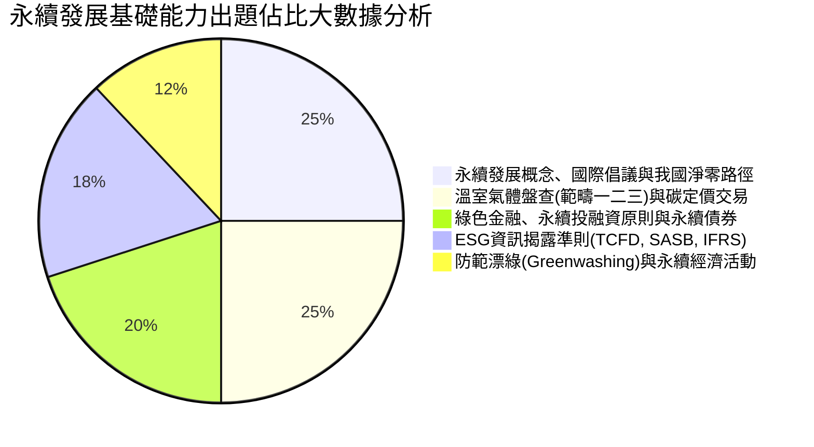

# 永續發展基礎能力：全景導讀與淨零碳排架構

---

## 🎯 考科核心架構與出題權重

「永續發展基礎能力測驗」為金管會推動「綠色金融行動方案 3.0」所設立之跨金融業共通核心專業證照。全卷共 80 題單選題，滿分 100 分（每題 1.25 分），70 分及格，全部單選、不倒扣。

依據最新歷屆試題分析，五大命題支柱權重如下：

---

## 💡 本教材特色

- 全球與台灣政策完美對接：精確剖析 2050 淨零轉型四大策略（能源、產業、生活、社會轉型）與二大基礎（科技研發、氣候法制）。
- 範疇一二三（Scope 1, 2, 3）白話情境化：徹底破除溫室氣體盤查 ISO 14064-1 艱澀代碼。
- 碳權、碳稅、碳費觀念穿透：剖析台灣氣候變遷因應法「碳費先於碳稅」之立法精神與碳交易所有限公司之運作。
