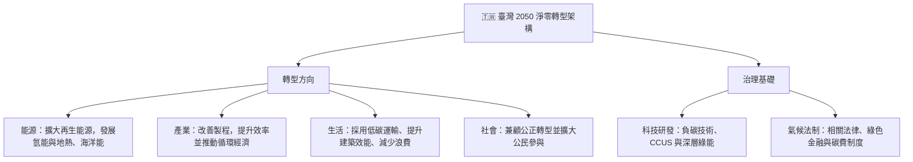

# 第 01 章：ESG 核心概念與國內外永續規範發展

---

評估企業永續議題時，可分別檢視環境（Environment）、社會（Social）與公司治理（Governance）面向。本章會帶你掌握聯合國 17 項永續發展目標、國際氣候協議，以及我國 2050 淨零政策與相關法制。

---

##  一、國際氣候公約演進里程碑

| 國際公約 / 倡議 | 簽訂年 | 核心里程碑與法定承諾 | 重點 |
| :--- | :--- | :--- | :--- |
| 京都議定書 (Kyoto Protocol) | 1997 | 建立第一套具法律拘束力的減量承諾，對象為已開發國家 | 允許透過 CDM、JI 與排放交易 ET 等市場機制達成承諾 |
| 巴黎協定 (Paris Agreement) | 2015 | 各國依本身情況訂出減量承諾，並定期提出更新版 NDC | 全球升溫須維持在遠低於 2°C 的範圍，並以 1.5°C 為努力方向。 |
| 格拉斯哥氣候協定 (COP26) | 2021 | COP26 首次把減少未設置減碳設備之燃煤發電寫入氣候決議 | 完成巴黎協定第 6 條下國際碳市場的執行細節 |

---

## 🇹🇼 二、我國 2050 淨零轉型核心戰略架構

國發會於 2022 年 3 月發布「臺灣 2050 淨零排放路徑及策略總說明」，內容以四種轉型方向和兩項治理基礎組成：

---

## 三、氣候治理與碳費制度

1. **淨零入法（第 4 條）**：《氣候變遷因應法》將 2050 年溫室氣體淨零列為法定長期目標。
2. **政策協調**：環境部主管氣候相關業務；行政院國家永續發展委員會負責協調跨部會政策。
3. **分期目標（第 10 條）**：中央主管機關會同相關部會，每五年訂定國家及部門的階段管制目標。
4. **碳費適用範圍**：對象須同時符合公告列管排放源、年排放量達 2.5 萬公噸 CO2e，以及屬電力、燃氣供應業或製造業等條件；計算包含直接排放與外購電力的間接排放。個別企業是否須繳費，仍應核對現行規定。
5. **自主減量計畫（第 29 條）**：事業提出減量計畫並經環境部核定後，得按適用條件申請優惠費率。

資料來源：[氣候變遷因應法](https://oaout.moenv.gov.tw/law/LawContent.aspx?id=GL005511)、[碳費收費辦法第 2、3 條](https://oaout.moenv.gov.tw/law/LawContent.aspx?id=GL007914)。

---

## 四、IFRS 永續揭露：2026 年 9 月調整重點

2026 年 9 月，金管會與環境部更新上市櫃公司接軌規劃。完整適用對象以實收資本額達 20 億元，或雖未達 20 億元但屬環境部列管對象的公司為主。其餘上市櫃公司仍須提供氣候治理、風險管理及範疇一、二等基本資訊。閱讀舊版資料時，勿直接沿用「全體上市櫃公司都分三階段強制適用」的說法。

第三階段的過渡安排包含：初期先著重氣候資訊，範疇三採自願揭露；部分階段免再為母公司個體的範疇一、二資訊取得確信。前兩年若永續專章無法與財報同時申報，可按股東會前 14 日的年報期限辦理。主管機關預計於 2030 年檢討；金融、保險及證券期貨業另依其業別規定處理。遇到考題時，應先確認年度與適用對象，再對照當期規定。

資料來源：[金管會與環境部 2026 年 9 月 23 日公告及修正路徑圖](https://esg.fsc.gov.tw/News/Detail/-%E6%8E%A5%E8%BB%8C%E5%9C%8B%E9%9A%9B-%E8%A1%8C%E7%A9%A9%E8%87%B4%E9%81%A0-%E7%92%B0%E5%A2%83%E9%83%A8-%E9%87%91%E7%AE%A1%E6%9C%83%E5%85%B1%E5%90%8C%E5%84%AA%E5%8C%96%E6%B0%B8%E7%BA%8C%E6%8F%AD%E9%9C%B2%E6%8E%A5%E8%BB%8C%E8%B7%AF%E5%BE%91-%E5%85%BC%E9%A1%A7%E8%B3%87%E8%A8%8A%E5%93%81%E8%B3%AA%E8%88%87%E7%94%A2%E6%A5%AD%E7%AB%B6%E7%88%AD%E5%8A%9B/)；[2026 年調整措施附件](https://esg.fsc.gov.tw/uploads/aba90162-57a2-42af-a015-c57b6d704855_%E9%99%84%E4%BB%B61-%E4%B8%8A%E5%B8%82%E6%AB%83%E5%85%AC%E5%8F%B8%E9%81%A9%E7%94%A8IFRS%E6%B0%B8%E7%BA%8C%E6%8F%AD%E9%9C%B2%E6%BA%96%E5%89%87%E8%AA%BF%E6%95%B4%E6%8E%AA%E6%96%BD.pdf)。

---

##  歷屆常見易錯觀念

> 易混淆 1：巴黎協定的升溫界線
> - 誤讀：把協定目標說成「升溫不得超過 2°C」。
> - 正確理解：目標是維持在遠低於 2°C，並努力控制在 1.5°C；這是共同努力的方向，不是保證全球升溫絕不越線。

資料來源：[UNFCCC《巴黎協定》第 2 條](https://unfccc.int/sites/default/files/resource/parisagreement_publication.pdf)。
>
> 易混淆 2：碳費由誰主管？
> - 誤讀：將碳費徵收工作歸給財政部賦稅署。
> - 正確理解：現行碳費制度由環境部主管；「費」與財政部主管的「稅」是不同制度。
