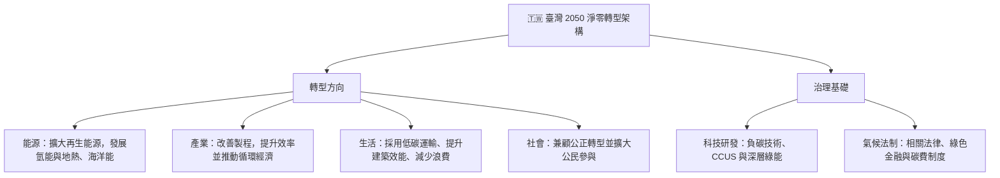

# 第 01 章：ESG 核心概念與國內外永續規範發展

---

評估企業永續議題時，可分別檢視環境（Environment）、社會（Social）與公司治理（Governance）面向。本章會帶你掌握聯合國 17 項永續發展目標、國際氣候協議，以及我國 2050 淨零政策與相關法制。

---

##  一、永續概念與國際氣候治理

**永續、ESG、CSR與SDGs先分清楚。**永續發展要滿足當代需要，同時保留後代滿足需要的能力，兼顧經濟、社會與環境。ESG是企業及投融資的評估框架；CSR是企業承擔社會責任的理念；SDGs則是全球發展目標。三者相關，但用途不同。利害關係人觀點要求同時考慮股東、員工、顧客、供應商、社區及環境，不能只看短期股東利益。

| 比較 | 判斷關鍵 | 教學例子 |
| --- | --- | --- |
| 減緩 Mitigation | 減少暖化來源與排放 | 節能設備、再生能源 |
| 調適 Adaptation | 降低氣候衝擊與損害 | 防洪設施、耐旱作物 |
| 淨零 Net Zero | 深度減排後，平衡剩餘人為溫室氣體排放與移除 | 不能只靠購買碳權取代實質減量 |
| 碳中和 Carbon Neutrality | 在指定邊界與標準下平衡碳排放 | 仍須確認範圍、減量與抵換規則 |

**全球目標的演進。**1987年《我們共同的未來》提出經典永續發展定義；2000年MDGs著重貧窮、教育、健康等議題，目標年為2015。2015年9月25日通過2030永續發展議程：SDGs有17項目標、169項細項，面向所有國家，強調全球性、整合性與轉型性。企業使用SDG Compass的順序是：了解 → 排定優先順序 → 設定目標 → 整合營運 → 報告與溝通。

**循環經濟不只回收。**線性模式是開採、製造、使用、丟棄；循環模式則優先保留材料與產品價值。

| 模式 | 教學例子 |
| --- | --- |
| 循環供應 | 使用再生或可再生原料 |
| 資源回收 | 廢材料回收再製 |
| 延長產品生命 | 維修、翻新及二手使用 |
| 共享平台 | 多人共用單車或閒置設備 |
| 產品即服務 | 依使用量付費取得功能，搭配產品維護與回收安排 |

再生能源應按能源來源與適用認定判斷，例如太陽、風力、地熱、生質及海洋能；不能只見「氫」便認定一定來自再生能源。裝置容量GW與發電占比%也不能混用。

**國際治理先辨角色。**UNEP與WMO共同於1988年成立IPCC，提供氣候科學評估；UNFCCC為全球氣候公約，COP為締約方大會，負責協商與行動安排。IPCC不直接替各國立法或分配相同配額。

**協定比較。**京都議定書於1997年通過、2005年生效，側重特定已開發國家的量化義務；巴黎協定於2015年通過、2016年生效，各國提出NDC（國家自主貢獻）。NDC原則上每五年提出新一輪，全球盤點GST也採五年週期；計畫提出不等於一定達成該減量數字。巴黎協定是條約，不能把「個別減量結果的約束方式不同」簡化成整部協定沒有法律拘束力。

**重要節點與名詞。**COP26關注1.5°C與未減排煤電逐步減少；phase down是逐步減少，phase out是逐步淘汰。COP27涉及損失與損害基金安排，COP28完成首次全球盤點並提出2030年再生能源裝置容量增為三倍的方向。全球甲烷承諾的2030年較2020年減少至少30%是參與國倡議，不能推論所有締約方都加入。

GCF是支援開發中國家減緩與調適的綠色氣候基金；GFANZ是金融機構淨零合作聯盟；損失與損害基金則處理脆弱國家面臨的氣候損失與損害，三者不能互換。

**公約速查**

| 國際公約 / 倡議 | 簽訂年 | 核心里程碑與法定承諾 | 重點 |
| :--- | :--- | :--- | :--- |
| 京都議定書 (Kyoto Protocol) | 1997 | 建立第一套具法律拘束力的減量承諾，對象為已開發國家 | 允許透過 CDM、JI 與排放交易 ET 等市場機制達成承諾 |
| 巴黎協定 (Paris Agreement) | 2015 | 各國依本身情況訂出減量承諾，並定期提出更新版 NDC | 全球升溫須維持在遠低於 2°C 的範圍，並以 1.5°C 為努力方向。 |
| 格拉斯哥氣候協定 (COP26) | 2021 | COP26 首次把減少未設置減碳設備之燃煤發電寫入氣候決議 | 完成巴黎協定第 6 條下國際碳市場的執行細節 |

---

## 🇹🇼 二、我國 2050 淨零轉型核心戰略架構

國發會於 2022 年 3 月發布「臺灣 2050 淨零排放路徑及策略總說明」，內容以四種轉型方向和兩項治理基礎組成：

---

**十二項關鍵戰略。**風電／光電、氫能、前瞻能源、電力系統與儲能、節能、CCUS、運具電動化及無碳化、資源循環零廢棄、自然碳匯、淨零綠生活、綠色金融、公正轉型。它們是落實轉型的工具，不要與四項轉型或兩項治理基礎混成同一分類。

**政策目標與成果分開讀。**教材中的2025年再生能源占比20%、太陽光電20GW、離岸風電5.6GW，以及2030年綠色投融資逾5兆元，都屬來源版本的政策目標，不能直接表述為實際達成。

## 三、氣候治理與碳費制度

1. **淨零入法（第 4 條）**：《氣候變遷因應法》將 2050 年溫室氣體淨零列為法定長期目標。
2. **政策協調**：環境部主管氣候相關業務；行政院國家永續發展委員會負責協調跨部會政策。
3. **分期目標（第 10 條）**：中央主管機關會同相關部會，每五年訂定國家及部門的階段管制目標。
4. **碳費適用範圍**：對象須同時符合公告列管排放源、年排放量達 2.5 萬公噸 CO2e，以及屬電力、燃氣供應業或製造業等條件；計算包含直接排放與外購電力的間接排放。個別企業是否須繳費，仍應核對現行規定。
5. **自主減量計畫（第 29 條）**：事業提出減量計畫並經環境部核定後，得按適用條件申請優惠費率。

資料來源：[氣候變遷因應法](https://oaout.moenv.gov.tw/law/LawContent.aspx?id=GL005511)、[碳費收費辦法第 2、3 條](https://oaout.moenv.gov.tw/law/LawContent.aspx?id=GL007914)。

---

## 四、IFRS 永續揭露：2026 年 9 月調整重點

IFRS 永續揭露的公司分級、適用年度及過渡例外，集中於第 04 章。這裡先掌握國際準則如何轉為國內企業的揭露義務；作答時須分清政策方案與已生效規定。

---

##  歷屆常見易錯觀念

> 易混淆 1：巴黎協定的升溫界線
> - 誤讀：把協定目標說成「升溫不得超過 2°C」。
> - 正確理解：目標是維持在遠低於 2°C，並努力控制在 1.5°C；這是共同努力的方向，不是保證全球升溫絕不越線。

資料來源：[UNFCCC《巴黎協定》第 2 條](https://unfccc.int/sites/default/files/resource/parisagreement_publication.pdf)。
>
> 易混淆 2：碳費由誰主管？
> - 誤讀：將碳費徵收工作歸給財政部賦稅署。
> - 正確理解：現行碳費制度由環境部主管；「費」與財政部主管的「稅」是不同制度。
