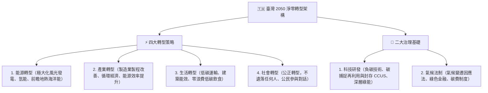

# 第 01 章：ESG 核心概念與國內外永續規範發展

---

## 🎯 本章學習導航與核心地圖

ESG（環境 Environment、社會 Social、公司治理 Governance）已從企業道德責任躍升為資本市場投資定價之法定核心指標。本章命題三大熱點：
1. 聯合國永續發展目標（SDGs 17 項領域）
2. 國際氣候公約與巴黎協定（1.5°C 防線目標）
3. 我國「2050 淨零排放路徑」與《氣候變遷因應法》法制架構

---

## 🌍 一、國際氣候公約演進里程碑

| 國際公約 / 倡議 | 簽訂年 | 核心里程碑與法定承諾 | 歷屆必考亮點 |
| :--- | :--- | :--- | :--- |
| 京都議定書 (Kyoto Protocol) | 1997 | 首次對已開發國家設定具法律約束力之溫室氣體減量目標 | 引入三大市場機制（清潔發展機制 CDM、共同減量 JI、排放交易 ET） |
| 巴黎協定 (Paris Agreement) | 2015 | 取代京都議定書，所有締約國（不論開發中或已開發）皆需提出自主貢獻(NDC) | 核心控溫目標：致力將全球平均升溫控制在工業化前水準之 1.5°C 以內，最差不超過 2°C！ |
| 格拉斯哥氣候協定 (COP26) | 2021 | 首次在氣候決議文中明確納入「逐步減少未裝設減碳設備的燃煤發電 (Phase down coal)」 | 完成巴黎協定第 6 條國際碳市場實施細則 |

---

## 🇹🇼 二、我國 2050 淨零轉型核心戰略架構

我國國發會於 2022 年 3 月正式公布「臺灣 2050 淨零排放路徑及策略總說明」：

---

1. 淨零目標法制化（第 4 條）：將我國「2050 年溫室氣體淨零排放」之長期目標明文寫入法律，具強制性法定拘束力！
2. 主管機關：升格為「環境部」；並由行政院國家永續發展委員會（永續會）統籌協調跨部會重大氣候政策。
3. 階段管制目標（第 10 條）：中央主管機關應會商中央目的事業主管機關，以每 5 年為一期，訂定國家與各部門之階段管制目標。
4. 碳費（Carbon Fee）機制（第 28 條）：
   - 採「碳費先於碳稅」原則，由環境部對直接與間接排放溫室氣體達指定門檻（年排放量達 2.5 萬公噸以上）之排碳大戶徵收碳費；
   - 碳費收入納入「溫室氣體管理基金」，專款專用於輔導減量技術研發、執行公正轉型與獎勵自主減量。
5. 自主減量計畫與優惠費率（第 29 條）：企業若主動提出符合國內外減量標準之自主減量計畫，得向環境部申請核定適用「優惠費率」。

---

## 📅 四、金管會「上市櫃公司永續發展路徑圖」法定盤查期程

為落實我國淨零策略，金管會發布強制盤查時程表，所有上市櫃公司必須依資本額級距分階段完成溫室氣體盤查與第三方獨立確信：

| 實施階段與資本額級距 | 個體公司盤查完成 | 個體公司確信完成 | 合併報表子公司盤查 | 合併報表子公司確信 |
| :--- | :--- | :--- | :--- | :--- |
| 第一階段：資本額 100 億元以上及鋼鐵、水泥業 | 2023 年（112年） | 2024 年（113年） | 2025 年（114年） | 2027 年（116年） |
| 第二階段：資本額 50 億元以上未滿 100 億元 | 2025 年（114年） | 2027 年（116年） | 2026 年（115年） | 2028 年（117年） |
| 第三階段：資本額未滿 50 億元之全體上市櫃 | 2026 年（115年） | 2028 年（117年） | 2027 年（116年） | 2029 年（118年全體完成） |

---

## 🔥 歷屆必考陷阱手冊

> ❌ 陷阱 1：巴黎協定控溫目標數字
> - 錯誤題目：「巴黎協定的長期目標是將全球地表升溫控制在 3.5°C 以內。」
> - 👉 正解：錯！巴黎協定追求的是努力限制在 1.5°C 以內，絕對不能超過 2°C！
>
> ❌ 陷阱 2：我國氣候法規主管機關
> - 錯誤題目：「《氣候變遷因應法》主管徵收碳費之中央目的事業主管機關是財政部賦稅署。」
> - 👉 正解：錯！碳費的主管機關是環境部！財政部主管的是「稅」，而我國目前實施的是由環境部主管之「碳費（Carbon Fee）」！
