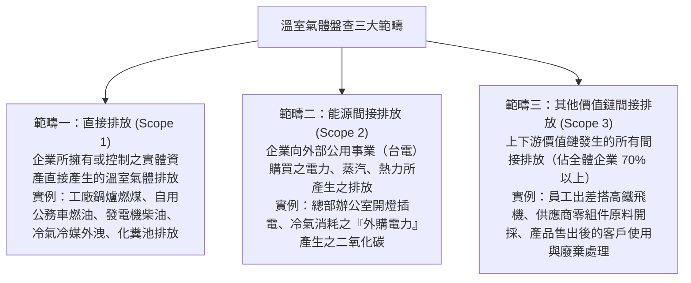

# 第 02 章：溫室氣體盤查(GHG)與碳定價機制

---

## 先建立本章的理解脈絡

溫室氣體盤查先界定組織邊界，再找出排放來源、計算排放量並留下可查證的資料。範疇一、二、三代表不同來源，不是嚴重程度排序；碳費、碳權和碳交易也各有制度目的，必須依題目情境區分。

##  本章學習導航與核心地圖

沒有盤查就沒有減碳！溫室氣體盤查與碳定價機制是企業落實 ESG 與因應歐盟碳關稅之第一線戰場。本章在歷屆中題數佔比高達 25%，出題核心鎖定：
1. 溫室氣體盤查三大範疇（Scope 1、Scope 2、Scope 3）與 ISO 14064-1:2018 六大類別對應
2. 法定列管之七種主要溫室氣體與溫暖化潛勢 (GWP)
3. 台灣環境部《溫室氣體排放量盤查登錄及查驗管理辦法》法定門檻與期程
4. 碳定價（Carbon Pricing）四大工具與臺灣碳權交易所 (TCX)
5. 歐盟碳邊境調整機制（CBAM）涵蓋產業、轉型期申報與憑證扣抵規定

---

##  一、溫室氣體盤查三大範疇與 ISO 14064-1:2018 六大類別

### (一) GHG Protocol 三大範疇（生活實務情境對照）

依國際 GHG Protocol 標準，企業排放劃分為三大範疇：

>  考古題判讀提示判斷：
> 1. 「公司公務車加油行駛產生的尾氣排放」屬於哪一範疇？  範疇一（直接排放）！
> 2. 「分行行員上班開電腦照明所消耗的台電外購度數」屬於哪一範疇？  範疇二（能源間接排放）！
> 3. 「理專搭乘台灣高鐵前往高雄拜訪客戶出差」屬於哪一範疇？  範疇三（價值鏈間接排放之員工商務旅行）！
> 4. 「半導體代工廠外購氮氣原料」屬於哪一範疇？  範疇三（購買商品與服務）！

### (二) ISO 14064-1:2018 六大排放類別對照

ISO 組織於 2018 年版將原三大範疇細化為六大分類（Category 1~6），考生須掌握其對應關係：
1. 類別 1（直接溫室氣體排放與移除）：對應 Scope 1。
2. 類別 2（輸入能源產生的間接排放）：對應 Scope 2（輸入電力、熱力、蒸汽等）。
3. 類別 3（運輸產生的間接排放）：對應 Scope 3（上游原料運送、員工差旅通勤、下游產品配送）。
4. 類別 4（組織使用之產品產生的間接排放）：對應 Scope 3（購買商品、資本財、處置固體液體廢棄物）。
5. 類別 5（與組織產品使用相關的間接排放）：對應 Scope 3（產品使用階段排放、產品報廢末端處置）。
6. 類別 6（其他來源的間接排放）：對應 Scope 3。

### (三) ISO 14067 產品碳足跡 (Carbon Footprint of Products, CFP)
- 定義：衡量某特定單一產品或服務在整個生命週期（Life Cycle Assessment, LCA）所產生的溫室氣體排放總量，換算為二氧化碳當量 ($CO_2e$)。
- 評估範疇邊界：
  - 搖籃到大門 (Cradle-to-Gate)：由原料開採至產品出廠為止（多用於 B2B 中間半成品）。
  - 搖籃到墳墓 (Cradle-to-Grave)：由原料開採、製造、運輸、消費者使用到最終廢棄掩埋/回收為止（多用於 B2C 終端消費品）。
- 功能單位 (Functional Unit)：作為衡量基準的標準量（例如：1 本書、1 瓶 600ml 瓶裝水、1 台筆電）。

---

##  二、七種主要列管溫室氣體（GHGs）

根據《京都議定書》與台灣《氣候變遷因應法》，列管之主要溫室氣體共七種：

| 氣體名稱 | 化學符號 | 主要來源 | 全球暖化潛勢 (GWP, 以 100 年為基準) |
| :--- | :--- | :--- | :--- |
| 二氧化碳 | $CO_2$ | 化石燃料燃燒、水泥石灰石分解 | 1（法定基準氣體） |
| 甲烷 | $CH_4$ | 天然氣逸散、垃圾掩埋場、反芻牲畜腸道發酵、水稻田 | 約 28 倍（依 IPCC 第五次評估報告 AR5） |
| 氧化亞氮 | $N_2O$ | 農業氮肥施用、石化工業製程、廢水處理 | 約 265 倍 |
| 氫氟碳化物 | $HFCs$ | 冷凍空調冷媒、發泡劑、滅火器 | 數百至數千倍不等 |
| 全氟碳化物 | $PFCs$ | 半導體晶圓蝕刻與化學氣相沉積、鋁冶煉 | 數千至近萬倍 |
| 六氟化硫 | $SF_6$ | 高壓輸配電設備（氣體絕緣開關 GIS） | 23,500 倍（GWP 最高常見工業氣體） |
| 三氟化氮 | $NF_3$ | 液晶顯示面板(TFT-LCD)與薄膜太陽能電池製程清洗劑 | 16,100 倍（2012杜哈修正案增列第七種） |

---

##  三、台灣環境部《溫室氣體排放量盤查登錄及查驗管理辦法》法定規範

1. 法定強制列管門檻：
   - 第一批公告排放源：發電業、鋼鐵業、石油煉製業、水泥業、半導體業、薄膜電晶體液晶顯示器業等製程大戶。
   - 第二批公告排放源：非屬第一批，且其全廠直接排放加能源間接排放合併計算年排放量達 2.5 萬公噸 $CO_2e$ 以上之事業（碳排大戶）。
2. 法定期程：
   - 盤查登錄：應於每年 4 月 30 日前，將上一年度之全廠溫室氣體排放量清冊上傳至環境部指定資訊平臺完成登錄。
   - 第三者查驗：應於每年 10 月 31 日前，上傳取得許可查驗機構之查驗總結報告書及查證聲明書。

---

##  四、碳定價工具與臺灣碳權交易所 (TCX)

### (一) 四大碳定價工具比較

| 碳定價工具 | 運作機制 | 價格決定方式 | 優缺點與實施地 |
| :--- | :--- | :--- | :--- |
| 碳稅 (Carbon Tax) | 財政部稅捐稽徵機關對每噸碳排徵稅，納入國庫統收統支 | 價格由政府法定固定，但整體減排量無法預測 | 瑞典、新加坡；稅率固定好預期，但無法保證減排達標 |
| 碳費 (Carbon Fee) | 環保主管機關（環境部）徵收，專款專用於溫室氣體管理基金 | 費率由主管機關費率審議會核定，設有優惠費率 | 台灣《氣候變遷因應法》首創，專款用於輔導產業減碳 |
| 總量管制與排放交易 (ETS) | 政府設定排放總額上限，核發配額，業者在市場互相買賣 | 價格由市場供需自由競價搓合，減排總量百分之百確定鎖死 | 歐盟 EU ETS、加州、中國；減碳目標明確，但市場價格易波動 |
| 內部碳定價 (ICP) | 企業內部虛擬設定每噸碳排價格，納入資本支出 (CapEx) 投資評估 | 企業董事會或永續委員會自主決定（如每噸 50~100 美元） | 影子價格 (Shadow Price)、內部碳費 (Internal Carbon Fee)；台積電、微軟廣泛使用 |

### (二) 臺灣碳權交易所 (TCX) 核心業務
1. 設立背景：2023 年由證交所與國發基金共同出資成立，總部位於高雄（資訊中心設於台北）。
2. 三大營運業務板塊：
   - 國內碳權交易：依《氣候變遷因應法》辦理自願減量專案額度交易（採定價交易、拍賣或協議交易）。
   - 國外碳權交易：引進國際高品質金標標準（Gold Standard, GS）等自願減量碳權額度，供國內企業作供應鏈抵扣或碳中和宣稱使用（註：國外自願性碳權目前不得抵扣台灣境內法定碳費）。
   - 碳諮詢與教育推廣：提供國際標準查驗與人才培育課程。

---

## 🇪🇺 五、歐盟碳邊境調整機制（CBAM）

1. 核心宗旨：防範「碳洩漏（Carbon Leakage）」，防止歐盟境內高排碳產業為規避 EU ETS 成本將產線外移至環保管制寬鬆之境外國家，維持市場公平競爭。
2. 首波涵蓋六大產業（考科必背）：
   - 水泥 (Cement)
   - 鋼鐵 (Iron and Steel)
   - 鋁 (Aluminium)
   - 化肥 (Fertilisers)
   - 電力 (Electricity)
   - 氫氣 (Hydrogen)
3. 兩階段實施期程：
   - 轉型期（過渡期：2023年10月1日～2025年12月31日）：進口商僅須按季申報進口產品之直接與間接碳排放量，免繳納任何碳關稅或購買 CBAM 憑證。
   - 正式實施期（2026年1月1日起）：進口商必須向歐盟官方註冊申報，並依內含碳排放量購買並繳交等額之 CBAM 憑證 (CBAM Certificates)。
4. 碳價扣抵機制：若該產品在生產國已依法實際繳納當地碳定價（例如台灣繳納之碳費），在提出經查驗之證明文件後，可依比例全額扣抵應繳交之 CBAM 憑證數量，避免重複課稅。

---

##  歷屆常見易錯觀念

>  陷阱 1：外購電力屬於範疇一？
> - 錯誤題目：「台灣某半導體晶圓廠每年消耗數十億度外購台電電力，屬於範疇一直接排放。」
> -  正解：錯！外購電力、熱力或蒸汽屬於範疇二（能源間接排放）！只有自己廠區內燃燒煤炭、柴油、瓦斯才是範疇一！
>
>  陷阱 2：歐盟 CBAM 轉型期需要繳交碳關稅嗎？
> - 錯誤題目：「歐盟自 2023 年 10 月起已開始對進口至歐盟之鋼鐵及鋁產品正式課徵 CBAM 碳關稅憑證費用。」
> -  正解：錯！2023/10/1 至 2025/12/31 為「過渡轉型期」，只申報碳排放資料、不收費！正式購憑繳費是 2026 年 1 月 1 日才起跑！
>
>  陷阱 3：國外自願減量碳權可以直接抵扣台灣法定碳費？
> - 錯誤題目：「台灣鋼鐵廠購買臺灣碳權交易所上架之國際自願性黃金標準碳權，依法可直接百分之百抵繳台灣環境部應繳碳費。」
> -  正解：錯！環境部規定碳費抵扣目前以國內自願減量專案額度為主，國外碳權不得直接無限制抵繳我國境內法定碳費！
>
>  陷阱 4：歐盟 CBAM 首波涵蓋產業包含塑膠與紡織品？
> - 錯誤題目：「歐盟 CBAM 第一階段管制對象涵蓋成衣紡織品、鞋類與包裝食品及塑膠製品。」
> -  正解：錯！首波僅鎖定鋼鐵、鋁、水泥、肥料、電力、氫氣六大高碳原物料！有機化學品與塑膠在最後談判階段被暫時排除，未來將視檢討評估是否納入。
