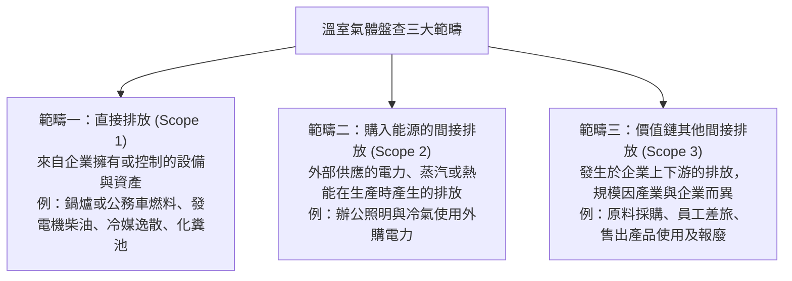

# 第 02 章：溫室氣體盤查(GHG)與碳定價機制

---

本章整理企業盤查排放、適用的管理規則，以及碳成本如何形成。內容涵蓋：
1. GHG Protocol 三大範疇與 ISO 14064-1:2018 六類排放的對照
2. 七種列管溫室氣體及其全球暖化潛勢 (GWP)
3. 台灣盤查、登錄與查驗的對象及申報期限
4. 碳定價方式與臺灣碳權交易所 (TCX) 的業務
5. 歐盟碳邊境調整機制（CBAM）的適用產業與時程

---

##  一、溫室氣體盤查三大範疇與 ISO 14064-1:2018 六大類別

### (一) GHG Protocol 三大範疇（生活實務情境對照）

GHG Protocol 依排放來源與企業價值鏈位置，將排放分成三組：

| 判斷線索 | 範疇 |
| :--- | :--- |
| 公司車燃油、鍋爐燃料、冷媒逸散 | 1：公司控制來源的直接排放 |
| 外購電力、蒸汽或熱能 | 2：購入能源帶來的間接排放 |
| 差旅、供應商原料、外購製程氣體 | 3：價值鏈中的其他間接排放 |

### (二) ISO 14064-1:2018 六大排放類別對照

ISO 14064-1:2018 把組織排放再分為六類。與 GHG Protocol 的對照如下：
1. **類別 1**：組織自身的排放與移除，對應範疇一。
2. **類別 2**：購入電力、熱力等能源造成的排放，對應範疇二。
3. **類別 3**：運輸活動的排放，例如貨運、通勤與商務旅行，屬範疇三。
4. **類別 4**：組織採購或處理的產品所帶來的排放，例如商品、資本財與廢棄物，屬範疇三。
5. **類別 5**：組織產品在使用及生命終結階段產生的排放，屬範疇三。
6. **類別 6**：不在前五類中的其他間接排放，歸入範疇三。

### (三) ISO 14067 產品碳足跡 (Carbon Footprint of Products, CFP)
- 定義：產品碳足跡把特定產品或服務在生命週期內的溫室氣體排放加總，並以二氧化碳當量 ($CO_2e$) 表示。
- 評估範疇邊界：
  - 搖籃到大門 (Cradle-to-Gate)：計算範圍從原料取得到產品離開工廠，常用於 B2B 中間品。
  - 搖籃到墳墓 (Cradle-to-Grave)：從原料、製造與運輸，延伸至使用和最終處理，常用於 B2C 消費品。
- 功能單位 (Functional Unit)：比較碳足跡時採用的共同計量基準，例如一本書、一瓶 600 ml 飲料或一台筆電。

---

##  二、七種主要列管溫室氣體（GHGs）

根據《京都議定書》與台灣《氣候變遷因應法》，列管之主要溫室氣體共七種：

| 氣體名稱 | 化學符號 | 主要來源 | 全球暖化潛勢 (GWP, 以 100 年為基準) |
| :--- | :--- | :--- | :--- |
| 二氧化碳 | $CO_2$ | 煤、油、天然氣燃燒及水泥製程 | 1，作為比較基準 |
| 甲烷 | $CH_4$ | 天然氣洩漏、掩埋場、反芻動物及稻田 | 約 28 倍（IPCC AR5） |
| 氧化亞氮 | $N_2O$ | 施用氮肥、石化製程與污水處理 | 約 265 倍 |
| 氫氟碳化物 | $HFCs$ | 冷媒、泡棉發泡與部分滅火設備 | 依化合物而異，數百至數千倍 |
| 全氟碳化物 | $PFCs$ | 半導體製程與鋁冶煉 | 數千倍至近萬倍 |
| 六氟化硫 | $SF_6$ | 高壓電力設備的絕緣介質 | 約 23,500 倍，常見工業氣體中偏高 |
| 三氟化氮 | $NF_3$ | 面板及薄膜太陽能製程的清潔作業 | 約 16,100 倍；2012 年增列為第七種 |

---

##  三、台灣環境部《溫室氣體排放量盤查登錄及查驗管理辦法》法定規範

1. **列管方式**：第一批包括發電、鋼鐵、石油煉製、水泥、半導體及薄膜電晶體液晶顯示器等產業；其他不屬第一批的事業，如全年直接排放加外購電力間接排放達 2.5 萬公噸 $CO_2e$，列入第二批管理。
2. **申報節點**：每年 4 月 30 日前登錄上一年度排放清冊；列管對象另須在 10 月 31 日前提交許可查驗機構出具的總結報告與查證聲明。

---

##  四、碳定價工具與臺灣碳權交易所 (TCX)

### (一) 四大碳定價工具比較

| 碳定價工具 | 運作機制 | 價格決定方式 | 優缺點與實施地 |
| :--- | :--- | :--- | :--- |
| 碳稅 (Carbon Tax) | 依排放量計算稅額並納入國庫 | 法定稅率先確定；實際減量結果則不預先固定 | 瑞典、新加坡採用；費率可預期，但減量幅度不保證 |
| 碳費 (Carbon Fee) | 環境部向符合條件的列管排放源收取，款項用於溫室氣體管理基金 | 費率由主管機關審議，並有不同適用費率 | 台灣依《氣候變遷因應法》實施，基金用於減碳相關用途 |
| 總量管制與排放交易 (ETS) | 設定排放總額並發放配額，事業可於市場交易配額 | 總量上限明確，交易價格隨市場供需變動 | 歐盟 EU ETS、加州與中國等地使用；價格可能波動 |
| 內部碳定價 (ICP) | 企業自行設定內部碳價，作為投資或資本支出評估參考 | 由企業依管理需求決定，例如每噸 50–100 美元 | 可採影子價格 (Shadow Price) 或內部碳費 (Internal Carbon Fee) |

### (二) 臺灣碳權交易所 (TCX) 核心業務
1. **設立**：2023 年由證交所與國發基金共同出資，總部設於高雄，資訊中心位於台北。
2. **主要工作**：
   - 國內碳權：辦理自願減量額度交易，可採定價、拍賣或協議方式。
   - 國際碳權：引進 Gold Standard (GS) 等國際額度，供企業因應供應鏈需求或作自願性宣稱；現行規定下，國外自願額度不能直接抵繳台灣法定碳費。
   - 專業服務：推廣碳管理知識、國際標準查驗與相關人才培訓。

---

## 🇪🇺 五、歐盟碳邊境調整機制（CBAM）

1. **政策目的**：降低「碳洩漏（Carbon Leakage）」；避免企業因 EU ETS 碳成本而把高排放生產移往管制較寬鬆地區，維持競爭條件一致。
2. **目前列入的六類產品**：
   - 水泥 (Cement)
   - 鋼鐵 (Iron and Steel)
   - 鋁 (Aluminium)
   - 化肥 (Fertilisers)
   - 電力 (Electricity)
   - 氫氣 (Hydrogen)
3. **時程**：2023 年 10 月至 2025 年底的過渡期以按季申報排放為主，無須購買憑證。正式制度於 2026 年開始；進口商自 2027 年 2 月起可購買憑證，並須在 2027 年 9 月 30 日前完成涵蓋 2026 年進口的首份年度申報及憑證繳交。
4. **已付碳價處理**：原產地已實際繳納且有證明的碳價，可依歐盟規則申請扣減，扣減金額按規定計算。

資料來源：[歐盟執委會 CBAM 正式制度](https://taxation-customs.ec.europa.eu/carbon-border-adjustment-mechanism/cbam-definitive-regime_en)、[CBAM 憑證價格及購買時間](https://taxation-customs.ec.europa.eu/carbon-border-adjustment-mechanism/price-cbam-certificates_en)、[首份年度申報期限](https://taxation-customs.ec.europa.eu/carbon-border-adjustment-mechanism/cbam-communication-and-news_en)。

---

##  歷屆常見易錯觀念

> 易混淆 1：範疇一與範疇二
> - 判斷時看能源在哪裡燃燒：公司自己燃燒燃料或冷媒逸散列範疇一；外購電力、熱力或蒸汽列範疇二。
>
> 易混淆 2：CBAM 轉型期何時開始繳費？
> - 轉型期（2023/10/1–2025/12/31）要求申報排放，正式制度於 2026/1/1 啟動；憑證購買安排自 2027 年 2 月開始。
>
> 易混淆 3：國際自願碳權與台灣碳費
> - 國際自願額度可有自願性用途，但不能因此推定可直接抵繳台灣法定碳費；須依國內規定核對可扣抵的額度種類。
>
> 易混淆 4：不要把其他製品當成首波品項
> - 首波名單是水泥、鋼鐵、鋁、化肥、電力與氫；紡織、塑膠等不在這份六類清單內。
