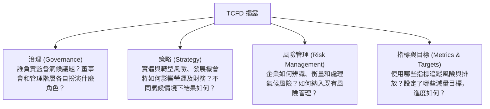

# 第 04 章：企業永續資訊揭露(IFRS 永續準則)與反漂綠

---

本章整理氣候資訊如何影響財務判斷、IFRS 永續準則的揭露內容，以及企業宣稱永續時應提出的依據。

---

##  一、TCFD 氣候財務揭露四大核心支柱

TCFD 建議企業說明氣候風險與機會如何進入決策、影響營運及財務。閱讀揭露時，可用以下四個問題檢視：

---

##  二、IFRS 永續準則與金管會接軌藍圖

### (一) ISSB IFRS S1 與 S2 核心架構
ISSB 於 2023 年 6 月發布 IFRS S1 與 S2。兩者都著眼於可能影響企業前景的永續資訊，涵蓋範圍不同：
1. **IFRS S1** 建立一般揭露原則，聚焦合理預期會影響企業現金流、融資取得或資金成本的永續風險與機會。
2. **IFRS S2** 聚焦氣候議題，包含海平面上升、極端天氣等實體風險，以及碳成本、法規變動與技術轉換等轉型風險；也規範範疇一、二、三排放資料的揭露。

### (二) 接軌安排：2026 年 9 月公告調整

2026 年 9 月公布的調整方案，將適用範圍集中在較大型公司及環境部列管對象；其他上市櫃公司仍須提供基本氣候資訊。下表列出原接軌階段及本次調整後的對象判讀方式：

| 適用對象 | 現行安排重點 |
| :--- | :--- |
| 第一階段 | 實收資本額 100 億元以上；自 2026 會計年度起適用。 |
| 第二階段 | 實收資本額 50 億元以上、未達 100 億元；自 2027 會計年度起適用。 |
| 第三階段 | 實收資本額 20 億元以上、未達 50 億元，以及未達 20 億元但屬環境部公告應盤查登錄及查驗對象；原時程為自 2028 會計年度起適用。 |
| 資本額未達 20 億元且非環境部納管 | 暫不強制完整適用 IFRS 永續準則，但仍須揭露氣候治理、風險管理、範疇一與範疇二等基本資訊。 |

第三階段採取分年銜接：初期優先準備氣候資訊，範疇三暫採自願揭露；第二、三階段在特定條件下免為母公司個體範疇一、二取得確信。若接軌前兩年無法同步申報永續專章，可依年報申報期限（股東會前 14 日）辦理。金管會規劃於 2030 年檢視安排；金融、保險及證券期貨業另依各自方案處理。考題涉及時程時，先確認公司類別及規則生效情況。

資料來源：[金管會與環境部 2026 年 9 月 23 日公告及修正路徑圖](https://esg.fsc.gov.tw/News/Detail/-%E6%8E%A5%E8%BB%8C%E5%9C%8B%E9%9A%9B-%E8%A1%8C%E7%A9%A9%E8%87%B4%E9%81%A0-%E7%92%B0%E5%A2%83%E9%83%A8-%E9%87%91%E7%AE%A1%E6%9C%83%E5%85%B1%E5%90%8C%E5%84%AA%E5%8C%96%E6%B0%B8%E7%BA%8C%E6%8F%AD%E9%9C%B2%E6%8E%A5%E8%BB%8C%E8%B7%AF%E5%BE%91-%E5%85%BC%E9%A1%A7%E8%B3%87%E8%A8%8A%E5%93%81%E8%B3%AA%E8%88%87%E7%94%A2%E6%A5%AD%E7%AB%B6%E7%88%AD%E5%8A%9B/)；[2026 年調整措施附件](https://esg.fsc.gov.tw/uploads/aba90162-57a2-42af-a015-c57b6d704855_%E9%99%84%E4%BB%B61-%E4%B8%8A%E5%B8%82%E6%AB%83%E5%85%AC%E5%8F%B8%E9%81%A9%E7%94%A8IFRS%E6%B0%B8%E7%BA%8C%E6%8F%AD%E9%9C%B2%E6%BA%96%E5%89%87%E8%AA%BF%E6%95%B4%E6%8E%AA%E6%96%BD.pdf)。

### (三) 過渡措施讀法

舊題可能沿用先前路徑及過渡期安排；作答時先辨別題目所屬年度與公司類別，再核對當期公告。2026 年 9 月調整方案的年報準則及相關函令仍待後續檢討修正，新聞稿所述方案與已生效法規應分開辨讀。

---

##  三、GRI vs. SASB 兩大準則核心差異

| 評估維度 | GRI Standards | SASB Standards |
| :--- | :--- | :--- |
| 主要讀者 | 員工、社區、消費者、主管機關等不同利害關係人 | 投資人及機構債權人 |
| 重要資訊 | 企業對經濟、環境與人的實際或可能影響；歐盟 ESRS 另結合衝擊與財務兩種重大性。 | 會影響企業價值或投資決策的產業永續議題。 |
| 編製方式 | 通用準則搭配主題準則 | 依 77 個產業設計對應指標 |

---

##  四、反漂綠（Anti-Greenwashing）法律防線與基金審查

> 「漂綠（Greenwashing）」是以不實、片面或容易令人誤解的環保說法，讓產品、服務或投資看起來比實際更永續。

### ESG 基金揭露與反漂綠：
1. ESG 主題投信基金審查原則：
   - 公開基金實際採用的 ESG 投資比重門檻及策略執行情形；個別契約中的 70% 標準不可直接視為所有 ESG 基金的共同法定要求。
   - 在公開說明書交代投資方法、排除條件、篩選依據及持續議合方式。
   - 於年報揭露最低比重實際達成情形及資產組合的減碳相關資訊。
2. 宣稱產品全面綠色，卻不交代高排放供應鏈等重要資訊，可能造成誤導。
3. 不實廣告與資訊揭露涉及的責任，須依行為、主體及適用法規分別判斷。

資料來源：[金管會 ESG 基金揭露事項](https://esg.fsc.gov.tw/SinglePage/Criterion/Product/)、[GRI 重大主題準則](https://www.globalreporting.org/publications/documents/english/gri-3-material-topics-2021/)、[GRI 關於雙重重大性說明](https://www.globalreporting.org/media/zauil2g3/public-faqs-universal-standards.pdf)。

---

##  歷屆常見易錯觀念

> 易混淆 1：TCFD 要回答哪些問題？
> - 依序確認監督責任、策略影響、風險處理方式，以及用來衡量成果的指標與目標。
>
> 易混淆 2：ESG 基金的最低投資比重
> - 不同基金可能採用不同比重，應查看該基金契約、公開說明書及主管機關要求。
>
> 易混淆 3：永續準則資訊的揭露位置
> - 適用公司須依規定在年報的永續資訊專章揭露；申報時點則看公司階段及過渡規則。
>
> 易混淆 4：範疇三揭露豁免
> - 不要假設所有公司首年都適用同一要求；依接軌階段與當期過渡規定確認範疇三的揭露義務。
