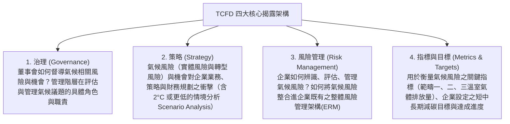

# 第 04 章：企業永續資訊揭露(IFRS 永續準則)與反漂綠

---

##  本章學習導航與核心地圖

投資人如何看穿企業到底是「真減碳」還是「表面作秀」？永續揭露標準的全球大整合已然成形。本章命題核心聚焦：
1. 氣候相關財務揭露（TCFD）四大核心架構支柱與情境分析
2. 國際永續準則理事會（ISSB）發布之 IFRS S1 與 IFRS S2 核心要件
3. 金管會「我國接軌 IFRS 永續揭露準則藍圖」三階段期程與「年報同步」法定義務
4. GRI 準則 vs. SASB 準則重大性思維差異
5. 防範漂綠（Anti-Greenwashing）與 ESG 基金揭露要求

---

##  一、TCFD 氣候財務揭露四大核心支柱

國際金融穩定委員會（FSB）成立之氣候相關財務揭露工作小組（TCFD），要求企業從「氣候變遷對企業財務損益之實質衝擊」角度出發，揭露四大維度：

---

##  二、IFRS 永續準則與金管會接軌藍圖

### (一) ISSB IFRS S1 與 S2 核心架構
由國際財務報導準則基金會（IFRS Foundation）下轄之 ISSB（國際永續準則理事會） 於 2023 年 6 月正式發布首套永續揭露準則：
1. IFRS S1（永續相關財務資訊揭露之一般規定）：
   - 建立全方位永續財務揭露之基礎通用架構，要求企業揭露所有可合理預期影響企業現金流量、籌資能力與資本成本之永續相關風險與機會。
2. IFRS S2（氣候相關揭露）：
   - 全面整合並吸收 TCFD 核心架構，專門規範氣候實體風險（海平面上升、極端颱風乾旱、淹水）與轉型風險（碳費碳關稅、低碳法規限制、新技術替代），要求強制揭露範疇一、範疇二及範疇三（價值鏈上下游排放）。

### (二) 接軌安排：2026 年 9 月公告調整

金管會與環境部於 2026 年 9 月宣布調整上市櫃公司接軌安排。新版方案將強制適用範圍聚焦於實收資本額 20 億元以上公司，以及未達 20 億元但屬環境部公告應盤查登錄及查驗對象；資本額未達 20 億元且非環境部納管的公司，仍須揭露氣候治理、風險管理及溫室氣體範疇一、二等基本資訊。原先教材所列「所有上市櫃公司分三階段全面強制」已不應直接當作現行範圍。

| 適用對象 | 現行安排重點 |
| :--- | :--- |
| 第一階段 | 實收資本額 100 億元以上；自 2026 會計年度起適用。 |
| 第二階段 | 實收資本額 50 億元以上、未達 100 億元；自 2027 會計年度起適用。 |
| 第三階段 | 實收資本額 20 億元以上、未達 50 億元，以及未達 20 億元但屬環境部公告應盤查登錄及查驗對象；原時程為自 2028 會計年度起適用。 |
| 資本額未達 20 億元且非環境部納管 | 暫不強制完整適用 IFRS 永續準則，但仍須揭露氣候治理、風險管理、範疇一與範疇二等基本資訊。 |

第三階段公司接軌初期前兩年以氣候資訊為主，範疇三排放改為自願揭露；第二、三階段公司免再就母公司個體範疇一、二資訊取得確信。接軌前兩年永續專章如未能與財務報告同步申報，得依年報時限（股東會前 14 日）申報。金管會預計 2030 年檢討安排；金融、保險及證券期貨業不適用這次對上市櫃公司的調整，應依各業別方案辦理。遇到時程或適用範圍題，應以當期最新公告及已生效規則為準。

資料來源：[金管會與環境部 2026 年 9 月 23 日公告及修正路徑圖](https://esg.fsc.gov.tw/News/Detail/-%E6%8E%A5%E8%BB%8C%E5%9C%8B%E9%9A%9B-%E8%A1%8C%E7%A9%A9%E8%87%B4%E9%81%A0-%E7%92%B0%E5%A2%83%E9%83%A8-%E9%87%91%E7%AE%A1%E6%9C%83%E5%85%B1%E5%90%8C%E5%84%AA%E5%8C%96%E6%B0%B8%E7%BA%8C%E6%8F%AD%E9%9C%B2%E6%8E%A5%E8%BB%8C%E8%B7%AF%E5%BE%91-%E5%85%BC%E9%A1%A7%E8%B3%87%E8%A8%8A%E5%93%81%E8%B3%AA%E8%88%87%E7%94%A2%E6%A5%AD%E7%AB%B6%E7%88%AD%E5%8A%9B/)；[2026 年調整措施附件](https://esg.fsc.gov.tw/uploads/aba90162-57a2-42af-a015-c57b6d704855_%E9%99%84%E4%BB%B61-%E4%B8%8A%E5%B8%82%E6%AB%83%E5%85%AC%E5%8F%B8%E9%81%A9%E7%94%A8IFRS%E6%B0%B8%E7%BA%8C%E6%8F%AD%E9%9C%B2%E6%BA%96%E5%89%87%E8%AA%BF%E6%95%B4%E6%8E%AA%E6%96%BD.pdf)。

### (三) 過渡措施讀法

舊題可能沿用先前路徑及過渡期安排；作答時先辨別題目所屬年度與公司類別，再核對當期公告。2026 年 9 月調整方案的年報準則及相關函令仍待後續檢討修正，新聞稿所述方案與已生效法規應分開辨讀。

---

##  三、GRI vs. SASB 兩大準則核心差異

| 評估維度 | 全球報告倡議組織 (GRI Standards) | 永續會計準則委員會 (SASB Standards) |
| :--- | :--- | :--- |
| 目標受眾 | 多元利害關係人（員工、社區、公民團體、消費者、主管機關） | 資本市場投資人與機構債權人 |
| 重大性原則 | 衝擊重大性：企業對經濟、環境與人的重大實際或潛在影響；雙重重大性是歐盟 ESRS 結合衝擊與財務兩個視角的要求。 | 投資人決策相關的財務重大資訊，聚焦產業別永續議題對企業價值的影響。 |
| 架構特性 | 共通性標準（Universal Standards）與主題準則 | 依 77 個細分產業別量身打造專屬量化指標（Industry-Specific） |

---

##  四、反漂綠（Anti-Greenwashing）法律防線與基金審查

>  什麼是「漂綠（Greenwashing）」？
> 企業透過誇大不實、具誤導性、選擇性揭露或虛偽陳述之環保宣傳，塑造其商品、服務或投資策略具備環境永續效益之假象，欺騙消費者與 ESG 基金投資人！

### ESG 基金揭露與反漂綠：
1. ESG 主題投信基金審查原則：
   - 基金須揭露符合 ESG 投資重點標的之**最低投資比重**及如何落實投資策略；不要把個別基金契約常見的 70% 寫成所有 ESG 基金共同法定門檻。
   - 必須於公開說明書詳實載明投資策略、排除政策（Negative Screening）、ESG 篩選標準與投後議合機制。
   - 基金年報須揭露實際達成率與資產組合減碳效益。
2. 不得避重就輕：宣稱「全產品綠色淨零」卻刻意隱匿佔比 80% 之範疇三高碳供應鏈，屬於誤導性陳述。
3. 不實揭露與廣告可能涉及不同法律責任；須依行為、主體與當期法規判斷，不宜把各法條刑責或罰鍰合併成固定答案。

資料來源：[金管會 ESG 基金揭露事項](https://esg.fsc.gov.tw/SinglePage/Criterion/Product/)、[GRI 重大主題準則](https://www.globalreporting.org/publications/documents/english/gri-3-material-topics-2021/)、[GRI 關於雙重重大性說明](https://www.globalreporting.org/media/zauil2g3/public-faqs-universal-standards.pdf)。

---

##  歷屆常見易錯觀念

>  陷阱 1：TCFD 四大支柱包含什麼？
> - 錯誤題目：「TCFD 四大核心支柱分別為：行銷宣傳、產品定價、公共關係與慈善捐贈。」
> -  正解：錯！TCFD 四大支柱是「治理 (Governance)」、「策略 (Strategy)」、「風險管理 (Risk Management)」、「指標與目標 (Metrics and Targets)」！
>
> 陷阱 2：ESG 基金投資比率
> - 錯誤觀念：「所有 ESG 基金都受同一個 70% 法定門檻拘束。」
> - 正解：不能一概而論。查基金契約與公開說明書的最低投資比重及主管機關揭露要求。
>
>  陷阱 3：我國接軌 IFRS 永續揭露準則後，永續資訊放在哪裡揭露？
> - 錯誤題目：「依照金管會藍圖，上市櫃公司接軌 IFRS 永續準則後，應在每年 12 月底前獨立出版一本永續宣傳月曆即可。」
> - 正解：錯！適用 IFRS 永續準則的公司應在年報永續資訊專章揭露；同步申報及過渡安排仍須依公司所屬階段與當期規定判斷。
>
>  陷阱 4：接軌 IFRS 首年度即強制揭露範疇三？
> - 錯誤題目：「首波接軌 IFRS 永續準則之大型企業，在第一年申報時必須強制全數揭露完整的範疇三價值鏈碳排放，不得享有豁免。」
> -  正解：錯！主管機關考量範疇三資料蒐集不易，給予首年度免揭露範疇三之過渡寬限條款（第二年起才必須揭露）！
