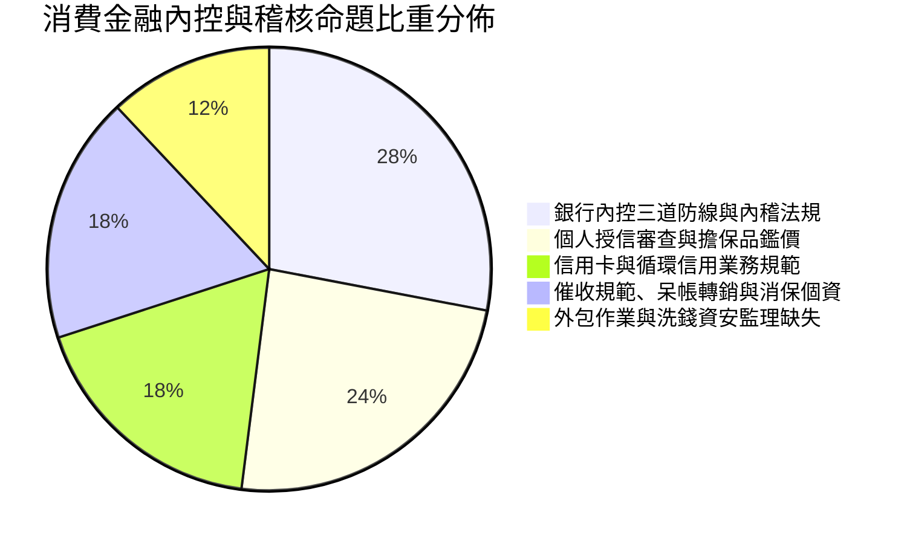

# 消費金融內部控制與稽核：全景導讀與高分攻略

---

## 🎯 考科核心架構與出題權重

消費金融內部控制與內部稽核測驗是所有銀行消金業務（房貸、信貸、車貸、信用卡、個人理財）主管與經辦之法定必備執照。考試分為兩大考科：
1. 銀行內部控制與內部稽核法規（選擇題 50 題，滿分 100 分，70 分及格）
2. 銀行內部控制與內部稽核實務（消費金融組）（選擇題 80 題，每題 1.25 分，滿分 100 分，70 分及格）

本重點教材全面整合歷屆 25~49 屆共 3,084 道標準真題，拆解出五大核心命題重心：

---

## 💡 本教材核心設計

- 三道防線穿透實務：以行員經辦（第一道）、法令遵循/風管（第二道）、內部稽核（第三道）之權責界線切入。
- 消金實務情境模擬：房貸鑑價五大原則、無擔保授信 DBR 22 倍天花板計算、信用卡最低應繳金額公式。
- 催收紅線禁區對照：催收合法時間（早 7 晚 10）、不得騷擾第三人、個資保護與金融消費者保護法之救濟途徑。
