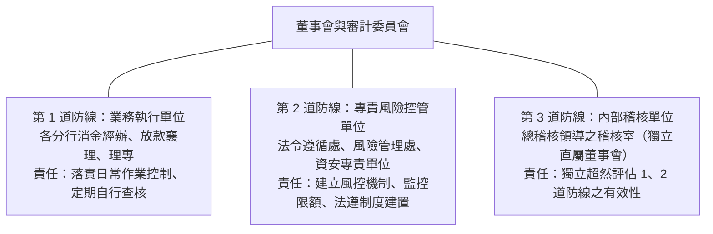

# 第 01 章：銀行內部控制與內部稽核法規精粹

---

## 先建立本章的理解脈絡

內部控制是銀行用來降低錯誤、舞弊和法遵風險的一套制度，內部稽核則獨立檢查制度是否設計妥當、確實執行。把董事會、管理階層、各單位與稽核單位的責任分開，才能正確判斷三道防線和缺失改善流程。

##  本章學習導航與核心地圖

《金融控股公司及銀行業內部控制及稽核制度實施辦法》是全法規科目的出題命脈。本章出題三大焦點：
1. 內部控制五大組成要素（COSO 框架）
2. 風險管理之「三道防線」權責界線
3. 內部稽核人員與總稽核之法定資格、任免程序與獨立性

---

##  一、內部控制五大組成要素（COSO 架構）

銀行內部控制制度必須涵蓋下列五大要素，缺一不可：

| 組成要素 | 定義與法規原意 | 實務情境 | 歷屆高頻考點 |
| :--- | :--- | :--- | :--- |
| 1. 控制環境 (Control Environment) | 塑造組織文化與道德價值觀，為其他四項要素之根本基礎 | 公司的「品格地基」，高層以身作則重視誠信！ | 內部控制之基礎要素；包含董事會監督與誠信文化 |
| 2. 風險評估 (Risk Assessment) | 辨識、分析影響目標達成之內外部風險（信用、市場、作業、流動性等） | 開車前預判天候路況與輪胎胎壓！ | 需考量組織目標變動與潛在詐欺風險 |
| 3. 控制作業 (Control Activities) | 建立具體政策與程序，確保高層管理階層之指令得以切實執行 | 雙人覆核、職責分工、密碼長度、金庫雙人會同！ | 核心為不相容職務分工（Segregation of Duties） |
| 4. 資訊與溝通 (Information & Comm.) | 獲取內部營運與外部市場資訊，確保橫向與垂直溝通順暢 | 體內的「神經傳導」，吹哨者管道必須暢通！ | 內部檢舉機制（Whistleblowing）與情資通報 |
| 5. 監督作業 (Monitoring) | 持續性評估與個別評估，以確認內部控制五項要素是否持續有效運作 | 身體定期「全身健康檢查」！ | 包含自行查核、內部稽核評估、會計師查核 |

---

##  二、銀行風險管理「三道防線」嚴格分工

>  常見易錯觀念：
> 1. 第一道防線（分行業務人員）發現缺失，能否說「這是稽核的事，不干我的事」？  錯！第一線單位對風險管理負第一線之主導責任！
> 2. 第二道防線（法遵處）可否直接去幫分行經辦審核放款、代理業務？  絕對嚴禁！二道防線不得從事第一線業務，避免球員兼裁判！

---

##  三、總稽核之法定任免與獨立超然地位

1. 直屬層級：內部稽核單位隸屬於董事會，直接向董事會及監察人（或審計委員會）報告。
2. 總稽核之任免程序（實施辦法第 11 條）：
   - 總稽核之聘任、解聘或調職，應經董事會全體董事三分之二以上出席，出席董事過半數同意；
   - 且應檢具資格證明文件，報主管機關（金管會）核准後始得生效！
   - 總稽核職位應相當於副總經理，不得兼任其他內部職務，以維護其超然獨立性。
3. 查核頻率法定期限（實施辦法第 15 條，歷屆高頻數字）：
   - 一般查核（綜合查核）：對國內外各營業、財務、資產保管及資訊單位，每年至少辦理一次！其他管理單位至少每二年辦理一次。
   - 專案查核：對海外分行及重大風險單位，每年至少辦理一次；遇重大事件應隨時辦理。
   - 查核報告交付期限：內部稽核報告應於查核完成後 2 個月內提報董事會及審計委員會核議。
4. 自行查核之法定週期（實施辦法第 20 條）：
   - 銀行各第一線單位每半年至少辦理一次一般自行查核；每半年至少辦理一次專案自行查核。
   - 新設營業單位或新業務開辦後半年內：每月至少辦理一次專案自行查核！
5. 法令遵循主管之獨立性與職掌（實施辦法第 32 條）：
   - 總機構法令遵循主管應由副總經理或同等職位擔任；
   - 為維持超然獨立，不得兼任法務主管以外之內部職務，且其考績與獎酬不得與業務績效掛鉤！

---

##  歷屆常見易錯觀念

>  陷阱 1：總稽核任免程序
> - 錯誤題目：「總經理得因業務考量，直接發布人事派令解聘總稽核並降調為分行經理。」
> -  正解：錯！總稽核地位崇高且受專法保障，必須由董事會高門檻同意並報經金管會核准，總經理絕無權擅自調任！
>
>  陷阱 2：自行查核頻率
> - 錯誤題目：「分行各業務單位每年只需由稽核室派員進行一次全面性查核，平時不需自行查核。」
> -  正解：錯！各業務單位（第一道防線）每年至少應辦理一次一般自行查核，每半年至少辦理一次專案自行查核！

## 現行內控架構核對

金融控股公司及銀行業內控辦法第 9 條要求建立自行查核、法令遵循、風險管理、資訊安全及內部稽核等控制模型，並明定各單位職責與溝通協調。另該辦法於 2026 年 5 月修正部分條文，部分新增或調整事項設有過渡期，須於 2027 年 12 月 31 日前調整符合；讀題時應區分已施行條文與過渡中規定，不能只看修正發布日。

資料來源：[金融控股公司及銀行業內部控制及稽核制度實施辦法（第 9 條及施行規定）](https://law.moj.gov.tw/LawClass/LawAll.aspx?pcode=G0380218)
