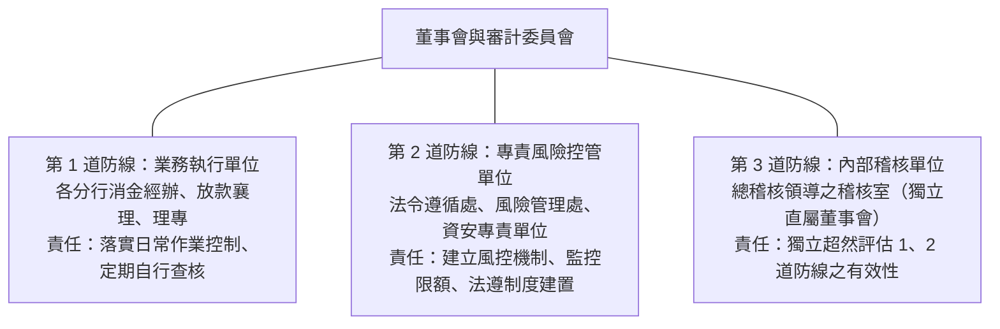

# 第 01 章：銀行內部控制與內部稽核法規精粹

---

> **本章法規版本（核對日期：2026-11-21）：金融控股公司及銀行業內部控制及稽核制度實施辦法 115-05-06 修正版（金管銀國字第 11502710961 號令，全文 55 條；第 44–47 條施行日期由主管機關定；過渡期至 116-12-31，即 2027-12-31）。本章條號、總稽核任免程序與查核頻率皆按此現行版寫成。第 49 期以前考題（115-03-14 之前）適用修正前版，讀舊題時以當期版本為準，不得把現行版條號套回舊題當答案。**

##  本章學習導航與核心地圖

《金融控股公司及銀行業內部控制及稽核制度實施辦法》是法規科目的重要出題範圍。本章有三個出題焦點：
1. 內部控制五大組成要素（COSO 框架）
2. 風險管理之「三道防線」權責界線
3. 內部稽核人員與總稽核之法定資格、任免程序與獨立性

---

##  一、內部控制五大組成要素（COSO 架構）

銀行內部控制制度必須涵蓋下列五大要素，缺一不可：

| 組成要素 | 定義與法規原意 | 白話生活寫照 | 歷屆高頻考點 |
| :--- | :--- | :--- | :--- |
| 1. 控制環境 (Control Environment) | 塑造組織文化與道德價值觀，為其他四項要素之根本基礎 | 公司的「品格地基」，高層以身作則重視誠信！ | 內部控制之基礎要素；包含董事會監督與誠信文化 |
| 2. 風險評估 (Risk Assessment) | 辨識、分析影響目標達成之內外部風險（信用、市場、作業、流動性等） | 開車前預判天候路況與輪胎胎壓！ | 需考量組織目標變動與潛在詐欺風險 |
| 3. 控制作業 (Control Activities) | 建立具體政策與程序，確保高層管理階層之指令得以切實執行 | 雙人覆核、職責分工、密碼長度、金庫雙人會同！ | 核心為不相容職務分工（Segregation of Duties） |
| 4. 資訊與溝通 (Information & Comm.) | 獲取內部營運與外部市場資訊，確保橫向與垂直溝通順暢 | 體內的「神經傳導」，吹哨者管道必須暢通！ | 內部檢舉機制（Whistleblowing）與情資通報 |
| 5. 監督作業 (Monitoring) | 持續性評估與個別評估，以確認內部控制五項要素是否持續有效運作 | 身體定期「全身健康檢查」！ | 包含自行查核、內部稽核評估、會計師查核 |

> 陷阱：「內部稽核功能評估」不是 COSO 五大要素（考題 43實2、45實2、48實3、49實3 皆以此為正確選項）。

---

##  二、銀行風險管理「三道防線」嚴格分工

>  常見易錯觀念：
> 1. 第一道防線（分行業務人員）發現缺失，能否說「這是稽核的事，不干我的事」？  錯！第一線單位對風險管理負第一線之主導責任！
> 2. 第二道防線（法遵處）可否直接去幫分行經辦審核放款、代理業務？  絕對嚴禁！二道防線不得從事第一線業務，避免球員兼裁判！

---

##  三、總稽核之法定任免與獨立超然地位

1. 直屬層級：內部稽核單位隸屬於董事會，直接向董事會及監察人（或審計委員會）報告。
2. 總稽核之任免程序（實施辦法第 27 條，115-05-06 現行版）：
   - 總稽核之聘任、解聘或調職，應經審計委員會全體成員二分之一以上同意及提董（理）事會全體董（理）事三分之二以上之同意，並報請主管機關核准後為之；未經審計委員會全體成員二分之一以上同意者，應於董事會議事錄載明審計委員會之決議。
   - 總稽核異動時，應於事實發生日之即日起算五日內向主管機關函報其異動原因及異動內容，並副知異動之總稽核。
   - 總稽核職位應等同於副總經理，且不得兼任與稽核工作有相互衝突或牽制之職務，以維護其超然獨立性。
   - 舊版提醒：第 49 期以前考題適用修正前版（董事會全體董事三分之二以上出席、出席董事過半數同意），讀舊題時以當期版本為準，不得把現行版程序套回舊題當答案。
3. 查核頻率法定期限（實施辦法第 32 條，歷屆高頻數字）：
   - 一般查核（綜合查核）：對國內營業、財務、資產保管、資訊及資訊安全專責單位，每年至少辦理一次一般查核及一次專案查核！其他管理單位每年至少辦理一次專案查核。
   - 一般查核（國外單位）：對各種作業中心、國外營業單位及國外子行，每年至少辦理一次一般查核；對國外辦事處之查核方式可以表報稽核替代或彈性調整實地查核頻率。專案查核遇重大事件應隨時辦理。
   - 查核報告交付期限：內部稽核報告應交付監察人（監事、監事會）或審計委員會查閱，除主管機關另有規定外，應於查核結束日起二個月內報主管機關，設有獨立董事者，應一併交付。
4. 自行查核之法定週期（實施辦法第 14 條）：
   - 銀行業各營業、財務、資產保管、資訊單位及國外營業單位，每半年至少辦理一次一般自行查核，每月至少辦理一次專案自行查核；已辦理一般自行查核、內部稽核單位一般業務查核、金融檢查機關一般業務檢查或法令遵循事項自行評估的月份，得免辦專案自行查核。經主管機關核准採行風險導向內部稽核的銀行業，得依風險評估結果訂定頻率、重點及範圍，並報董（理）事會通過後實施。
   - 金融控股公司每年至少辦理一次內部控制制度自行查核，並督導子公司辦理；適用對象與銀行業單位不同。
   - 原教材另稱新設營業單位或新業務開辦後半年內每月至少一次專案自行查核；其適用依當期規定核對。
5. 法令遵循長之獨立性與職掌（實施辦法第 16 條，115-05-06 現行版）：
   - 總機構應設立隸屬於總經理之法令遵循專責單位，並指派副總經理以上或職責相當之人擔任法令遵循長，綜理法令遵循事務，至少每半年向董（理）事會及監察人（監事、監事會）或審計委員會報告；
   - 法令遵循長得兼任防制洗錢及打擊資恐、防制詐欺專責單位主管，但不得兼任法務單位主管或內部其他職務；法令遵循專責單位得兼辦防制洗錢及打擊資恐、防制詐欺相關事項，但不得兼辦與法令遵循制度之規劃、管理及執行無關之法務或其他與職務有利益衝突之業務；
   - 法令遵循長、法令遵循專責單位主管及所屬人員、各單位法令遵循主管，每年應至少參加 15 小時在職教育訓練（實施辦法第 19 條）；法令遵循自行評估作業每半年至少辦理一次，工作底稿至少保存 5 年（實施辦法第 17 條第 4 項）；檢舉制度由總機構指定具獨立行使職權之單位受理調查（實施辦法第 13 條）。

---

## 四、內控聲明書、稽核人員、法遵細節與會計師查核（法規版本：內控辦法 115-05-06 版；核對日期：2026-11-21）

1. 內控聲明書（實施辦法 §8）：由董事長、總經理及總稽核聯名出具（監察人不須聯名），提報董事會通過，於每會計年度終了後 3 個月內將內容揭露於網站並於主管機關指定網站辦理公告申報；董事會對建立及維持適當有效之內部控制制度負最終責任，總經理督導各單位審慎評估檢討。

2. 稽核人員資格與訓練（實施辦法 §27、§29、§30、§37）：最近 3 年內應無記過以上不良紀錄；資格違反者，發現日起 2 個月內改善，逾期調整職務；執行業務違反者，1 個月內調整職務；每年專業訓練：正副主管及總稽核 20 小時以上、其餘稽核人員 30 小時以上；內稽人事由總稽核簽報、董事長核定；稽核單位至少每半年向董事會及監察人／審計委員會報告。

3. 法遵細節（實施辦法 §16、§17、§19）：法令遵循專責單位隸屬總經理；法遵長／法遵專責單位主管及所屬人員／各單位法遵主管每年至少 15 小時在職教育訓練；法遵自評每半年至少一次，工作底稿至少保存 5 年；檢舉制度由總機構指定具獨立行使職權之單位受理調查。

4. 會計師查核（實施辦法 §44–§47；§44–47 施行日期由主管機關定，見章首版本框）：銀行業年度財報查核簽證時，應委託會計師辦理內部控制制度專案審查；會計師立即通報主管機關的情形不含「遲未建立法令遵循主管制度」；主管機關發現會計師不勝任，得令銀行業更換會計師重新辦理專案審查；會計師應於每年 4 月底前出具上一年度確信報告報主管機關備查。

5. 首次擔任國內營業單位經理（實施辦法 §41）：應於就任前具備下列條件之一：曾任內部稽核人員實際辦理內部稽核工作 1 年以上，或參加稽核人員研習班考試及格，或取得銀行內部控制與內部稽核測驗合格證書；符合後二者者，應於就任前或就任後半年內參與內部稽核單位查核實習四次以上。

---

## 五、巴塞爾內控評估原則與重大缺失通報

1. 巴塞爾內控評估原則（巴塞爾銀行監理委員會《Framework for Internal Control Systems in Banking Organisations》，1998-09；十三項原則）：（一）管理階層監督與控管文化：原則 1 董事會責任（核准並定期評估整體營運策略及重要政策，對建立並維持妥適有效的內部控制制度負最後之責）、原則 2 高階管理階層責任（執行董事會核准之策略及政策，監控內部控制制度之適足性及有效運作）、原則 3 董事會與高階管理階層共同責任（提昇全體員工高尚廉潔之道德水準，建立重視內部控制的文化）；（二）風險認知與評估：原則 4（確切辨識並持續評估有礙銀行目標達成之主要風險，涵蓋信用、國家及移轉、市場、利率、流動性、作業、法律及商譽風險）；（三）牽制與分工：原則 5 控制架構與控管作業程序、原則 6 適當分工牽制、不指派員工擔任有利害衝突或互為牽制之工作；（四）資訊與溝通：原則 7 充分提供內部財務、業務及法令遵循資訊與外部市場資訊（並確保資訊之可靠性、及時性、可取得性與一致格式）、原則 8 涵蓋所有重要業務之可靠資訊系統（須具備安全性、獨立監控與適當備援機制）、原則 9 有效之溝通管道（確保全體員工充分瞭解並遵循與其職責相關之政策與程序，且相關資訊傳達予適當人員）；（五）監控作業與缺失改善：原則 10 持續性監控、原則 11 周詳有效的內部稽核建置、原則 12 內控缺失及時陳報適當管理階層並立即採取因應措施，情節重大者陳報高階管理階層及董事會；（六）監理機關評估：原則 13 監理機關要求所有銀行建立有效內部控制制度，不足者採取適當導正措施。

2. 重大缺失通報（實施辦法 §51）：內部稽核人員及法令遵循主管對內部控制重大缺失或違法違規情事所提改進建議不為管理階層採納、將肇致所屬金融控股公司（含子公司）或銀行業重大損失時，均應立即作成報告陳核，並通知獨立董事及監察人（監事、監事會）或審計委員會，同時通報主管機關。另補：偶發事件應依重大偶發事件處理機制通報與處理（實施辦法 §12 第 1 項第 2 款第 10 目）；舞弊防範與理專舞弊防範措施要點（各附代表題號：42法7、42法32、42實6、43法5、44實4、45實4、48實4）。

---

##  歷屆常見易錯觀念

>  陷阱 1：總稽核任免程序
> - 錯誤題目：「總經理得因業務考量，直接發布人事派令解聘總稽核並降調為分行經理。」
> -  正解：錯！總稽核地位崇高且受專法保障，必須由董事會高門檻同意並報經金管會核准，總經理絕無權擅自調任！
>
現行頻率應區分銀行業單位與金融控股公司，並依上列條件確認例外；下方題目若屬歷史考期，應另依當期規範判讀。資料來源：[實施辦法第 14 條](https://law.banking.gov.tw/Chi/FLAW/FLAWDOC01.aspx?lno=14&lsid=FL053396)。

>  陷阱 2：自行查核頻率
> - 錯誤題目：「分行各業務單位每年只需由稽核室派員進行一次全面性查核，平時不需自行查核。」
> -  判斷：錯。銀行業營業、財務、資產保管、資訊及國外營業單位，一般自行查核每半年至少一次、專案自行查核每月至少一次；得免辦月份及風險導向例外見上文。

## 現行內控架構核對

金融控股公司及銀行業內控辦法第 9 條要求建立自行查核、法令遵循、風險管理、資訊安全及內部稽核等控制模型，並明定各單位職責與溝通協調。另該辦法於 2026 年 5 月修正部分條文，部分新增或調整事項設有過渡期，須於 2027 年 12 月 31 日前調整符合；讀題時應區分已施行條文與過渡中規定，不能只看修正發布日。

資料來源：[金融控股公司及銀行業內部控制及稽核制度實施辦法（第 9 條及施行規定）](https://law.moj.gov.tw/LawClass/LawAll.aspx?pcode=G0380218)
