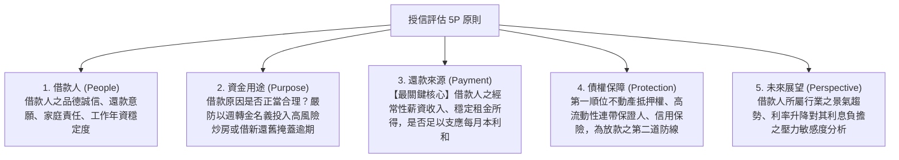

# 第 02 章：消費金融授信徵信、擔保品鑑價與放款審查

---

##  本章學習導航與核心地圖

個人消費性貸款（房屋貸款、信用貸款、汽車貸款、留學貸款）涉及巨量自然人授信。本章出題最密集的四大必考計算與準則：
1. 授信「5P 原則」在消金之具體落實
2. 無擔保授信「DBR 22 倍」天花板鐵律與計算題
3. 不動產擔保品估價原則與第一順位最高限額抵押權
4. 聯徵中心（JCIC）個人信用紀錄揭露期限規範

---

##  一、授信評估 5P 原則（消金實務對照）

---

## 二、DBR 22 倍：監理比率與授信審查

DBR 是金融機構衡量個人無擔保債務負擔的監理比率。金管會銀行局函釋用語是「不宜超過 22 倍」；它不是《銀行法》直接寫出的普遍法定核貸上限，相關函釋另有特定排除項目。計算前須先確認適用規範、計入哪些債務及例外條件，不可把所有擔保貸款或信用卡額度一概套用同一公式。

若題目明確指定適用 22 倍基準，月收入 50,000 元的參考比率為 1,100,000 元；此數字不等於銀行必須核准的金額。信用卡業務規則另要求發卡機構審查申請人的還款能力，並依主管機關規定管理全體金融機構無擔保債務與平均月收入倍數；聯徵資料也不得作為核准或駁回的唯一依據。

資料來源：[金管會銀行局 DBR 22 倍函釋](https://law.banking.gov.tw/Chi/printNewsContent.aspx?msgid=1018)、[信用卡業務機構管理辦法第 22 條](https://law.moj.gov.tw/LawClass/LawAll.aspx?pcode=G0380055)

###  經典計算範例：
- 小張每月平均月薪為 50,000 元。
- 假設本案適用 DBR 22 倍基準，月收入對應的參考比率金額為：$50,000 \times 22 = 1,100,000$ 元（110 萬元）。
- 若小張目前在 A 銀行有信貸 50 萬元，在 B 銀行有信用卡循環未結清 20 萬元（合計已動用 70 萬元）。
- 假設上述 70 萬元均應計入，參考剩餘金額為：$110萬 - 70萬 = 40 萬元$；C 銀行實際核貸仍須依適用規範、排除條件及授信審查判斷。

> 特定排除項目依主管機關函釋逐案確認；不得把以下歷屆例子視為完整或永久適用的法定豁免清單：
> 下列情況曾見於教材與函釋整理：
> 1. 具備足額擔保品之貸款（如房屋貸款、定存單質借）；
> 2. 政策性專案貸款（如公教人員自購住宅貸款、青年創業貸款由信保基金保證者）；
> 3. 原無擔保債務經金融機構依消債條例成立協商之債務協商整合方案。

---

##  三、不動產擔保品鑑價與抵押權設定

1. 鑑價三方法：比較法（市價比較法，消金最常用）、成本法、收益法。
2. 最高限額抵押權 vs. 普通抵押權：
   - 消金房貸絕大多數採用「最高限額抵押權」！
   - 特性：在設定之最高限額範圍內，擔保借款人對銀行現在及將來所發生之一定法律關係之不特定債權，借款還清後抵押權不消滅，循環動用不需每次重跑地政事務所重設！
3. 火險與地震險強制投保：
   - 房屋抵押時，借款人必須投保住宅火災及地震基本保險，並將抵押權人銀行列為第一順位優先受償受益人（特約質權條款）。

---

##  四、銀行法利害關係人授信三大鐵律（銀行法第 12、32、33 條）

1. 法定擔保品之範圍（銀行法第 12 條，全文僅 4 款）：
   - 不動產抵押權或動產抵押權。
   - 動產或權利質權（定存單質押、股票質押）。
   - 借款人營業交易所發生之應收票據。
   - 各級政府公庫主管機關、銀行或經政府核准設立之信用保證機構（如中小企業信保基金）之保證。
   - 陷阱：應收帳款、母公司保證函、信託占有、反面承諾書皆非 §12 擔保（考題 49法4、43法1、43實21）。
2. 利害關係人無擔保授信「絕對禁止」（銀行法第 32 條）：
   - 銀行不得對其持有實收資本總額 3% 以上之企業，或本行負責人、職員、或主要股東，或對與本行負責人或辦理授信之職員有利害關係者，為無擔保授信；但消費者貸款及對政府貸款不在此限。
   - 消費者貸款額度（金管會 114-07-10 解釋令 11402720286 號，現行版）：每一消費者合計不超過 200 萬元，其中信用卡循環信用以信用卡循環信用餘額計算。原 100 萬元規定自 93-10-04 實施，114-07-10 起調高為 200 萬元；49 期考 200 萬元，43 期考 100 萬元，讀舊題注意版本。
   - 主要股東（銀行法 §32 第 3 項）：持有銀行已發行股份總數 1% 以上者；主要股東為自然人時，本人之配偶與其未成年子女之持股應計入本人之持股。所稱股份指普通股及有表決權之特別股。
   - 同一人或同一關係人單獨、共同或合計持有同一銀行已發行有表決權股份總數超過 5% 者，自持有之日起 10 日內，應向主管機關申報（銀行法 §25 第 2 項）。
   - 利害關係者（銀行法 §33-1，全文五款）：（一）銀行負責人或辦理授信之職員之配偶、三親等以內之血親或二親等以內之姻親；（二）銀行負責人、辦理授信之職員或前款有利害關係者獨資、合夥經營之事業；（三）銀行負責人、辦理授信之職員或第一款有利害關係者單獨或合計持有超過公司已發行股份總數或資本總額 10% 之企業；（四）銀行負責人、辦理授信之職員或第一款有利害關係者為董事、監察人或經理人之企業（因投資關係經主管機關核准兼任者除外）；（五）銀行負責人、辦理授信之職員或第一款有利害關係者為代表人、管理人之法人或其他團體。
3. 利害關係人擔保授信「嚴格限制」（銀行法第 33 條）：
   - 銀行對其持有實收資本總額 5% 以上之企業，或本行負責人、職員、或主要股東，或對與本行負責人或辦理授信之職員有利害關係者為擔保授信，應有十足擔保，其條件不得優於其他同類授信對象；
   - 達主管機關規定金額以上者（對同一授信客戶之每筆或累計金額達 1 億元或各該銀行淨值 1% 孰低者），必須經董事會三分之二以上董事出席，出席董事四分之三以上同意之「重度特別決議」！
   - 授信限額（主管機關規定）：同一法人擔保授信總餘額不得超過銀行淨值 10%；同一自然人不得超過銀行淨值 2%；全體利害關係人擔保授信總餘額不得超過銀行淨值 1.5 倍。

---

##  五、聯徵中心（JCIC）個人信用資料法定揭露期限

| 信用資料類別 | 聯徵中心法定揭露期限（自事實發生或清償日起算） |
| :--- | :--- |
| 逾期、催收及呆帳紀錄 | 自清償之日起揭露 3 年；呆帳未清償者，自轉銷之日起最長揭露 5 年 |
| 退票紀錄 | 自退票日起揭露 3 年；已辦妥清償註記自註記日起揭露 6 個月 |
| 破產宣告紀錄 | 自破產宣告日起揭露 10 年 |
| 信用卡強制停卡未清償 | 自停卡發生日起揭露 7 年；清償者自清償日起揭露 6 個月（最長不超過停卡日起 7 年） |
| 就學貸款逾期紀錄 | 清償後揭露 1 年；未清償自逾期起最長揭露 3 年 |
| 前置協商 / 調解成立紀錄 | 履約完成自完成日起揭露 1 年 |

##  歷屆常見易錯觀念

>  陷阱 1：DBR 22 倍的計算分母
> - 錯誤題目：「DBR 22 倍是指無擔保債務總額不得超過個人每年年薪收入之 22 倍。」
> -  正解：錯！分母是平均「月」收入，不是年收入！
>
>  陷阱 2：自住購屋貸款計入 DBR 22 倍？
> - 錯誤題目：「老王剛買了總價 1,000 萬元的房屋並向銀行辦理 800 萬元房貸，因此老王已經嚴重超過 DBR 22 倍，不能再辦信用卡。」
> -  正解：錯！房屋貸款屬於有足額不動產擔保品之授信，完全不計入無擔保 DBR 22 倍的計算限額中！
