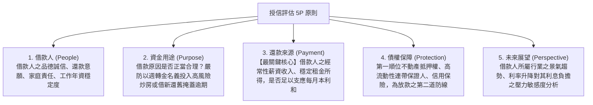

# 第 02 章：消費金融授信徵信、擔保品鑑價與放款審查

---

## 先建立本章的理解脈絡

授信是在評估是否借錢以及條件如何；徵信是蒐集和查證借款人的信用資訊；擔保品則在借款人未還款時提供額外清償來源。核貸不能只看抵押品，還要分析收入、負債、資金用途和還款能力，並分辨法規門檻與內部風險指標。

##  本章學習導航與核心地圖

個人消費性貸款（房屋貸款、信用貸款、汽車貸款、留學貸款）涉及巨量自然人授信。本章出題最密集的四大必考計算與準則：
1. 授信「5P 原則」在消金之具體落實
2. 無擔保授信「DBR 22 倍」天花板鐵律與計算題
3. 不動產擔保品估價原則與第一順位最高限額抵押權
4. 聯徵中心（JCIC）個人信用紀錄揭露期限規範

---

##  一、授信評估 5P 原則（消金實務對照）

---

## 二、DBR 22 倍：監理比率與授信審查

DBR 是金融機構衡量個人無擔保債務負擔的監理比率。金管會銀行局函釋用語是「不宜超過 22 倍」；它不是《銀行法》直接寫出的普遍法定核貸上限，相關函釋另有特定排除項目。計算前須先確認適用規範、計入哪些債務及例外條件，不可把所有擔保貸款或信用卡額度一概套用同一公式。

若題目明確指定適用 22 倍基準，月收入 50,000 元的參考比率為 1,100,000 元；此數字不等於銀行必須核准的金額。信用卡業務規則另要求發卡機構審查申請人的還款能力，並依主管機關規定管理全體金融機構無擔保債務與平均月收入倍數；聯徵資料也不得作為核准或駁回的唯一依據。

資料來源：[金管會銀行局 DBR 22 倍函釋](https://law.banking.gov.tw/Chi/printNewsContent.aspx?msgid=1018)、[信用卡業務機構管理辦法第 22 條](https://law.moj.gov.tw/LawClass/LawAll.aspx?pcode=G0380055)

###  經典計算範例：
- 小張每月平均月薪為 50,000 元。
- 小張在全體銀行的無擔保債務最高上限為：$50,000 \times 22 = 1,100,000$ 元（110 萬元）。
- 若小張目前在 A 銀行有信貸 50 萬元，在 B 銀行有信用卡循環未結清 20 萬元（合計已動用 70 萬元）。
- 則 C 銀行最多只能再核准小張信用貸款：$110萬 - 70萬 = 40 萬元$！

> 特定排除項目依主管機關函釋逐案確認；不得把以下歷屆例子視為完整或永久適用的法定豁免清單：
> 下列情況曾見於教材與函釋整理：
> 1. 具備足額擔保品之貸款（如房屋貸款、定存單質借）；
> 2. 政策性專案貸款（如公教人員自購住宅貸款、青年創業貸款由信保基金保證者）；
> 3. 原無擔保債務經金融機構依消債條例成立協商之債務協商整合方案。

---

##  三、不動產擔保品鑑價與抵押權設定

1. 鑑價三方法：比較法（市價比較法，消金最常用）、成本法、收益法。
2. 最高限額抵押權 vs. 普通抵押權：
   - 消金房貸絕大多數採用「最高限額抵押權」！
   - 特性：在設定之最高限額範圍內，擔保借款人對銀行現在及將來所發生之一定法律關係之不特定債權，借款還清後抵押權不消滅，循環動用不需每次重跑地政事務所重設！
3. 火險與地震險強制投保：
   - 房屋抵押時，借款人必須投保住宅火災及地震基本保險，並將抵押權人銀行列為第一順位優先受償受益人（特約質權條款）。

---

##  四、銀行法利害關係人授信三大鐵律（銀行法第 12、32、33 條）

1. 法定擔保品之範圍（銀行法第 12 條）：
   - 不動產抵押權或動產抵押權。
   - 動產或權利質權（定存單質押、股票質押）。
   - 借款人營業交易所發生之應收票據。
   - 各級政府公債、庫券、金融債券。
   - 各級政府或中央主管機關核准設立之信用保證機構（如中小企業信保基金）之保證。
2. 利害關係人無擔保授信「絕對禁止」（銀行法第 32 條）：
   - 銀行絕對不得對下列對象為「無擔保授信」：
     ① 銀行負責人、辦理授信之職員；
     ② 主要股東（持股 1% 以上或排名前十名之自然人/法人股東）；
     ③ 與負責人或辦理授信職員有利害關係者（配偶、三親等以內之血親、二親等以內之姻親）；
     ④ 銀行持有資本達 3% 以上之企業。
3. 利害關係人擔保授信「嚴格限制」（銀行法第 33 條）：
   - 利害關係人借款必須有充分擔保品；
   - 條件不得優於其他同類授信對象（不得特權降息或寬限期放水）；
   - 達主管機關規定金額以上者（無擔保 1 億元/擔保 2 億元，或資本 1%），必須經董事會三分之二以上董事出席，出席董事四分之三以上同意之「重度特別決議」！

---

##  五、聯徵中心（JCIC）個人信用資料法定揭露期限

| 信用資料類別 | 聯徵中心法定揭露期限（自事實發生或清償日起算） |
| :--- | :--- |
| 逾期、催收及呆帳紀錄 | 自清償之日起揭露 3 年；呆帳未清償者，自轉銷之日起最長揭露 5 年 |
| 退票紀錄 | 自退票日起揭露 3 年；已辦妥清償註記自註記日起揭露 6 個月 |
| 破產宣告紀錄 | 自破產宣告日起揭露 10 年 |
| 信用卡強制停卡未清償 | 自停卡發生日起揭露 7 年；清償者自清償日起揭露 6 個月（最長不超過停卡日起 5 年） |
| 就學貸款逾期紀錄 | 清償後揭露 1 年；未清償自逾期起最長揭露 3 年 |
| 前置協商 / 調解成立紀錄 | 履約完成自完成日起揭露 1 年 |

##  歷屆常見易錯觀念

>  陷阱 1：DBR 22 倍的計算分母
> - 錯誤題目：「DBR 22 倍是指無擔保債務總額不得超過個人每年年薪收入之 22 倍。」
> -  正解：錯！分母是平均「月」收入，不是年收入！
>
>  陷阱 2：自住購屋貸款計入 DBR 22 倍？
> - 錯誤題目：「老王剛買了總價 1,000 萬元的房屋並向銀行辦理 800 萬元房貸，因此老王已經嚴重超過 DBR 22 倍，不能再辦信用卡。」
> -  正解：錯！房屋貸款屬於有足額不動產擔保品之授信，完全不計入無擔保 DBR 22 倍的計算限額中！
