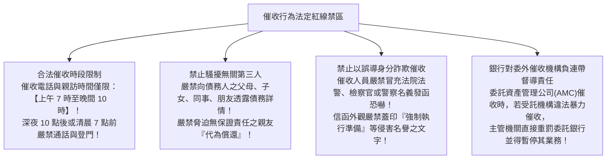

# 第 04 章：逾期放款催收準則、呆帳轉銷與個資保護防線

---

##  本章學習導航與核心地圖

貸款逾期後，金融機構須合法維護債權、計提充足備抵呆帳，並遵守法規、避免暴力催收。本章有四個出題重點：
1. 放款資產五大分類與最低備抵呆帳提撥比率
2. 金融機構催收債權行為規範（紅線禁區與法定催收時間）
3. 不良資產轉銷呆帳之法定授權程序
4. 個人資料保護法在消金行銷與催收之外包防線

---

##  一、銀行資產品質五大分類與提存比率（必背百分比）

依金管會《銀行資產評估損失準備提列及逾期放款催收款呆帳處理辦法》，授信資產分為五類：

| 資產等級 | 名稱 | 定義與逾期徵狀 | 法定最低備抵呆帳提存比率 |
| :--- | :--- | :--- | :--- |
| 第一類 | 正常授信資產 | 債務人正常繳息、本金未逾期、信用健全 | 最低 1%（一般放款）；不動產購屋貸款最低 1.5% |
| 第二類 | 應予注意資產 | 評估有足額擔保，但本金或利息逾期 1 個月至 12 個月；或無擔保逾期 1~3 個月 | 最低 2% |
| 第三類 | 可望收回資產 | 評估有足額擔保，但本利逾期超過 12 個月；或無擔保逾期 3~6 個月 | 最低 10% |
| 第四類 | 收回困難資產 | 評估收回困難，無擔保逾期 6 個月以上 | 最低 50% |
| 第五類 | 收回無望資產 | 評估完全無法收回，債務人失聯、破產或逃逸 | 100% 全數提存 |

---

## 一之一、逾期放款與催收款（銀行資產評估損失準備提列及逾期放款催收款呆帳處理辦法 §7、§10；103-01-28 版；核對日期：2026-11-21）

1. 逾期放款定義（辦法 §7）：積欠本金或利息超過清償期三個月，或雖未超過三個月、但已向主、從債務人訴追或處分擔保品者。

2. 轉入催收款：逾期放款應於清償期屆滿六個月內轉入催收款科目；但經協議分期償還放款並依約履行者，不在此限。協議分期免列報條件（辦法 §7 第 2 項）：依協議條件履行達六個月以上，且協議利率不低於原承作利率或銀行新承作同類風險放款之利率。

3. 逾期放款經轉入催收款者，應停止計息（辦法 §10）。

---

##  二、金融機構與委外催收合法規範（催收紅線禁區）

依《金融機構作業委託他人處理內部作業制度及程序辦法》（law.moj G0380200；112-08-25 大幅修正，115-04-13 修正 §3、§13）與催收自律規範：

> 委外現行制（112-08-25 修正後）：金融機構辦理應收債權催收作業之委外，所委託之催收程序行為樣態、通知書函等應依銀行公會範本制定，經律師審閱無違反本辦法及其他相關法令之虞後，送主管機關備查（委外辦法 §12 現行版）；現行版 §12 已無「申請核准」程序，舊考題（≤48 期）所稱「應收債權催收作業之委外應報經主管機關核准」為修正前規定，讀舊題注意版本。受委託機構相關作業人員之電話暨外訪時均應錄音並製作備份，至少保存六個月以上，錄音紀錄不得刪除或竄改（委外辦法 §13 第 6 款）。

---

##  三、轉銷呆帳之法定程序（銀行資產評估損失準備提列及逾期放款催收款呆帳處理辦法，依銀行法 §45-1 第 2 項訂定）

1. 轉銷條件（辦法 §11 全文 4 款，應扣除估計可收回部分後轉銷為呆帳）：
   - （一）債務人因解散、逃匿、和解、破產之宣告或其他原因，致債權之全部或一部不能收回者；
   - （二）擔保品及主、從債務人之財產經鑑價甚低或扣除先順位抵押權後，已無法受償，或執行費用接近或可能超過銀行可受償金額，執行無實益者；
   - （三）擔保品及主、從債務人之財產經多次減價拍賣無人應買，而銀行亦無承受實益者；
   - （四）逾期放款及催收款逾清償期二年，經催收仍未收回者。
   - 不得轉銷情形：擔保品及主、從債務人之財產經多次減價拍賣無人應買而由銀行承受者，不得轉銷（§11 第 3 款反面：僅「銀行亦無承受實益」者得轉銷；考題 46實54、49實53）。
   - 轉銷應先就提列之備抵呆帳或保證責任準備項下沖抵，如有不足得列為當年度損失（辦法 §13）；逾期放款經轉入催收款者應停止計息（辦法 §10）。
2. 核決層級（必考考點，辦法 §12）：
   - 逾期放款及催收款之轉銷，應經董（理）事會之決議通過，並通知監察人（監事）。但經主管機關或金融檢查機關（構）要求轉銷者，應即轉銷為呆帳，並提報最近一次董（理）事會及通知監察人備查。董事會休會期間，得由常務董（理）事會代為行使，並通知監察人（監事），再報董事會備查。
   - 屬銀行法 §33 規定金額以上之案件，應經三分之二以上董事之出席及出席董事四分之三以上之同意。
   - 轉銷呆帳後，銀行對該筆債務之請求權並未消滅，仍應列入帳外備查簿列管並繼續追償！

---

##  四、個人資料保護法在消金之落實（個資法第 19、20、28 條）

1. 法定蒐集與處理要件（第 19 條）：
   - 金融機構於客戶辦理消金貸款時蒐集身分證明、所得扣繳憑單、財產清冊，係基於「與當事人間有契約或類似契約之關係」；
   - 目的外之共同行銷（如金控旗下跨業行銷），必須經客戶「單獨、明確之書面同意」，不得包裹於定型化契約中強制勾選！
2. 行銷拒絕權（Opt-out）：
   - 金融機構於首次進行電話或簡訊行銷時，必須主動向客戶告知其得表示拒絕接受行銷，並提供免費拒絕管道。客戶一旦表示拒絕，銀行必須立即停止行銷，不得再以任何藉口推銷！
3. 外包作業之個資洩密責任（個資法 §4；個資法施行細則 §8）：
   - 金融機構將催收或行銷業務委外時，受託機構視同委託機關；委託機關應對受託者為適當之監督。受託催收公司若外洩客戶個資，金融機構應負連帶賠償責任！
   - 催收委外事前書面通知：金融機構將不良債權委外催收前，必須以書面正式通知債務人受託催收機構之名稱、催收金額與催收範圍！
   - 催收人員專業證照：受託機構之催收人員應完成銀行公會或其認可之機構舉辦有關催收專業訓練課程或測驗並領有合格證書者；未完成者，應於任職後兩個月內補正（委外辦法 §13，115-04-13 現行版）。
4. 個資侵害之法定損害賠償限額（個資法第 28 條）：
   - 被害人不易證明其實際受損害額時，得請求法院依侵害情節，以每人每一事件新臺幣 500 元以上 2 萬元以下計算；
   - 對於同一原因事實造成多數人權益受侵害者，合計最高總額以新臺幣 2 億元為限！

---

##  歷屆常見易錯觀念

>  陷阱 1：合法催收時限
> - 錯誤題目：「只要債務人欠錢不還，銀行催收人員即可在凌晨 2 點打電話到其住家催款。」
> -  正解：錯！催收時間嚴格限制於上午 7 時至晚間 10 時！其他時段催收屬於重大違規騷擾！
>
>  陷阱 2：呆帳轉銷後債務是否一筆勾銷？
> - 錯誤題目：「銀行一旦將逾期放款轉銷為呆帳，代表銀行放棄該筆債權，債務人日後不必再償還。」
> -  正解：錯！轉銷呆帳只是銀行會計帳務上的沖銷處理，法律上的債權依然完全有效，銀行仍應列入帳外專簿列管，隨時向法院聲請換發債權憑證並繼續追索！
