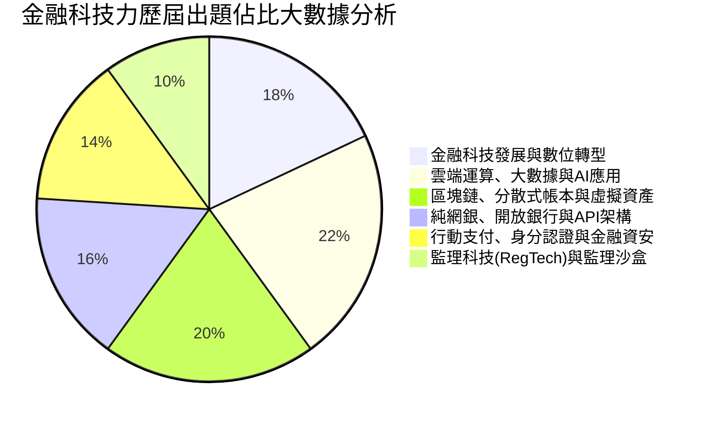

# 金融科技力知識檢定：全景導讀與應試戰略

---

## 🎯 考科核心地圖與出題權重分佈

「金融科技力知識檢定」由台灣金融研訓院主辦，為金融機構各級從業人員與科技跨界人才必備的核心法定證照。全卷共 60 題單選題（第 1~40 題每題 1.5 分，第 41~60 題每題 2 分，滿分 100 分，70 分及格），全部單選、不倒扣。

依據最新歷屆 839 道標準試題之深層大數據分析，出題比重高度集中於以下六大核心領域：

---

## 💡 本教材設計特色（比照信託業務人員高品質規格）

1. 白話情境生活化：徹底打破死記硬背的艱澀科技名詞，以網銀轉帳、電商購物、防詐辨識等生活實務情境切入。
2. 考點穿透剖析：對標主管機關（金管會）最新監理規定（如金融科技發展路徑圖2.0、純網銀資本額、開放銀行三大階段）。
3. 歷屆必考陷阱對照：直接整理出題委員會最常設下的文字替換題（如把公有雲換成私有雲、把分散式換成中心化）。
4. 單一離線學習包：教材產出後，將完整納入 Study Pack 編譯管線，生成無任何外部 CDN 依賴的終極單一 HTML。

---

## 📚 教材章節索引

- [第 01 章：金融科技發展路徑與數位轉型架構](01_金融科技發展路徑與數位轉型.md)
- [第 02 章：雲端運算、大數據與人工智慧金融應用](02_雲端運算、大數據與人工智慧金融應用.md)
- [第 03 章：區塊鏈、分散式帳本與虛擬資產監理規範](03_區塊鏈、分散式帳本與虛擬資產監理.md)
- [第 04 章：純網路銀行、開放銀行與金融 API 生態系](04_純網銀、開放銀行與API生態系.md)
- [第 05 章：行動支付創新、數位身分認證與金融資安防線](05_支付創新、身分認證與金融資安.md)
- [第 06 章：監理科技(RegTech)與金融監理沙盒機制](06_監理科技(RegTech)與金融監理沙盒法規.md)
- [第 07 章：金融科技歷屆高頻數字、英文縮寫與陷阱速查手冊](07_金融科技歷屆高頻考點與陷阱速查手冊.md)
