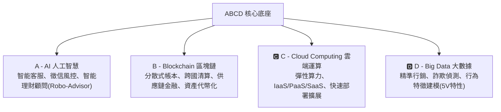

# 第 01 章：金融科技發展路徑與數位轉型

---

##  本章學習導航與核心地圖

金融科技（FinTech）不是單純將傳統金融業務「搬到網路上」，而是以創新技術重構金融服務流程、降低交易摩擦成本、提升普惠金融（Financial Inclusion）可及性。本章出題焦點在於：
1. 金融科技發展階段演進（FinTech 1.0 ~ 3.5）
2. 科技驅動要素（ABCD 技術矩陣）
3. 鯰魚效應（Catfish Effect）與競合策略
4. 我國「金融科技發展路徑圖 2.0」四大核心目標

---

##  一、金融科技演進四部曲（白話生活化對照）

| 演進階段 | 時代特徵 | 代表技術與產品 | 白話生活寫照 | 歷屆高頻考點 |
| :--- | :--- | :--- | :--- | :--- |
| FinTech 1.0 (1866~1967) | 基礎設施鋪設期 | 跨大西洋海底電纜、電報轉帳、自動記帳機 | 過去買賣匯款要靠輪船送信，電纜鋪設後幾分鐘就能電匯！ | 金融與科技結合的起點，由電報與大型主機驅動 |
| FinTech 2.0 (1967~2008) | 金融機構主導數位化 | 自動櫃員機(ATM)、SWIFT 國際清算、電子交易中心、網路銀行 | 銀行開始有 ATM 與網銀，不用每件事都跑實體櫃檯排隊！ | 1967年第一台 ATM 出現；主導權在傳統金融機構 |
| FinTech 3.0 (2008~至今) | 新創與科技巨頭跨界進擊 | 智慧型手機、行動支付、P2P 借貸、群眾募資、純網銀 | 買咖啡直接刷手機條碼，連皮夾都不用帶，甚至路邊攤也能無現金支付！ | 2008年金融海嘯為分水嶺；由新創科技公司(Startups)主導推進 |
| FinTech 3.5 (開發中國家) | 跳躍式發展 (Leapfrogging) | 肯亞 M-Pesa 手機簡訊錢包、中國微信/支付寶 | 許多人從未擁有過傳統銀行帳戶，直接跳過信用卡時代，一腳跨進手機行動錢包！ | 開發中國家因為實體分行不足，直接跳過 PC 網銀進入行動支付 |

---

##  二、鯰魚效應（Catfish Effect）與競合模式

>  經典典故：在運送沙丁魚的魚槽中放入一隻兇猛的「鯰魚」，沙丁魚為了生存而緊張游動，反而保持了鮮活度。
>  金融意涵：主管機關核准非傳統金融業者（例如純網路銀行、第三方支付業者、大型科技公司 BigTech）進入金融市場，透過強大的數位體驗與低廉成本激發市場競爭，迫使傳統既有銀行加速數位轉型、改善服務品質！

### 傳統金融與科技新創的三大互動形態：
1. 競爭 (Competition)：新創業者瓜分支付、匯款、微型貸款等高利潤碎片化業務。
2. 合作 (Collaboration)：銀行提供資金與法遵牌照，科技業者提供 AI 演算法與前端 UI/UX 設計。
3. 合資/收購 (M&A)：金控機構直接注資併購新創團隊，化敵為友。

---

##  三、ABCD 四大核心技術底座

金融科技的核心底層由四大技術英文字母縮寫組成，歷屆必考其定義與應用：

---

##  四、我國主管機關「金融科技發展路徑圖 2.0」

金管會為建立健全之金融科技生態系，發布發展路徑圖，核心圍繞於：
1. 包容性 (Inclusion)：保障不同族群之數位金融權益，推動高齡與身障友善介面。
2. 創新性 (Innovation)：擴大監理沙盒與業務試辦成效，推動數位身分證(FIDO)整合。
3. 韌性 (Resilience)：加強金融資安防護體系、推動資安情資分享(F-ISAC)。
4. 永續 (Sustainability)：結合綠色金融與 ESG 科技數據收集。

---

##  歷屆常見易錯觀念（直擊出題文字坑）

>  陷阱 1：FinTech 2.0 與 3.0 的主導力量混淆
> - 錯誤題目：「FinTech 3.0 是指傳統銀行主導的網路銀行與 ATM 現代化。」
> -  正解：錯！傳統金融主導的是 FinTech 2.0；FinTech 3.0 是由非銀行新創企業（Startups）與科技巨頭引領！
>
>  陷阱 2：普惠金融（Financial Inclusion）的真正涵義
> - 錯誤題目：「普惠金融是指政府對所有民眾提供免費的無上限金融信貸。」
> -  正解：錯！普惠金融是指以負擔得起的成本，向所有社會階層（尤其是偏鄉、弱勢、微型企業）提供平等的全方位金融服務，絕非盲目放貸！
>
>  陷阱 3：長尾效應（Long Tail）在金融科技中的應用
> - 錯誤題目：「金融科技主要專注於服務金字塔頂端 20% 的高資產客戶，忽視長尾端。」
> -  正解：錯！透過自動化與數位渠道，服務邊際成本趨近於零，金融科技讓過去傳統銀行不屑做的小額客群（長尾市場）轉變為龐大的利潤來源！
