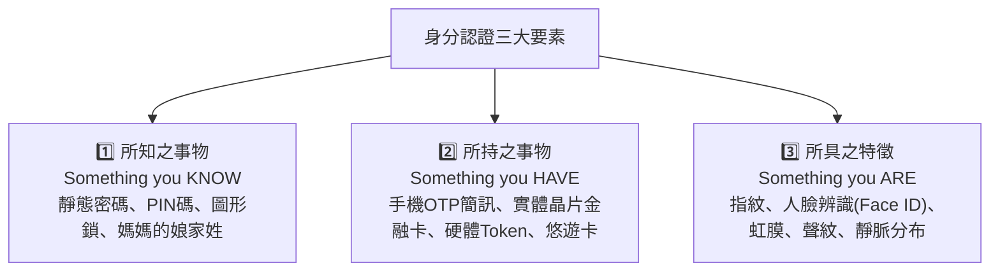

# 第 05 章：行動支付創新、數位身分認證與金融資安防線

---

##  本章學習導航與核心地圖

無現金社會（Cashless Society）的推進仰賴支付法規鬆綁、快速安全的數位身分認證與銅牆鐵壁般的資安防護體系。本章歷屆核心出題點：
1. 第三方支付 vs. 電子支付機構法定權限差異（是否能「儲值」、「帳戶間轉帳」）
2. 電子支付機構條例全新整併亮點（電支電票二合一、紅利點數整合）
3. 身分認證三大因數（3 Factors of Authentication）
4. FIDO（線上快速身分認證）免密碼標準與金融 FIDO 規範
5. 零信任架構（Zero Trust）與金融資安三大組織（F-ISAC, F-CERT, F-SOC）

---

##  一、第三方支付 vs. 電子支付機構（業務邊界比較）

依據 2021 年新修正實施之《電子支付機構管理條例》（電支電票二合一新法），我國將電子支付與電子票證整併為單一專法管理：

| 比較項目 | 第三方支付業者 (Third-Party Payment) | 電子支付機構 (Electronic Payment Institutions) |
| :--- | :--- | :--- |
| 主管機關 | 數位發展部 (數產署)（過去為經濟部） | 金融監督管理委員會 (金管會) |
| 法律依據 | 一般商業法規與消費者保護法 | 《電子支付機構管理條例》專法管轄 |
| 法定最低資本額 | 無金融專法限制（依公司法辦理） | 依業務分級： • 僅代理收付：1 億元 • 兼營收受儲值：3 億元 • 兼營小額匯兌（全功能）：5 億元 |
| 代理收付實質款項 |  可以（代收買方款項轉付賣方） |  可以 |
| 收受儲值款項 |  絕對嚴禁！不能預先存錢！ |  可以（儲值款項餘額以等值新臺幣 5 萬元為限） |
| 國內外小額匯兌 (帳戶間轉帳) |  嚴禁！不能將錢從 A 帳號轉給 B 帳號！ |  可以（如 一卡通 MONEY、街口支付跨機構互轉） |
| 買賣外幣業務 |  不可 |  經許可可辦理外幣買賣與跨境支付 |
| 輔導升格紅線 | 代理收付日平均餘額逾新臺幣 20 億元者，必須於 6 個月內向金管會申請電支許可！ | 已領有金管會營業執照 |
| 代表業者 | 綠界科技 (ECPay)、藍新科技、早期未修法前的 LINE Pay（純代收付綁卡） | 一卡通(iPASS MONEY)、街口支付、悠遊付、全支付、全盈+PAY |

>  考題審題重點：
> 「第三方支付只能單純代收付，不能儲值、不能轉帳！只要題目問到『能儲值』、『能帳戶間互相轉帳』，必然是電子支付機構！日均餘額破 20 億元必須強制升格電支！」

---

##  二、數位身分認證三大要素（Authentication Factors）

為了防範冒名頂替與盜刷，多因子身分認證（MFA）必須結合下列相異類型的兩項以上要素：

---

##  三、FIDO 聯盟與金融 FIDO 標準

### 1. 什麼是 FIDO (Fast IDentity Online)？
- 解決傳統「死記長串密碼」的痛苦與密碼庫遭撞庫攻擊外洩的資安風險。
- 免密碼核心原理：結合「非對稱加密」與「裝置本機生物辨識」。
  - 私鑰永遠鎖在使用者的手機安全晶片 (Secure Enclave / TEE) 內，絕不上傳雲端伺服器！
  - 使用者在手機按壓指紋或刷臉解鎖，手機晶片以私鑰對挑戰字串簽章送回伺服器驗章。
  - 即使伺服器遭駭客入侵，資料庫裡也只有公鑰，駭客根本無法偽造生物特徵！

### 2. 金融 FIDO（數位身分認證生態圈）
- 金管會推動金融機構建立跨機構、跨產業的統一身分認證標準。
- 實現「一個金融 FIDO 帳號，跨機構授權登入與線上申辦金融服務」。

---

##  四、零信任架構 (Zero Trust) 與金融資安聯防體系

### 1. 零信任架構的核心哲學
- 傳統防護（城堡護城河模式）：假設內網內部都是安全的，只要擋住外網駭客即可。一旦駭客攻破邊界，內網便暢行無阻。
- 零信任三大原則：
  1. 永不信任，始終驗證 (Never Trust, Always Verify)。
  2. 最小權限原則 (Least Privilege)：僅給予完成當前任務所需的最小存取權限。
  3. 假定已經遭到入侵 (Assume Breach)：預設內網已有惡意程式潛伏，所有內部通訊全面端到端加密、持續性監控與行為分析。

### 2. 台灣金融資安鐵三角（常考英文縮寫）
- F-ISAC (Financial Information Sharing and Analysis Center)：金融資安資訊分享與分析中心，扮演各銀行與金管會間的資安情報交換中樞，即時通報最新勒索軟體與駭客攻擊手法。
- F-CERT (Financial Computer Emergency Response Team)：金融電腦緊急應變小組，於金融機構發生重大資安事故時，提供專業鑑識調查與應變支援。
- F-SOC (Financial Security Operations Center)：金融資安監控中心，7x24 小時全天候自動化蒐集與關聯分析金融資安日誌與威脅事件。

---

##  歷屆常見易錯觀念

>  陷阱 1：第三方支付能否收受客戶儲值金？
> - 錯誤題目：「某新創電商設立第三方支付平台，為增加客戶黏著度，允許客戶先儲值 5 萬元現金於平台供日後購物扣抵。」
> -  正解：錯！第三方支付嚴禁收受儲值款項！收受儲值屬於特許金融業務，未經許可收受儲值款項違反《電子支付機構管理條例》，具刑事責任！
>
>  陷阱 2：輸入兩組密碼算不算雙因子認證（2FA）？
> - 錯誤題目：「小明登入網銀時，先輸入第一道 8 碼英數密碼，系統接著要求輸入第二道 6 碼圖形鎖，此舉符合多因子認證(MFA)。」
> -  正解：錯！密碼與圖形鎖都屬於第一類別「所知之事物 (Something you know)」，本質上依然是單一因子（Single-factor）！真正的 MFA 必須跨越兩個不同類別（例如密碼 + 手機 OTP，或密碼 + 指紋辨識）！
>
>  陷阱 3：FIDO 的生物辨識資料存在哪裡？
> - 錯誤題目：「使用 FIDO 登入時，使用者的指紋特徵與人臉特徵會加密傳送並儲存於銀行的雲端伺服器資料庫以供比對。」
> -  正解：錯！FIDO 的生物特徵絕對不出本機設備！指紋與人臉只留在自己的手機硬體安全晶片內驗證，雲端伺服器只有公鑰，根本碰不到使用者的生物特徵！
>
>  陷阱 4：第三方支付代收付金額無限膨脹也無須申請特許執照？
> - 錯誤題目：「只要業者自稱是第三方支付，哪怕一年代收代付幾千億元，也永遠歸數位發展部管轄，絕對無須向金管會申請電支執照。」
> -  正解：錯！依條例第 5 條規定，第三方支付代理收付日平均餘額若超過新臺幣 20 億元，必須在 6 個月內向金管會申請電子支付機構營業許可，否則將構成未經許可擅自經營電支業務之重大違法！
