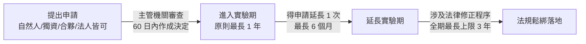

# 第 06 章：監理科技(RegTech)與金融監理沙盒法規

---

##  本章學習導航與核心地圖

法規遵循成本日益高昂；本章探討如何運用科技加速合規，以及如何在不違反剛性金融法律的前提下鼓勵創新。金融科技力測驗歷屆頻繁出題的法規重點包括：
1. RegTech（金融業者端）vs. SupTech（主管機關端）精準區辨
2. 《金融科技發展與創新實驗條例》（金融監理沙盒條例）關鍵法定數字（審查 60 日、實驗 1 年、展延 6 個月、修法上限 3 年）
3. 審查會議組成（委員 7–21 人、專家學者占 1/3–1/2、副首長以上召集人）與申請人主體資格
4. 責任豁免範圍與「洗錢防制法/資恐防制法絕對不豁免」鐵律
5. 金融監理沙盒 vs. 金融業務試辦之重大差異

---

##  一、RegTech vs. SupTech 雙劍合璧

| 科技術語 | 全稱 | 適用主體 | 核心目標 | 典型應用情境 |
| :--- | :--- | :--- | :--- | :--- |
| RegTech | Regulatory Technology 法遵科技 / 監理科技 | 金融機構自身 | 降低機構之合規與審查成本，避免遭主管機關重罰 | 自動化洗錢防制黑名單比對、可疑交易監控、內控異常稽核、法規異動自動追蹤 |
| SupTech | Supervisory Technology 監理機關科技 | 金管會 / 中央銀行等主管監理機構 | 提升金檢效能、及早發現系統性風險、實現即時數位化金檢 | 自動化金檢報表抓取、API 即時風險監控、市場異常交易警示演算法 |

---

##  二、金融監理沙盒條例精粹（常見法定數字）

我國於 2018 年 1 月 31 日正式制定公布《金融科技發展與創新實驗條例》（俗稱金融監理沙盒條例），為全球少數以「專法位階」落實沙盒機制之國家！

### 1. 什麼是監理沙盒（Regulatory Sandbox）？
監理沙盒像設有保護邊界的沙坑。新創團隊在主管機關監控的受限環境下測試新型金融業務；環境設有限制客戶人數、限制曝險金額及保障消費者權益等條件。實驗期間，暫時豁免特定金融法規的刑罰與行政罰。

### 2. 沙盒條例必考核心要素大盤點（重要法定數字）：

1. 申請人資格（條例第 4 條）：
   - 自然人、獨資、合夥事業、法人（不論本國人或外國人）皆具有申請資格！
   - *考點陷阱*：並非只有大型金融機構或資本額破億的股份有限公司才能申請！
2. 主管機關審查時限（條例第 8 條）：
   - 主管機關應自受理申請之日起 60 日內完成審查並作成決定（必要時得延長一次，並以延長 60 日為限）。
3. 審查會議組成（條例第 6 條＋《金融科技創新實驗審查會議及評估會議運作辦法》第 4 條、第 7 條）：
   - 置審查委員 7 人至 21 人；召集人由主管機關副首長以上人員擔任。
   - 專家及學者之比例不得少於委員總額三分之一，並不得超過委員總額二分之一。
4. 實驗期間與延長限制（條例第 9 條，最愛考！）：
   - 基本實驗期間：原則上以 1 年為限。
   - 一般延長限制：實驗屆滿前得申請延長，以延長 1 次為限，最長不得逾 6 個月。
   - 特殊法律修正上限：若創新實驗評估具可行性，且其業務經營需「修正相關金融法規條文」者，得不受前述 1 次 6 個月之限制，但全部創新實驗期間合計最長不得逾 3 年！
5. 責任豁免與排除例外（條例第 25 條、第 26 條，必考核心陷阱）：
   - 核准創新實驗之業務，於實驗期間內排除適用《銀行法》、《證券交易法》、《保險法》等金融法規之刑事責任與行政罰。
   -  絕對不豁免之例外：《洗錢防制法》與《資恐防制法》之刑事責任與通報義務，絕對不予豁免！申請人實驗期間仍必須嚴格執行客戶審查(CDD)與通報！
6. 參與者保障機制（條例第 13、14 條）：
   - 申請人必須事前告知參與者風險並取得書面同意；並應投保責任保險或提撥適當之補償準備金。
7. 曝險限額（《金融科技創新實驗管理辦法》第 5 條，現行版，核對日期 2026-11-21）：
   - 契約資金、交易或暴險金額總計：原則上不得逾新臺幣 1 億元；經審查會議決議得視個別業務性質、保護措施與實際管理需要限縮或放寬，但放寬後總計不得逾新臺幣 2 億元。
   - 單一參與者限額（專業投資機構除外）：消費信貸金額以新臺幣 50 萬元為限；保險商品之保費或保險服務費用以新臺幣 10 萬元或其等值外幣為限，或保險金額以新臺幣 100 萬元或其等值外幣為限；其餘金融商品或服務以新臺幣 25 萬元或其等值外幣為限。
   - 考點提醒：19-41 題答案 D「總曝險金額以新臺幣 2 億元為限」指的是放寬後上限，不是原則總額；原則總額是 1 億元，不要背反。

---

##  三、金融監理沙盒 vs. 金融業務試辦

| 比較維度 | 金融監理沙盒 (Regulatory Sandbox) | 金融業務試辦機制 (Trial Run) |
| :--- | :--- | :--- |
| 法源依據 | 《金融科技發展與創新實驗條例》（立法院法律位階） | 主管機關頒布之行政命令/作業要點（如銀行業業務試辦作業要點） |
| 是否排除法律刑罰 |  可以排除特定金融專法之刑事責任與行政罰 |  絕對不能牴觸現行法律強制規定！ |
| 適用對象 | 金融機構、科技新創、自然人、跨界業者皆可 | 既有金融機構（金管會已開放金融機構得與科技業者聯合試辦） |
| 審查程序 | 需經審查會議審核（委員 7–21 人，專家學者占 1/3–1/2，副首長以上召集） | 流程相對敏捷，由金管會業務局直接核定 |

---

## 創新實驗的申請與參與者保護

《金融科技發展與創新實驗條例》把監理沙盒定義為金融業務的創新實驗，申請須經主管機關核准。申請資料包括實驗範圍、期間與規模、參與者保護措施、可能風險與風險管理，以及洗錢與資恐風險評估。制度目的同時包含促進創新與保護金融消費者，因此沙盒不等於所有金融法規全面豁免；應逐條確認法規所定可排除或準用的範圍。

資料來源：[金融科技發展與創新實驗條例](https://law.moj.gov.tw/LawClass/LawAll.aspx?pcode=G0380254)、[金融科技創新實驗管理辦法](https://law.moj.gov.tw/LawClass/LawAll.aspx?pcode=G0380257)

---

##  四、RegTech 報告體系對照（附節）

| 報告／機構 | 年份 | 監理科技重點內容 |
| :--- | :--- | :--- |
| PwC《RegTech》報告 | 2016a | 效率與合作／整合、標準、理解／預測、學習、簡化／新方向 |
| IMF 報告 | 2017 | 監理科技領域：數據分析工具、雲應用程序、認知計算與 AI、身分驗證技術、API、區塊鏈等 |
| Deloitte 報告 | — | RegTech 四特性：敏捷性、速度、整合、分析 |
| 劍橋大學（Cambridge）報告 | 2019 | 優先領域：身分識別 |

> 注意：本表內容以稽核報告 §3.6 P06-C 為據；各報告原文細節（如 PwC 分類的確切項數與用語）編者宜對照原始報告覆核後再定稿，Codex 不得自行增補未經核對的分類項目。

---

##  歷屆常見易錯觀念

>  陷阱 1：沙盒申請人限制
> - 錯誤題目：「依《金融科技發展與創新實驗條例》，只有資本額達新台幣一億元以上且登記為股份有限公司之金融業者，始得提出沙盒申請。」
> -  正解：錯！法規明訂自然人、獨資、合夥或法人皆得提出申請，保護個人發明家與早期新創團隊的創新權利！
>
>  陷阱 2：創新實驗的最長合計年限
> - 錯誤題目：「創新實驗若涉及法律修訂，只要立法院未三讀通過，就可以無限制連續展延 10 年。」
> -  正解：錯！即便涉及立法院修法程序，條文明文規定全部創新實驗期間合計最長不得超過 3 年！超過 3 年即必須退場或停止實驗！
>
>  陷阱 3：沙盒實驗期間連洗錢防制法刑責都一併豁免？
> - 錯誤題目：「經金管會核准進入監理沙盒之創新實驗，為鼓勵創新，在實驗期間全面豁免洗錢防制法與資恐防制法之通報與處罰規定。」
> -  正解：錯！洗錢防制法與資恐防制法為國際金融防線，絕對不在豁免條款範圍之內！實驗期間違反洗錢防制法仍會依法追訴刑事責任！
>
>  陷阱 4：RegTech 與 SupTech 角色顛倒
> - 錯誤題目：「SupTech 是指各家商業銀行用來檢查內部員工是否落實個資法規的內部資訊系統。」
> -  正解：錯！商業銀行內部使用的是 RegTech（監理/法遵科技）；SupTech 的專屬使用者是主管監理機關（Supervisory Authority，如金管會）！
