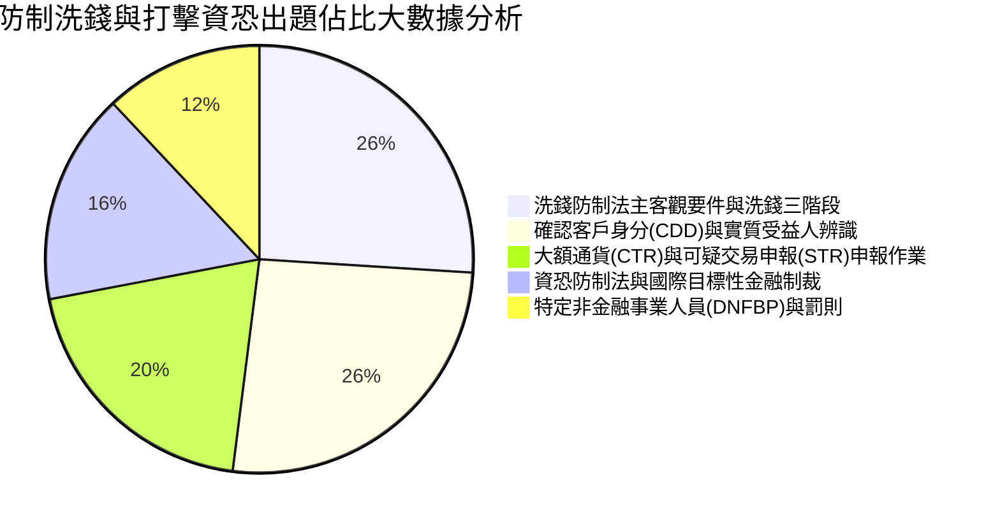

# 防制洗錢與打擊資恐人員：全景導讀與法令體系

---

## 🎯 考科核心架構與出題權重

「防制洗錢與打擊資恐專業人員測驗」為金融機構專責遵循主管、一般行員、證券投信投顧、保險、銀樓業及地政士會計師律師等指定非金融事業（DNFBP）之法定必修證照。全卷共 80 題單選題（第 1~60 題為單選題標準題庫），滿分 100 分，70 分及格，全部單選無倒扣。

依據最新歷屆試題與 FATF 40 項建議大數據分析，五大核心命題領域權重如下：

---

## 💡 本教材特色

- 洗錢三階段白話破案圖解：處置（Placement）、多層化（Layering）、整合（Integration）之犯罪金流生活情境對照。
- CDD 穿透實質受益人防線：25% 持股門檻判定、高風險重要政治性職務人士（PEPs）強化審查（EDD）。
- CTR 50 萬與 STR 申報期限：法務部調查局洗錢防制處申報流程、申報保密防範洩密罪（Tipping-off）。
