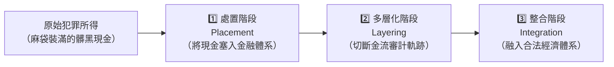

# 第 01 章：洗錢防制法核心要件與洗錢三階段生活圖解

---

##  本章學習導航與核心地圖

《洗錢防制法》用於防範不法資金漂白。本章命題有四個核心：
1. 法定洗錢行為態樣（依第 2 條四款辨認）
2. 前置重大犯罪（Predicate Offenses）之法定門檻
3. 洗錢三階段（處置、多層化、整合）生活白話金流情境
4. 「自洗錢」與「他人洗錢」同等處罰原則

---

##  一、洗錢三部曲：經典洗錢三階段（必考金流情境）

洗錢者將販毒、電信詐欺、貪污取得的「黑錢」，轉化為合法外觀「白錢」的標準三階段：

| 洗錢階段 | 英文術語 | 犯罪手法與生活寫照 | 歷屆必考典型手法 |
| :--- | :--- | :--- | :--- |
| 第一階段：處置 (入袋) | Placement | 把整麻袋的實體犯罪現金，首次塞進合法金融機構體系！ （最容易被行員現場逮獲的高風險期） | 1. 結構化交易 / 化整為零 (Smurfing)：為了規避 50 萬申報門檻，拆成 49 萬分多次到不同分行存入！ 2. 走私現金出境、買進黃金珠寶或高額賭場籌碼。 |
| 第二階段：多層化 (漂洗) | Layering | 製造複雜混亂的交易迷宮，切斷資金與原始犯罪的關聯！ （金流像洋蔥一樣層層包裹） | 1. 透過境外紙上公司跨國電匯輾轉數個避稅天堂銀行帳戶； 2. 購買虛擬貨幣(加密資產)在各去中心化交易所頻繁混幣互轉； 3. 頻繁買進賣出高流動性股票與外匯期貨。 |
| 第三階段：整合 (上岸) | Integration | 將漂白乾淨的資金以看似完全合法的投資收益名義拿出來花用！ （黑錢搖身一變成為合法企業盈餘） | 1. 設立空殼投資公司，出資向自己購買不動產豪宅； 2. 假借跨國貿易高報進口低報出口（虛假發票合法匯回）； 3. 開立合法連鎖洗車場或餐廳，虛增營業額報稅洗白。 |

> **重要加註（B01）：** 上表所列交易（買進黃金珠寶、買賣股票／外匯期貨、購買虛擬貨幣等）本身為合法交易；僅於其標的為特定犯罪所得，且行為符合洗錢防制法第 2 條各款（隱匿特定犯罪所得或掩飾其來源、收受／持有／使用特定犯罪所得、冒名開戶等）時，始構成洗錢。判斷洗錢須同時具備「特定犯罪所得」＋「法第 2 條行為」兩要件，缺一不可。

---

##  二、洗錢罪之法定構成要件（洗錢防制法第 2 條）

本法所稱洗錢，指下列行為：
1. 隱匿特定犯罪所得或掩飾其來源。
2. 妨礙或危害國家對特定犯罪所得的調查、發現、保全、沒收或追徵。
3. 收受、持有或使用他人之特定犯罪所得。
4. 使用自己的特定犯罪所得與他人進行交易。

### 1. 前置特定犯罪之門檻（第 3 條）
- 洗錢防制法第 3 條共 21 款。第 1 款為概括條款：最輕本刑為 6 個月以上有期徒刑之罪。
- 第 2 款至第 21 款為列舉款。原教材所舉六類，分屬不同依據，**不可一概稱為「法條特別明文列舉」**：
  - 屬列舉款者：刑法詐欺罪、背信罪（第 2 款）；智慧財產權侵害（商標法第 95、96 條，第 5 款；著作權法第 91、91-1、92 條，第 19 款）。
  - 屬概括條款（第 1 款）者：證交法內線交易（證交法第 171 條，不在列舉款內）、操縱股價（證交法第 155 條，不在列舉款內）、銀行法不法吸金（銀行法第 125 條，不在列舉款內）——三者之所以屬特定犯罪，是因其最輕本刑 6 個月以上，符合第 1 款概括條款。
- 另須記住兩款常考列舉款：第 12 款（資恐防制法第 8 條、第 9 條第 1、2、4 項之罪）、第 13 款（本法第 21 條收集帳戶罪）。
- 考點：內線交易、操縱股價、不法吸金之所以屬特定犯罪，靠的是第 1 款概括條款，不是列舉款（稽核報告 B02）。

### 2. 「自洗錢」入罪化
- 過去舊法認為「自己犯罪自己藏錢」不另論洗錢罪；現行法明訂：自己犯特定犯罪後掩飾隱匿犯罪所得（自洗錢者），依然單獨成立洗錢防制法之洗錢罪，與前置犯罪數罪併罰！

### 3. 收集帳戶與交付帳戶（第 21 條、第 22 條）
- 無正當理由收集他人金融帳戶、虛擬資產或第三方支付帳號，且有冒用公務名義、對公眾散布、科技製作不實資料、期約或交付對價、強暴脅迫詐術等法定情形之一者（第 21 條）：處 5 年以下有期徒刑、拘役或科或併科新臺幣 3,000 萬元以下罰金；未遂犯亦罰。
- 交付、提供自己或他人的上述帳戶、帳號供他人使用（第 22 條）：符合一般商業、金融交易習慣、親友間信賴關係或其他正當理由者除外。
  - 違反規定者由警察機關裁處告誡；告誡後逾 5 年再違反，亦同。
  - 期約或收受對價、交付提供帳戶或帳號合計 3 個以上、或經告誡後 5 年內再犯，任一情形可成立刑責：處 3 年以下有期徒刑、拘役或科或併科新臺幣 100 萬元以下罰金。前兩種情形不必先受告誡，並應併予告誡。

### 4. 洗錢罪刑責、特殊洗錢罪與沒收（第 19 條、第 20 條、第 25 條）
- 第 19 條（洗錢罪）：處 3 年以上 10 年以下有期徒刑，併科新臺幣 1 億元以下罰金。
- 洗錢的財物或財產上利益未達新臺幣 1 億元者：處 6 個月以上 5 年以下有期徒刑，併科新臺幣 5,000 萬元以下罰金；未遂犯亦罰。
- 第 20 條（特殊洗錢罪）：收受、持有或使用無合理來源之財物或財產上利益，有下列情形之一者，處 6 個月以上 5 年以下有期徒刑，得併科新臺幣 5,000 萬元以下罰金：(1) 冒名或以假名或其他不實資訊申請開立帳戶、帳號；(2) 以不正方法取得他人向金融機構申請開立之帳戶、向虛擬通貨平台及交易業務之事業申請之帳號；(3) 規避第 8 條至第 13 條所定洗錢防制程序。未遂犯亦罰。**特殊洗錢罪不以證明該財物為特定犯罪所得為必要（與第 19 條之區別）。**
- 第 25 條：犯第 19、20 條之罪的洗錢財物或財產上利益，不問屬於犯罪行為人與否，沒收之；其他違法所得的沒收另依該條規定。
> **新舊條號對照註（113-07-31 修正後，核對日期 2026-11-21）：** 沒收現行法為第 25 條（修正前為第 18 條；114-4 Q7 題幹仍用舊條號第 18 條，答案「應沒收之」不變）；特殊洗錢罪現行法為第 20 條（修正前為第 15 條；115-2 Q19 選項仍用舊條號第 15 條）；邊境金流管制現行法為第 14 條（106 年版為第 12 條；113-4 Q14 題幹仍用舊條號）；洩密現行法為第 24 條（106 年版為第 13 條）。**歷屆題幹沿用舊條號時，答案以題幹當期官方答案為準，不得以現行條號改判。**

### 5. 受規範主體：金融機構與指定非金融事業或人員 (DNFBP)（第 5 條）
- 金融機構：銀行、信用合作社、農漁會信用部、票券金融、信用卡業務機構、信託業、郵政儲金匯兌、證券商、證券投資信託、證券金融、期貨商、保險業、電子支付機構、辦理外籍移工小額匯兌事業。
- 指定之非金融事業或人員（DNFBP，第 5 條第 3 項）：
  1. 銀樓業。
  2. 地政士及不動產經紀業（於從事不動產買賣交易之籌劃或執行時）。
  3. 律師、公證人、會計師（於為客戶準備或進行不動產買賣、客戶資金資產管理、銀行帳戶管理、公司籌設營運買賣時）。
  4. 信託及公司服務提供者。
  5. 提供第三方支付服務之事業或人員。
  6. 其他經指定之事業或從業人員，依其適用交易型態判斷。
- 提供虛擬資產服務之事業或人員（VASP）依第 5 條第 2 項適用金融機構規定，不能混列為上述 DNFBP。

### 6. 虛擬資產服務與第三方支付之登記制（第 6 條）與指定機制（第 5 條第 4 項）
> 法源：洗錢防制法第 6 條、第 5 條第 4 項（113-07-31 修正，113-11-30 施行，核對日期 2026-11-21）。
> **條號更正：稽核報告稱登記制為法第 5 條第 7–10 項，係錯誤；法第 5 條僅 8 項，第 7 項為「中央目的事業主管機關認定有疑義者由行政院指定」，與登記制無關。登記制為法第 6 條。**

- 登記制（法第 6 條第 1 項）：提供虛擬資產服務、第三方支付服務之事業或人員，未向中央目的事業主管機關完成洗錢防制、服務能量登記或登錄者，不得提供虛擬資產服務、第三方支付服務。境外設立之提供虛擬資產服務、第三方支付服務之事業或人員，非依公司法辦理公司或分公司設立登記，並完成洗錢防制、服務能量登記或登錄者，不得在我國境內提供虛擬資產服務、第三方支付服務。
- 刑責（法第 6 條第 5 項）：違反第 1 項規定者，處 2 年以下有期徒刑、拘役或科或併科新臺幣 500 萬元以下罰金。法人之代表人、管理人或其他有代表權人，因執行業務犯前項之罪者，除處罰其行為人外，對該法人亦科以其十倍以下之罰金（法第 6 條第 6 項）。
- 指定機制（法第 5 條第 4 項）：第 2 項辦理融資性租賃、提供虛擬資產服務之事業或人員之範圍、第 3 項第 6 款指定之非金融事業或人員，其適用之交易型態，及得不適用第 12 條第 1 項申報規定之前項各款事業或人員，由法務部會同中央目的事業主管機關報請行政院指定。
- 未來變動提示：虛擬資產服務法已於 2026 年 6 月 30 日三讀、7 月 22 日公布，施行日期由行政院定之（截至 2026-11-02 查詢仍未施行，金管會預期 2027 年第 1 季施行）；新法施行後 VASP 改採許可制，現行登記制（法第 6 條）將隨之調整，教材屆時須再更新。

---

##  歷屆常見易錯觀念

>  陷阱 1：洗錢三階段判定
> - 錯誤題目：「毒販將販毒取得的現金，分批以每筆 48 萬元存入五家不同銀行帳戶，此行為屬於多層化(Layering)階段。」
> -  正解：錯！將實體現金首次存入銀行體系的動作，屬於第一階段「處置 (Placement)」！將存款電匯到國外境外公司才進入第二階段多層化！
>
>  陷阱 2：洗錢罪是否處罰自己犯罪的所得？
> - 錯誤題目：「依我國現行洗錢防制法，只有幫別人洗錢才會被判刑，自己貪污後把贓款藏在床底下不構成洗錢罪。」
> -  正解：錯！現行法已經將自洗錢（Self-laundering）全面入罪化！自己犯罪後隱匿處置犯罪所得，同樣觸犯洗錢罪！

法規校核：洗錢防制法（113-07-31 修正）、金融機構防制洗錢辦法（110-12-14 修正）、資恐防制法（107-11-07 修正）——核對日期 2026-11-21。歷史題目仍依原考期法規與官方答案判讀。
