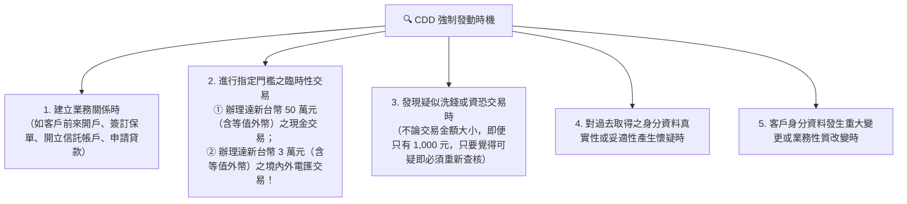

# 第 02 章：客戶審查(CDD)與實質受益人辨識攻略

---

## 🎯 本章學習導航與核心地圖

確認客戶身分（Know Your Customer / Customer Due Diligence, CDD）是防制洗錢最前線的防禦工事。本章在歷屆中考題佔比達 26%，三大必考考點：
1. CDD 法定發動時機（何時必須強制驗證客戶身分？）
2. 法人實質受益人（Beneficial Ownership, BO）穿透三階辨識法則（25% 門檻）
3. 重要政治性職務人士（PEPs）及其家屬之加強審查（EDD）程序

---

## 🔍 一、CDD 法定發動時機（五大強制查核情境）

金融機構在下列情況下，必須強制執行確認客戶身分程序：

---

## 🏢 二、法人「實質受益人」穿透三階辨識（必考 25% 門檻）

當開戶主體為公司行號、信託或團體等法人時，金融機構不得只看營業登記表上的紙上負責人，必須「穿透迷宮，找出藏在幕後操控該法人的真正自然人」：

| 辨識位階 | 穿透判定準則 | 實例說明 |
| :--- | :--- | :--- |
| 第一位階 (股權控制) | 直接或間接持有該法人股份或資本超過 25% 之自然人 | 張三持有甲公司 30% 股權，張三即為實質受益人！ |
| 第二位階 (其他實質控制) | 若第一位階無人持股超過 25%（股權分散），則尋找透過其他方式行使實質控制權之自然人 | 股東會表決權信託受託人、協議控制人、具實質人事任免權之幕後金主 |
| 第三位階 (高階管理人員) | 若經窮盡查證，前兩位階均查無實質控制自然人時，以法人的「高階管理人員」作為實質受益人登記列管 | 董事長、董事、總經理、執行長 (CEO) |

> 🔥 考古題免穿透之例外法人（得不適用 25% 實質受益人辨識）：
> 下列具備公開透明監理機制之法人，得簡化免逐層穿透實質受益人：
> 1. 我國政府機關、公營事業機構；
> 2. 外國政府機關；
> 3. 我國掛牌上市、上櫃公司及其子公司（資訊已高度公開）；
> 4. 在證券交易所掛牌之外國上市公司；
> 5. 受我國或外國嚴格監理之金融機構及其管理之投資工具。

---

## 🏛️ 三、重要政治性職務人士（PEPs）與加強審查 (EDD)

### 1. PEPs 涵蓋範圍
- 現任或曾任國內外政府或國際組織之重要政治性職務人士（元首、行政首長、部會首長、立委、大法官、國營企業董事長等）。
- 核心家庭成員：配偶（或實質伴侶）、一親等直系血親（父母、子女）及一親等直系姻親、兄弟姊妹。
- 密切關係人：同夥合夥人、受託代持資產者。

### 2. 加強客戶審查（Enhanced Due Diligence, EDD）三鐵律
1. 核准層級提升：與高風險國外 PEP 建立業務關係或維持關係前，必須取得高階管理人員（總行高層或分行經理以上）之核准同意！
2. 查明財富來源 (SOF) 與資金來源 (SOW)：必須調查其資產是如何賺來的（合法的薪資所得、家族繼承遺產，還是來路不明的不法賄賂？）。
3. 持續性加強監控：交易行為必須列入常態性高頻率自動化稽核名單。
4. PEP 退職後之處置原則（第 10 條）：國內外重要政治性職務人士退職後，並非一律終生適用 EDD，金融機構應進行「風險基礎評估」，考量其卸任時間長短、當前實質政治影響力等，評估其是否仍應視為高風險客戶列管。

---

## 🚫 四、金融機構應婉拒建立業務關係或交易之法定情形（辦法第 4 條）

金融機構確認客戶身分時，有下列情形之一者，應予以婉拒建立業務關係或交易：
1. 疑似使用匿名、假名、人頭、虛設行號或虛設法人團體。
2. 客戶拒絕提供審查身分所須之相關文件（但經可靠、獨立來源確實查證身分者不在此限）。
3. 持用偽造、變造身分證明文件，或出示之身分證明文件均為影本。
4. 提供文件資料可疑、模糊不清，不願提供其他佐證資料，或提供之文件資料無法進行查證。
5. 客戶不尋常拖延應補充之身分證明文件。
6. 建立業務關係之對象為受資恐防制法指定制裁之個人、法人或團體，或外國政府/國際組織認定或追查之恐怖分子/團體。
7. 開戶或交易時，有其他異常情形，客戶無法提出合理合法說明。

---

## 🗄️ 五、客戶身分資料與交易紀錄保存年限（辦法第 12 條）

- 身分資料保存年限：所有在確認身分過程中所取得之各項資料、紀錄憑證，自「與客戶業務關係結束」起，至少保存 5 年！
- 交易紀錄保存年限：對國內外所有交易進行完整記錄，確保足以重現金流軌跡，自「交易完成」時起，至少保存 5 年！
- 遇有司法調查或可疑申報時：如涉及正由司法調查或監管機關查處之案件，即便逾 5 年，相關紀錄仍應繼續妥善保存至結案為止！

---

## 🔥 歷屆必考陷阱手冊

> ❌ 陷阱 1：實質受益人持股門檻
> - 錯誤題目：「依主管機關規定，法人實質受益人之辨識標準為直接或間接持股達 50% 以上之自然人。」
> - 👉 正解：錯！國際 FATF 與我國法定門檻為超過 25%（非 50%）！
>
> ❌ 陷阱 2：國內上市公司開戶是否需逐層穿透持股？
> - 錯誤題目：「台積電或聯發科前往銀行開立營運帳戶時，銀行必須要求其提供股東名簿並逐一穿透至持有 25% 的自然人始得開戶。」
> - 👉 正解：錯！我國上市、上櫃公司及其子公司屬於法定豁免穿透對象，因為其大股東與財務報表依法已受證交法嚴格公開揭露，無需重複逐層穿透！
