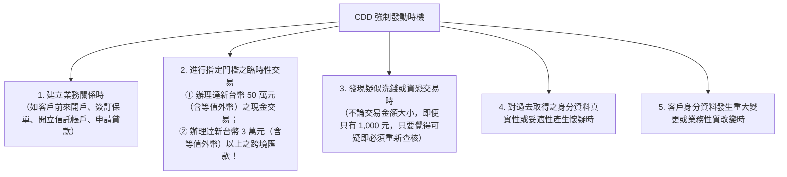

# 第 02 章：客戶審查(CDD)與實質受益人辨識攻略

---

##  本章學習導航與核心地圖

確認客戶身分（Know Your Customer / Customer Due Diligence, CDD）是防制洗錢的重要環節。本章整理三項客戶審查重點：
1. CDD 法定發動時機（何時必須強制驗證客戶身分？）
2. 法人實質受益人（Beneficial Ownership, BO）穿透三階辨識法則（25% 門檻）
3. 重要政治性職務人士（PEPs）及其家屬之加強審查（EDD）程序

---

##  一、CDD 法定發動時機（五大強制查核情境）

金融機構在下列情況下，必須強制執行確認客戶身分程序：

---

##  二、法人「實質受益人」穿透三階辨識（必考 25% 門檻）

法人客戶的實質受益人辨識，須依股權、其他控制方式及高階管理人員的適用條件辦理：

| 辨識位階 | 穿透判定準則 | 實例說明 |
| :--- | :--- | :--- |
| 第一位階 (股權控制) | 直接或間接持有該法人股份或資本超過 25% 之自然人 | 張三持有甲公司 30% 股權，張三即為實質受益人！ |
| 第二位階 (其他實質控制) | 若第一位階無人持股超過 25%（股權分散），則尋找透過其他方式行使實質控制權之自然人；未能辨識或仍有疑義時，再以法人的「高階管理人員」作為實質受益人登記列管（第三位階） | 股東會表決權信託受託人、協議控制人、具實質人事任免權之自然人 |
| 第三位階 (高階管理人員) | 若經窮盡查證，前兩位階均查無實質控制自然人時，以法人的「高階管理人員」作為實質受益人登記列管 | 董事長、董事、總經理、執行長 (CEO) |

> **間接持股加總算例（114-1 Q65）：** 直接持股與間接持股加總超過 25% 者，即為實質受益人。例：A 直接持股 15%，另透過持股 30% 之乙公司間接持股 30% × 30% = 9%，合計 24%，未超過 25%，非實質受益人；B 直接持股 20%，間接持股 9%，合計 29%，超過 25%，為實質受益人；D 直接持股 20%，間接持股 12%，合計 32%，超過 25%，為實質受益人。**關鍵：間接持股須逐層乘算後與直接持股加總，不可只看直接持股。**

>  考古題免穿透之例外法人（得不適用 25% 實質受益人辨識）：
> 現行辦法列有多種身分例外，不限於上市櫃公司；包括我國政府機關、公營事業、公開發行公司及其子公司、受監理金融機構等。是否適用例外仍要核對法定身分與條件，不能把它概括成所有上市櫃關係企業一律免查：
> 1. 我國政府機關、公營事業機構；
> 2. 外國政府機關；
> 3. 我國公開發行公司或其子公司；
> 4. 國外掛牌並依掛牌所在地規定應揭露其主要股東之股票上市、上櫃公司及其子公司；
> 5. 受我國監理之金融機構及其管理之投資工具；
> 6. 設立於我國境外且其監理規範與防制洗錢金融行動工作組織（FATF）所定標準一致之金融機構及其管理之投資工具；
> 7. 我國政府機關管理之基金；
> 8. 員工持股信託或員工福利儲蓄信託。
> 但書：有辦法第 6 條第 1 項第 3 款但書情形（客戶來自未遵循或未充分遵循國際防制洗錢組織建議之國家或地區；足資懷疑客戶涉及洗錢或資恐）或已發行無記名股票者，豁免不適用。
> 註：原第 3 項「掛牌上市、上櫃公司」應為「公開發行公司」（辦法第 3 條第 7 項第 3 款第 4 目）；原第 4 項「在證券交易所掛牌之外國上市公司」應為「國外掛牌並依掛牌所在地規定應揭露其主要股東之股票上市、上櫃公司及其子公司」（第 5 目）；原第 5 項將兩類金融機構合併一句，現分列為第 5、6 項（第 6、7 目）。第 1、2 項（我國政府機關、公營事業機構；外國政府機關）與 L45 引言段正確，不動。

---

##  三、重要政治性職務人士（PEPs）與加強審查 (EDD)

### 1. PEPs 涵蓋範圍
- 現任或曾任國內外政府或國際組織之重要政治性職務人士（元首、行政首長、部會首長、立委、大法官、國營企業董事長等）。
- 家庭成員（認定標準第 6 條，113-12-03 修正）：(1) 配偶；(2) 直系血親；(3) 直系姻親；(4) 兄弟姊妹及配偶之兄弟姊妹。**注意：原教材漏「配偶之兄弟姊妹」，且「一親等直系姻親」之寫法不正確——認定標準第 6 條第 3 款為「直系姻親」，未限一親等。**
- 密切關係人（認定標準第 7 條，12 款判斷基準）：(1) 同一合夥事業之合夥人；(2) 同一公司之董事、監察人或高階主管；(3) 有密切商業往來之人；(4) 受僱人或僱用人；(5) 由前款受僱人或由其擔任代表人之法人所僱用之人；(6) 同一借款債務之借款人、保證人或擔保人；(7) 代理達一定金額通貨交易之人（引法第 12 條第 1 項）；(8) 同一法人或信託之實質受益人；(9) 擔任為 PEP 利益所設立之法人或信託之實質受益人；(10) 受委託持有、管理或運用資產之人；(11) 以 PEP 為受益人之人身保險契約之要保人及被保險人；(12) PEP 所屬人民團體或工會之負責人。**原教材僅列兩例，現按認定標準第 7 條完整列出 12 款。**

### 2. 加強客戶審查（Enhanced Due Diligence, EDD）與退職後評估
1. 核准層級提升：與高風險國外 PEP 建立業務關係或維持關係前，必須取得高階管理人員（總行高層或分行經理以上）之核准同意！
2. 查明財富來源 (SOW) 與資金來源 (SOF)：必須調查其資產是如何賺來的（合法的薪資所得、家族繼承遺產，還是來路不明的不法賄賂？）。
3. 持續性加強監控：交易行為必須列入常態性高頻率自動化稽核名單。
4. PEP 退職後之處置原則（第 10 條）：國內外重要政治性職務人士退職後，並非一律終生適用 EDD，金融機構應依重要政治性職務之人範圍認定標準第 5 條（113-12-03 修正）進行評估，考量兩項法定要件：(1) 擔任重要政治性職務之時間；(2) 離職後所擔任之新職務，與其先前重要政治性職務是否有關連性。評估其是否仍應視為高風險客戶列管。

### 3. PEP 偵測來源與警示訊號
> 依據：認定標準；金融機構防制洗錢辦法第 3、10 條；歷屆試題（核對日期 2026-11-21）。

#### 偵測來源
- 公開資訊系統：監察院廉政專刊等公開資訊系統為辨識 PEP 之主要來源（113-4 Q72、114-4 Q72）。
- 社群媒體與網路／電子媒體資源：可透過社群媒體取得 PEP 相關公開資訊（115-2 Q35，官方解答標準答案為社群媒體）。
- 媒體與社會負面新聞：注意媒體及社會負面新聞，落實客戶審查（115-3 Q71，repo 答案為 (B)(C)，未經官方解答核對）。
- 客戶資訊更新與員工訓練：確保客戶資訊更新、員工定期接受 PEP 相關訓練（115-2 Q65，官方解答標準答案為 123）。

#### 警示訊號（疑似洗錢及資恐）
- 詢問金融機構的洗錢防制政策（探詢監控底線）（115-2 Q58，官方解答標準答案為 (2)）。
- 交易金額經常是整數（115-3 Q59）。
- 個人資金與企業相關資金混淆不清（115-3 Q59）。
- 曾多次被陳報涉及可疑交易（115-3 Q59）。
- 使用記名票據支付款項**不是** PEP 警示表徵（115-3 Q59：(C) 使用記名票據支付款項為非警示表徵）。

---

##  四、金融機構應婉拒建立業務關係或交易之法定情形（辦法第 4 條）

金融機構確認客戶身分時，有下列情形之一者，應予以婉拒建立業務關係或交易：
1. 疑似使用匿名、假名、人頭、虛設行號或虛設法人團體開設帳戶、投保或辦理儲值卡記名作業。
2. 客戶拒絕提供審核客戶身分措施相關文件。
3. 代理人辦理開戶、儲值卡記名、註冊電子支付帳戶、投保、保險理賠、保險契約變更或交易，查證代理事實及身分資料有困難。
4. 持用偽、變造身分證明文件。
5. 出示之身分證明文件均為影本。但依規定得以影本或影像檔輔以其他管控措施辦理之業務，不在此限。
6. 提供文件資料可疑、模糊不清，不願提供其他佐證資料或提供之文件資料無法進行查證。
7. 客戶不尋常拖延應補充之身分證明文件。
8. 建立業務關係之對象為資恐防制法指定制裁之個人、法人或團體，以及外國政府或國際組織認定或追查之恐怖分子或團體。但依資恐防制法第 6 條第 1 項第 1 款至第 3 款所為之支付，不在此限。
9. 建立業務關係或交易時有其他異常情形，客戶無法提出合理說明。

---

##  五、客戶身分資料與交易紀錄保存年限（辦法第 12 條）

- 身分資料保存年限：所有在確認身分過程中所取得之各項資料、紀錄憑證，自「與客戶業務關係結束」起，至少保存 5 年！
- 交易紀錄保存年限：對國內外所有交易進行完整記錄，確保足以重建個別交易，自「交易完成」時起，至少保存 5 年！
- 遇有司法調查或可疑申報時：如涉及正由司法調查或監管機關查處之案件，即便逾 5 年，相關紀錄仍應繼續妥善保存至結案為止！

### 六、風險基礎措施與持續審查（P02、P12、P13）
> 法源：金融機構防制洗錢辦法第 5 條、第 6 條、第 3 條第 9 項、第 3 條第 10 項、第 3 條第 11 項（110-12-14 修正，核對日期 2026-11-21）。歷屆高頻：P02 單元共 46 題。

#### 1. 高風險客戶：強化措施三項（辦法第 6 條第 1 項第 1 款）
對高風險客戶建立業務關係或交易時，應採取下列強化措施：
- (1) 建立業務關係或交易前，應取得高階管理人員同意；
- (2) 採取合理措施瞭解客戶財富及資金來源；
- (3) 建立業務關係後，應採取強化之持續監督。
> 口訣：「高階同意、瞭解財富資金來源、強化持續監督」。

#### 2. 不得簡化措施之情形（辦法第 6 條第 1 項第 3 款但書）
下列情形不得採簡化措施，應採一般或強化措施：
- (1) 客戶來自未遵循或未充分遵循國際防制洗錢組織建議之國家或地區；
- (2) 足資懷疑客戶涉及洗錢或資恐之情形。
> 另依第 6 條第 1 項第 2 款，保險業對於受益人為法人或信託之保險契約，於給付保險金前應辨識受益人是否為高風險客戶，並納入考量。

#### 3. 持續審查（辦法第 5 條）與先完成原則（辦法第 3 條第 9 項）
- 持續審查三時機：(1) 客戶身分資料異動時；(2) 客戶涉及疑似洗錢或資恐交易時；(3) 客戶之風險等級變動時（辦法第 5 條第 1 項）。
- 高風險客戶之身分資料，至少每年檢視一次（辦法第 5 條第 3 項；115-3 Q40：高風險客戶至少每年檢視一次為正確敘述；115-2 Q75：高風險至少每二年檢視一次為錯誤敘述）。
- 先完成原則：建立業務關係時，應於建立業務關係前完成客戶審查；例外情形有三：(1) 依業務特性無法於建立業務關係前完成者；(2) 依業務特性無法於交易前完成者；(3) 依業務特性無法於辦理儲值卡記名作業前完成者（辦法第 3 條第 9 項）。例外情形下應於建立業務關係後，在合理可行之情形下儘速完成；未能在合理時限內完成者，應終止業務關係，並事先告知客戶。
- 歷屆試題例：銀行業注意事項範本訂有「建立業務關係後不遲於 30 個工作天完成驗證」（114-3 Q20、Q48）；考試依各業別範本出題時以範本為準。
- 無法完成客戶審查時，應考量是否申報疑似洗錢或資恐交易（辦法第 3 條第 10 項）；客戶審查程序所得資料，不得洩漏，但依洗錢防制法規定向法務部調查局申報者，不在此限（辦法第 3 條第 11 項）。

### 七、CDD 方式、代理人、依賴第三方與 DNFBP（P14）
> 法源：金融機構防制洗錢辦法第 3 條第 4 項、第 7 條；洗錢防制法第 5 條、第 8 條（核對日期 2026-11-21）。

#### 1. CDD 四款方式（辦法第 3 條第 4 項）
金融機構確認客戶身分時，應採取下列方式：(1) 以可靠、獨立來源之文件、資料或資訊，辨識及驗證客戶身分；(2) 辨識客戶是否為代理人，並採取合理措施辨識及驗證代理人身分；(3) 辨識法人或團體客戶之實質受益人，並採取合理措施驗證其身分；(4) 瞭解業務往來之目的及預計進行交易之性質。

#### 2. 代理人
- 客戶為代理人時，應辨識及驗證代理人身分，並查證代理事實（辦法第 3 條第 4 項第 2 款）；代理人辦理開戶等業務而查證代理事實及身分資料有困難者，應婉拒（辦法第 4 條第 3 款，見 AML-16）。
- 代理達一定金額通貨交易之人，為 PEP 密切關係人之判斷基準之一（認定標準第 7 條第 7 款，引法第 12 條第 1 項）。

#### 3. 依賴第三方（辦法第 7 條；FATF 建議 17）
- 金融機構依賴第三方執行客戶審查程序時，仍負最終責任（115-2 Q2：FATF 建議 17「依賴第三方仍負最終責任」；「第三方負最終責任」為錯誤敘述）。
- 應立即取得第三方執行客戶審查程序所得之資訊，並於接獲要求時毫不延遲提供相關文件影本。
- 第三方應受防制洗錢及打擊資恐規範並受監督，且其所在地之防制洗錢及打擊資恐規範與 FATF 標準一致。

#### 4. 指定之非金融事業或人員（DNFBP）
- 法第 5 條第 3 項六類：銀樓業、地政士及不動產經紀業、律師／公證人／會計師（為客戶準備或進行特定交易時）、信託及公司服務提供者、提供第三方支付服務之事業或人員、其他經指定之事業或從業人員。
- DNFBP 亦負客戶審查義務（法第 8 條）；違反法第 7 條第 1 項未建立內控制度者，處 5 萬元以上 500 萬元以下罰鍰（法第 7 條第 4 項）。

### 八、名稱檢核（P15）
> 法源：金融機構防制洗錢辦法第 8 條（110-12-14 修正，核對日期 2026-11-21）；洗錢防制法第 5 條第 1 項至第 3 項。

金融機構應建立姓名及名稱檢核政策及程序，並作成書面化紀錄，內容包括下列三要素：
1. 比對與篩檢邏輯；
2. 檢核作業之執行程序；
3. 檢視標準。
> 考點：證券期貨業姓名檢核政策及程序不包括「機構風險評估」（114-2 Q50，repo 答案為 (1)「機構風險評估」；該題官方解答 Q50=2，選項順序疑義見修補單文末暫不可執行清單第 12 項——姓名檢核三要素以辦法第 8 條原文為準）。
> 名稱檢核對象：建立業務關係前，應檢核客戶是否為法第 5 條第 1 項至第 3 項所定機構、事業或人員通報之對象，以及是否為資恐防制法指定制裁對象；檢核結果應留存紀錄。

---

## 現行法規核對：CDD、PEP 與風險基礎措施

法人客戶的實質受益人判斷，先找直接或間接持有股份／資本「超過 25%」的最終自然人；未能辨識或仍有疑義時，再查其他控制方式，仍未找到者辨識高階管理人員。對低風險可採相稱的簡化措施，但高風險情況須加強審查。現任國外重要政治性職務人士須直接視為高風險；國內或國際組織 PEP 則依規定評估，不能把所有 PEP 一律寫成相同處置。

資料來源：[金融機構防制洗錢辦法第 3、6、10 條](https://law.moj.gov.tw/LawClass/LawAll.aspx?pcode=G0380252)、[洗錢防制法第 8 條](https://law.moj.gov.tw/LawClass/LawAll.aspx?kw=%E6%B4%97%E9%8C%A2%E9%98%B2%E5%88%B6%E6%B3%95&pcode=G0380131)

---

##  歷屆常見易錯觀念

>  陷阱 1：實質受益人持股門檻
> - 錯誤題目：「依主管機關規定，法人實質受益人之辨識標準為直接或間接持股達 50% 以上之自然人。」
> -  正解：錯！國際 FATF 與我國法定門檻為超過 25%（非 50%）！
>
>  陷阱 2：國內上市公司開戶是否需逐層穿透持股？
> - 錯誤題目：「台積電或聯發科前往銀行開立營運帳戶時，銀行必須要求其提供股東名簿並逐一穿透至持有 25% 的自然人始得開戶。」
> - 判斷：先核對客戶是否符合本章列出的例外身分及條件，再判斷實質受益人辨識要求；不能只憑公司名稱認定，也不能推論所有關係企業或其他客戶審查事項一律免查。
