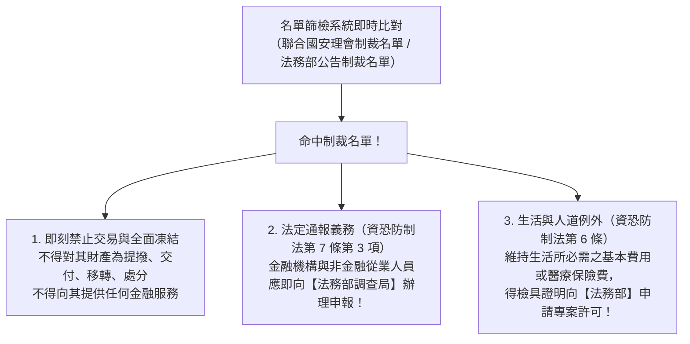

# 第 04 章：資恐防制法要件與目標性金融制裁名單篩檢

---

##  本章學習導航與核心地圖

防止恐怖分子取得資金毀滅世界，《資恐防制法》具備強大的國際法效力與即時凍結威力。本章出題核心三焦點：
1. 《資恐防制法》主管機關與「資恐防制審議會」
2. 資恐罪之成立要件（不問恐怖活動是否真正發生）
3. 目標性金融制裁（TFS）名單篩檢與資產即刻凍結處分

---

##  一、《資恐防制法》主管機關與審議機制

- 主管機關：法務部（資恐防制法第 2 條）。
- 資恐防制審議會（第 3 條）：
  - 由法務部長擔任召集人，成員涵蓋國安局、內政部、外交部、國防部、經濟部、中央銀行、金管會等部會副首長組成。**原教材漏列中央銀行（115-2 Q61 官方解答標準答案含中央銀行）。**
  - 職權：審議指定制裁名單、除名名單與酌留生活費用之專案許可。
  - 指定制裁兩種程序：第 4 條——經審議會決議指定（得指定）；第 5 條——聯合國安全理事會資恐決議或大規模毀滅性武器擴散決議所指定者，主管機關應即指定（應指定）。
  - 除名：第 4 條指定者，經審議會決議並公告除名；第 5 條指定者，非經聯合國安全理事會除名程序，不得除名。指定或除名，自公告時生效（第 13 條）。

---

##  二、資恐罪之特殊法律要件（必考法理）

資恐防制法第 8 條、第 9 條規範之資恐罪，其最大特色在於：
1. 不以發生恐怖活動為前提：
   - 行為人只要直接或間接提供、募集財產或財產上利益，意圖供恐怖組織、恐怖分子從事恐怖活動，不論該恐怖活動最終是否真正發生，罪名即完全成立！
2. 不論資金來源是否合法：
   - 傳統洗錢是漂白「非法黑錢」；資恐資金往往來自「完全合法的捐款、募款、個人薪資或小額積蓄」，只要資金流向是為了支持恐怖活動，即構成資恐！
3. 第 8 條與第 9 條刑度區分：
   - 第 8 條（資恐罪）：明知他人有實行第 8 條第 1 項各款之罪以引起人員死亡或重傷、達恐嚇公眾或脅迫政府等目的之具體計畫或活動，直接或間接為其收集或提供財物或財產上利益者，處 1 年以上 7 年以下有期徒刑，得併科新臺幣 1,000 萬元以下罰金。
   - 第 9 條（明知為受制裁對象而收集或提供財物或財產上利益）：處 6 個月以上 5 年以下有期徒刑，得併科新臺幣 500 萬元以下罰金；且犯罪之成立不以證明該財物或財產上利益為供特定恐怖活動為必要（第 9 條第 3 項）。
   - **概念註明：** 「不論資金來源是否合法」為 FATF 概念說明，法條無此明文；第 8 條與第 9 條均以行為人「明知」為要件，且第 8 條以「具體計畫或活動」為要件（非以恐怖活動實際發生為必要）。

---

##  三、目標性金融制裁（TFS）與即刻凍結作業

### 1. 目標性金融制裁（TFS）之法律效果（資恐防制法第 7 條）
- 全面性資產禁止處分（凍結，資恐防制法第 7 條第 1 項）：
  1. 不得提款、匯款、轉帳、付款、交付或轉讓其財物或財產上利益。
  2. 不得移轉、變更、處分、利用或為其他足以變動其數量、品質、價值及所在地之行為。
  3. 不得收集或提供其財物或財產上利益。
- 第三人持有或管理受制裁對象之財物或財產上利益者，亦適用前項規定（第 7 條第 2 項）。
> **對照註：** 原教材第 1 款混用「提撥、交付、移轉、變更、處分、利用…移轉其所有權或管理權」之措辭，與現行 §7 第 1 項第 1、2 款不完全對應；原第 2、3 款（受任或受託管理財產、提供金融／商業交易或資產管理服務）為舊法措辭，現行法已改寫為第 1 項第 3 款「收集或提供財物或財產上利益」。
- 善意第三人之權利保障（資恐防制法第 6 條第 1 項第 3 款）：第三人對受制裁者所負之債務，依法院判決、執行名義或契約約定應予履行者，主管機關得依職權或申請，許可對受制裁者為支付。受制裁處分前，善意第三人已取得之既有債權或擔保物權，其依法行使權利（如實行抵押權求償）不受凍結處分之影響。現行 §7 第 4 項為通報者免除保密義務之規定，與善意第三人無關。

### 2. 違反凍結令與違法提供資產之刑事處罰（資恐防制法第 8 條、第 9 條）
- 違反資恐防制法第 8 條（資恐罪）：明知他人有實行第 8 條第 1 項各款之罪以引起人員死亡或重傷、達恐嚇公眾或脅迫政府等目的之具體計畫或活動，直接或間接為其收集或提供財物或財產上利益者，處 1 年以上 7 年以下有期徒刑，得併科新臺幣 1,000 萬元以下罰金。
- 違反資恐防制法第 9 條（明知為受制裁對象而收集或提供財物或財產上利益）：處 6 個月以上 5 年以下有期徒刑，得併科新臺幣 500 萬元以下罰金；且犯罪之成立不以證明該財物或財產上利益為供特定恐怖活動為必要（第 9 條第 3 項）。
- 法人罰金：法人因其代表人、管理人或其他有代表權人執行業務犯第 8 條或第 9 條之罪者，除處罰其行為人外，對該法人亦科以各該條所定之罰金（第 11 條）。
- 違反第 7 條第 1 項至第 3 項（禁止行為、第三人適用、通報義務）者，處新臺幣 20 萬元以上 100 萬元以下罰鍰（第 12 條）。第 10 條僅定性第 8 條及第 9 條之罪為洗錢防制法第 3 條第 12 款之特定犯罪，無刑度。

>  考題審題重點：
> 「只要名單一命中，第一時間立刻凍結資產，不用等法院裁判！生活費找法務部申請，違法解凍或資助判 1 至 7 年重刑！」

---

##  四、資恐資金偵測特性與非營利組織
> 依據：FATF 建議 8。

### （一）資恐資金特性
- 資恐犯罪為洗錢罪之前置犯罪（洗錢防制法第 3 條第 12 款：資恐防制法第 8 條、第 9 條第 1、2、4 項之罪為特定犯罪）（115-3 Q32）。
- 資恐資金來源大都合法（捐款、募款、個人薪資或小額積蓄），且來源大都小額（115-3 Q32）。
- 資恐交易不易偵測之三特性（115-2 Q71，官方解答標準答案為 234）：(2) 匯款人及受款人所在國家未必是資恐高風險國家；(3) 資恐交易的金額無固定規則，可大可小；(4) 匯款人不一定是罪犯或犯罪組織。
- **注意：** 「資金迅速移轉且多以現金交易」為洗錢特性，非資恐交易不易偵測之三特性（115-2 Q71 選項 (1) 不在答案內）。

### （二）非營利組織（NPO）遭利用之原因（FATF 建議 8）
- 民眾信任非營利組織，可作為公開募款管道；
- 非營利組織可依設立宗旨公開在特定族群、宗教或地區活動；
- 各國法令對非營利組織成立條件與營運監理要求比較寬鬆。
- **「非營利組織均無賦稅優惠」不是 NPO 遭利用之原因**（115-2 Q34，官方解答標準答案為 (2)，即該敘述為非原因）。

---

## 現行指定制裁名單通報流程

《資恐防制法》第 7 條禁止對指定制裁對象的帳戶、通貨及其他支付工具提款、匯款、轉帳、付款或轉讓；對其財物或財產利益也不得移轉、處分或以其他方式改變。金融機構如持有或管理受制裁對象財物，或知悉財物所在地，須向法務部調查局通報。一般案件經專責主管核定後，通報期限不得逾 2 個營業日；明顯重大緊急案件須立即通報。這個通報期限屬指定制裁財物通報辦法，應與 STR 的申報規則分開記憶。

資料來源：[資恐防制法第 7 條](https://law.moj.gov.tw/LawClass/LawAll.aspx?pcode=I0030047)、[金融機構對經指定制裁對象之財物或財產上利益及所在地通報辦法第 3 條](https://law.moj.gov.tw/LawClass/LawAll.aspx?kw=%E9%80%9A%E5%A0%B1&pcode=G0380251)

---

##  歷屆常見易錯觀念

>  陷阱 1：資恐罪是否需要等到炸彈引爆才成立？
> - 錯誤題目：「某人匯款 10 萬元給國外恐怖組織，但該組織尚未策劃任何恐怖行動即遭瓦解，因此該匯款人不構成資恐罪。」
> -  正解：錯！資恐防制法明文規定不以恐怖活動之實際發生為必要，只要提供資金意圖支持恐怖主義，罪名即行成立！
>
>  陷阱 2：凍結資產的通報主管機關
> - 錯誤題目：「金融機構一旦發現客戶被列為聯合國制裁名單，應立即向行政院國家安全會議提出申報。」
> -  正解：錯！依據資恐防制法第 7 條規定，金融機構凍結受制裁資產後，應即向法務部調查局辦理申報！
