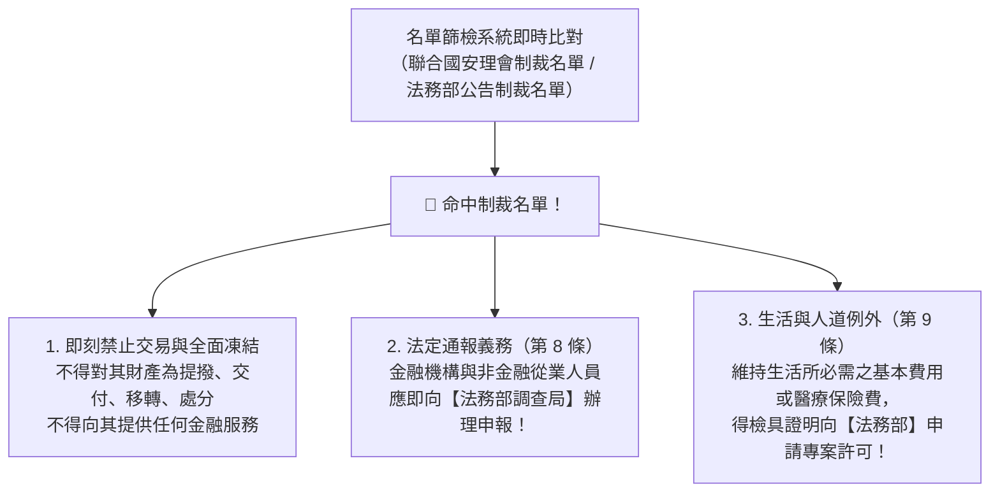

# 第 04 章：資恐防制法要件與目標性金融制裁名單篩檢

---

## 🎯 本章學習導航與核心地圖

防止恐怖分子取得資金毀滅世界，《資恐防制法》具備強大的國際法效力與即時凍結威力。本章出題核心三焦點：
1. 《資恐防制法》主管機關與「資恐防制審議會」
2. 資恐罪之成立要件（不問恐怖活動是否真正發生）
3. 目標性金融制裁（TFS）名單篩檢與資產即刻凍結處分

---

## 🏛️ 一、《資恐防制法》主管機關與審議機制

- 主管機關：法務部。
- 資恐防制審議會：
  - 由法務部長擔任召集人，成員涵蓋國安局、內政部、外交部、國防部、經濟部、金管會等部會副首長組成。
  - 職權：審議指定制裁名單、除名名單與酌留生活費用之專案許可。

---

## 💣 二、資恐罪之特殊法律要件（必考法理）

資恐防制法第 8 條、第 9 條規範之資恐罪，其最大特色在於：
1. 不以發生恐怖活動為前提：
   - 行為人只要直接或間接提供、募集財產或財產上利益，意圖供恐怖組織、恐怖分子從事恐怖活動，不論該恐怖活動最終是否真正發生，罪名即完全成立！
2. 不論資金來源是否合法：
   - 傳統洗錢是漂白「非法黑錢」；資恐資金往往來自「完全合法的捐款、募款、個人薪資或小額積蓄」，只要資金流向是為了支持恐怖活動，即構成資恐！

---

## ❄️ 三、目標性金融制裁（TFS）與即刻凍結作業

### 1. 目標性金融制裁（TFS）之法律效果（資恐防制法第 7 條）
- 全面性資產禁止處分（凍結）：
  1. 不得對受制裁之個人、法人或團體為直接或間接之財產或財產上利益之提撥、交付、移轉、變更、處分、利用或為其他足以變動其數量、品質、價值及移轉其所有權或管理權之行為。
  2. 不得為其受任或受託管理財產或財產上利益。
  3. 不得為其提供任何金融交易、商業交易或資產管理等服務。
- 善意第三人之權利保障（第 7 條第 4 項）：受制裁處分前，善意第三人已取得之既有債權或擔保物權，其依法行使權利（如實行抵押權求償）不受凍結處分之影響！

### 2. 違法提供資產或違反凍結令之刑事處罰（第 10 條）
- 違反第 7 條規定，明知為受制裁之對象仍為其提撥、交付財產或為其管理財產者：
  - 法定刑度：處 1 年以上 7 年以下有期徒刑，得併科新臺幣 1,000 萬元以下罰金！
- 意圖掩飾或隱匿受制裁對象財產所在者亦同！

> 🔥 考古題必殺審題口訣：
> 「只要名單一命中，第一時間立刻凍結資產，不用等法院裁判！生活費找法務部申請，違法解凍或資助判 1 至 7 年重刑！」

---

## 🔥 歷屆必考陷阱手冊

> ❌ 陷阱 1：資恐罪是否需要等到炸彈引爆才成立？
> - 錯誤題目：「某人匯款 10 萬元給國外恐怖組織，但該組織尚未策劃任何恐怖行動即遭瓦解，因此該匯款人不構成資恐罪。」
> - 👉 正解：錯！資恐防制法明文規定不以恐怖活動之實際發生為必要，只要提供資金意圖支持恐怖主義，罪名即行成立！
>
> ❌ 陷阱 2：凍結資產的通報主管機關
> - 錯誤題目：「金融機構一旦發現客戶被列為聯合國制裁名單，應立即向行政院國家安全會議提出申報。」
> - 👉 正解：錯！依據資恐防制法第 7 條規定，金融機構凍結受制裁資產後，應即向法務部調查局辦理申報！
